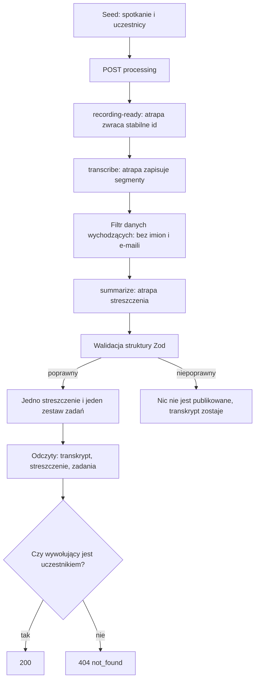

# Firmowy asystent spotkań (zadanie rekrutacyjne Vinseo)

Repozytorium zawiera obie części zadania:

- **Część A:** dokument decyzyjny w [part-a-doc.md](part-a-doc.md).
- **Część B:** szkielet backendu (NestJS, wersja zero) w katalogu [backend/](backend/). Przetwarza przykładowe spotkanie od sygnału „nagranie gotowe”, przez atrapę transkrypcji i atrapę streszczenia, do zapisanego streszczenia i zadań. Dostęp do wyników mają tylko uczestnicy spotkania.

Szczegółowe zachowanie wersji zero opisuje [docs/version-zero.md](docs/version-zero.md), kontrakt API [docs/api.md](docs/api.md), a model danych [docs/data-model.md](docs/data-model.md).

## 1. Jak uruchomić

Wymagania: Docker z Docker Compose. Porty `3000`, `5432` i `6379` muszą być wolne.

```bash
docker compose up --build
```

Komenda buduje obraz i uruchamia PostgreSQL, Redis, jednorazowy krok `init` (migracje Drizzle i idempotentny seed), API oraz osobny proces workera. Uruchomienie stacku nie przetwarza spotkania automatycznie. Pierwszy build trwa dłużej (pobranie obrazów i `npm ci`). Plik `.env` nie jest potrzebny do Dockera, bo zmienne są w `docker-compose.yml`. Po zmianie kodu użyj `--build`, bo bez niego Compose użyje istniejącego obrazu `vinseo-backend:local`. Wymagany jest Docker Compose v2.

Jeśli `init` się nie powiedzie (np. migracja), API i worker nie wystartują. Przyczynę widać w `docker compose logs init`. Żeby zacząć od czystej bazy (też gdy stary wolumen Postgresa blokuje start albo nie ma w nim bazy `vinseo_test`):

```bash
docker compose down -v
```

W drugim terminalu przetwórz przykładowe spotkanie:

```bash
docker compose run --rm demo
```

Demo wysyła `POST /meetings/:meetingId/processing`, czeka na wynik, odczytuje transkrypt, streszczenie i zadania jako uczestnik przez API i zapisuje cztery pliki w `artifacts/example-meeting/`: `transcript.md`, `summary.md`, `decisions.md` i `tasks.md`. Katalog jest ignorowany przez Git. Ponowne uruchomienie demo nie tworzy duplikatów.

### Przepływ przetwarzania



### Co się dzieje przy awarii

- **Awaria lub restart w trakcie kroku:** niezakończony krok jest dostarczany ponownie. Zapisany wynik zostaje, więc nie powstają duplikaty, a spotkanie nie ginie.
- **Błąd kroku:** krok jest ponawiany z backoffem do `WORKER_JOB_ATTEMPTS` prób (domyślnie 5). Każda próba ma limit czasu `WORKER_STEP_TIMEOUT_MS`.
- **Niepoprawne streszczenie:** nic nie jest publikowane, a transkrypt pozostaje czytelny. Odczyt streszczenia i zadań zwraca wtedy `404`.
- **Po wyczerpaniu prób:** zadanie zostaje w BullMQ jako nieudane (z ograniczoną retencją), a worker loguje identyfikator spotkania, krok i kod błędu, bez treści spotkania. Wersja zero nie ma endpointu statusu.

### Konfiguracja

Zmienne są walidowane przy starcie (Zod). W Dockerze działają wartości domyślne. Do lokalnych testów skopiuj `backend/.env.example` do `backend/.env`.

| Zmienna                      | Domyślnie        | Znaczenie                               |
| ---------------------------- | ---------------- | --------------------------------------- |
| `PORT`                       | `3000`           | Port API.                               |
| `DATABASE_URL`               | z `.env.example` | Połączenie z PostgreSQL.                |
| `REDIS_URL`                  | z `.env.example` | Połączenie z Redis (kolejka BullMQ).    |
| `WORKER_JOB_ATTEMPTS`        | `5`              | Liczba prób kroku.                      |
| `WORKER_JOB_BACKOFF_MS`      | `1000`           | Opóźnienie między próbami.              |
| `WORKER_STEP_TIMEOUT_MS`     | `30000`          | Limit czasu jednej próby kroku.         |
| `WORKER_CONCURRENCY`         | `1`              | Liczba zadań przetwarzanych równolegle. |
| `WORKER_LOCK_DURATION_MS`    | `30000`          | Czas blokady zadania w BullMQ.          |
| `WORKER_STALLED_INTERVAL_MS` | `30000`          | Interwał wykrywania zawieszonych zadań. |

### Ręczne sprawdzenie kontroli dostępu

Po przetworzeniu spotkania odczyty wymagają nagłówka `X-User-Id` (lokalny zamiennik logowania Google). Identyfikatory z seeda (`backend/src/database/local-seed.ts`):

| Rola                          | `X-User-Id`                            |
| ----------------------------- | -------------------------------------- |
| organizator, nie uczestniczył | `11111111-1111-4111-8111-111111111111` |
| pracownik 1 (uczestnik)       | `22222222-2222-4222-8222-222222222222` |
| pracownik 2 (uczestnik)       | `33333333-3333-4333-8333-333333333333` |
| klient (uczestnik)            | `44444444-4444-4444-8444-444444444444` |

Spotkanie przykładowe: `55555555-5555-4555-8555-555555555555`.

```bash
# uczestnik: 200
curl -i -H "X-User-Id: 22222222-2222-4222-8222-222222222222" \
  http://localhost:3000/meetings/55555555-5555-4555-8555-555555555555/summary

# organizator, który nie uczestniczył: 404 not_found
curl -i -H "X-User-Id: 11111111-1111-4111-8111-111111111111" \
  http://localhost:3000/meetings/55555555-5555-4555-8555-555555555555/summary
```

Odpowiedź 404 nie rozróżnia braku spotkania, braku dostępu i braku wyniku, żeby odczyt nie ujawniał istnienia spotkania.

### Testy

Wymagany jest Node.js 22 (taki jak w obrazie Dockera). W katalogu `backend/` (`npm install`, a dla testów e2e także `cp .env.example .env`):

```bash
npm run lint
npm run test
npm run test:e2e
```

Testy e2e wymagają działających PostgreSQL i Redis (na przykład z `docker compose up postgres redis`) i używają osobnej bazy `vinseo_test` oraz osobnego prefiksu kolejki.

## 2. Co działa, co jest atrapą, czego nie zrobiłem

### Działa naprawdę

- **Model danych:** spotkania, uczestnicy, segmenty transkrypcji, streszczenia, decyzje i zadania w PostgreSQL (Drizzle, migracje wersjonowane w repozytorium). Uprawnieniem jest uczestnictwo w spotkaniu.
- **Pipeline:** `recording-ready` -> `transcribe` -> `summarize-and-publish` w BullMQ, z API i workerem jako osobnymi procesami.
- **Idempotencja i awarie:** PostgreSQL jest źródłem prawdy, a wynik kroku jest zapisywany w tej samej transakcji co znacznik jego ukończenia. Redis tylko dostarcza zadania (payload to `meetingId` i nazwa kroku). Powtórne dostarczenie lub restart workera nie tworzy duplikatów ani nie gubi spotkania. Retry, backoff i timeout kroku są jawnie skonfigurowane.
- **Walidacja streszczenia:** wynik ma ustaloną strukturę sprawdzaną przez Zod. Niepoprawny wynik (proza, brak pola, zły mówca, e-mail zamiast identyfikatora) nie jest publikowany, a transkrypt pozostaje czytelny.
- **Ochrona danych wychodzących:** payload dla streszczenia zawiera tylko segmenty, lokalne identyfikatory mówców i role. Filtr odrzuca imiona, e-maile i mapowania mówców na osoby. Ma testy.
- **Kontrola dostępu:** każdy odczyt sprawdza uczestnictwo po stronie serwera i domyślnie odmawia. Organizator, który nie uczestniczył, nie ma dostępu. Testy obejmują przypadki dozwolone i odmowne.
- **API:** `GET /health`, `POST /meetings/{meetingId}/processing` oraz trzy odczyty (transkrypt, streszczenie, zadania). Kontrakt: [docs/api.md](docs/api.md).
- **Uruchomienie:** dwie komendy Docker Compose opisane wyżej.

### Atrapy

- **Źródło nagrań (świadomie pominięte):** wersja zero nie pobiera, nie przechowuje i nie przetwarza żadnych nagrań. Fałszywy adapter (`FakeRecordingSourceAdapter`) odpowiada od razu, że nagranie jest gotowe, i zwraca jeden stabilny identyfikator. Nie zwraca pliku, ścieżki, URL-a ani audio, a znacznik „gotowe” zapisuje się raz na spotkanie. Konsekwencje:
  - nie ma przypadku „nagranie niedostępne lub niegotowe”, nie ma też nasłuchiwania nowych nagrań: przetwarzanie zaczyna się dopiero po `POST /meetings/:meetingId/processing`;
  - adapter transkrypcji nie otwiera żadnych mediów, więc ścieżka audio -> transkrypcja -> rozpoznanie mówców nie jest ćwiczona, a jakość polskiego i diarizacji nie jest sprawdzana.
  - port `RecordingSourceAdapter` jest miejscem podmiany: późniejszy adapter może zwracać plik z bucketu lub Dysku, a kolejne kroki zostają bez zmian.
- **Transkrypcja i streszczenie:** deterministyczne adaptery korzystają z jednego syntetycznego spotkania (`backend/fixtures/example-meeting.json`): rozmowa agencji z siecią kawiarni, 177 segmentów, 11 decyzji, 16 zadań. Dane nie zawierają prawdziwych osób. Streszczenie nie korzysta z prawdziwego modelu, choć zadanie na to pozwala. Port adaptera jest gotowy do podmiany.
- **Tożsamość:** nagłówek `X-User-Id` zamiast logowania Google. Reguła uczestnictwa pozostanie ta sama po podmianie.

### Czego nie zrobiłem i dlaczego

Przy ograniczonym czasie wybrałem wiarygodny pipeline, kontrolę dostępu i testy zamiast szerokiego, powierzchownego zakresu. Poniższe elementy są zaplanowane w [docs/implementation-plan.md](docs/implementation-plan.md).

| Brak w wersji zero | Dlaczego pominąłem | Kiedy |
| --- | --- | --- |
| Pobieranie i przechowywanie nagrań, cykl życia plików, wykrywanie nowych nagrań | W wersji zero nic nie przetwarza nagrań: transkrypcja jest atrapą czytającą gotowy zestaw segmentów. Plik w buckecie nie zostałby przez nic odczytany, więc jego istnienie nie zmieniłoby ani wyniku, ani testów. Dodałbym tylko storage, zarządzanie plikami i ich retencję bez żadnej wartości dla weryfikacji pipeline'u. Zostaje znacznik „gotowe”, który ćwiczy ten sam krok i tę samą idempotencję. | Etap 1 (bucket), etap 2 (Meet i Dysk) |
| Google Meet, Dysk, logowanie Google | Zadanie nie wymaga działającej integracji. Prawdziwa integracja wymaga konta Workspace, zgody administratora i prawdziwych nagrań, a bez nich nie da się jej sensownie przetestować. Źródło nagrań i tożsamość są za adapterami, więc podmiana nie zmienia reguły dostępu ani pipeline'u. | Etap 2 |
| Prawdziwa transkrypcja i model streszczeń | Wymagałyby płatnych kluczy API, prawdziwych nagrań (których nie mam) i wysyłania danych poza firmę. Wybór dostawcy transkrypcji ma jeszcze otwarte warunki: opinię specjalisty o przechowywaniu danych i test na przykładowym nagraniu polskiej rozmowy. Zadanie dopuszcza atrapy, a walidację niepoprawnego wyniku i filtr danych wychodzących da się w pełni przetestować bez modelu. | Etap 1 |
| Mapowanie mówców na osoby | Potrzebuje interfejsu, w którym uczestnik przypisuje mówców. Bez nagrań i prawdziwej diarizacji nie ma też czego mapować, bo mówcy w atrapie są stałymi etykietami. Mapowanie bez interfejsu byłoby kodem, którego nic nie wywołuje. | Etap 2 |
| Zgody, retencja, usuwanie | Wersja zero działa tylko na syntetycznych danych, bez prawdziwych osób i nagrań, więc nie ma jeszcze czyich zgód zbierać ani co usuwać. Te mechanizmy są konieczne przed pierwszym prawdziwym nagraniem. Opisane w [docs/privacy.md](docs/privacy.md). | Etap 1 i 3 |
| Wyszukiwanie i asystent z cytowaniem źródeł | Zadanie dopuszcza pseudokod. Wartościowa implementacja wymaga prawdziwego modelu i większego zbioru spotkań, a najważniejsze ryzyko (wyciek treści osobie bez dostępu) opisałem w zasadach autoryzacji [notes/search.md](notes/search.md). Najpierw potrzebny jest działający pipeline i kontrola dostępu, na których to się oprze. | Etap 4 |
| Powiadomienia, lista spotkań, interfejs użytkownika | Zadanie wymienia je jako opcjonalne. Nie wnoszą nic do sprawdzenia pipeline'u i kontroli dostępu, a przy 5 dniach pracy zajęłyby czas z ważniejszych elementów. | Etap 2 i 4 |
| Endpoint statusu pipeline'u | Wykraczał poza zatwierdzony zakres wersji zero. Demo obchodzi to, traktując `404` jako „wynik jeszcze nie opublikowany”. Do wdrożenia będzie potrzebny, żeby widzieć nieudane spotkania. | Etap 1 |

### Znane ograniczenia

- Timeout kroku (`Promise.race`) odrzuca próbę, ale nie przerywa pracy w tle. Jest to akceptowalne, bo zapisy są idempotentne i chronione ograniczeniami unikalności.
- `POST /meetings/{meetingId}/processing` i `GET /health` nie sprawdzają uczestnictwa. To założenie wersji zero (lokalne środowisko, brak treści w odpowiedzi), opisane w [docs/api.md](docs/api.md).
- Dokumentacja wersji zero świadomie zastępuje dwa fragmenty planu etapów: źródło nagrań bez pliku audio oraz odroczenie zgód i retencji.
- Specyfikacja OpenAPI jest generowana w testach kontrolerów. Lokalny interfejs Swagger nie jest uruchamiany.

## 3. Jak używałem AI

AI (Cursor) było asystentem do researchu i szybkiej implementacji małych, zatwierdzonych kroków: zbierało dokumentację i ceny dostawców, zestawiało opcje z zaletami, wadami i ryzykami oraz pisało kod według planu etapów. Decyzje o stosie, zakresie, modelu dostępu i kolejności prac podejmowałem sam. Model pracował według reguł zapisanych w `AGENTS.md`: najpierw analiza i plan, potem moje potwierdzenie, dopiero potem mała implementacja i weryfikacja. Korygowałem go między innymi przy argumencie o trenowaniu na audio, przy ocenie „dane w UE” jako wniosku prawnego, przy niezweryfikowanych twierdzeniach o API Google Meet i przy zakresie przypisywania mówców. Pełny opis, tabelę korekt i przykładowe prompty zawiera [docs/ai-usage.md](docs/ai-usage.md).

## 4. Mapa dokumentacji

| Plik                                                             | Zawartość                                                                        |
| ---------------------------------------------------------------- | -------------------------------------------------------------------------------- |
| [part-a-doc.md](part-a-doc.md)                                   | Dokument części A.                                                               |
| [part-a-doc-structure.md](part-a-doc-structure.md)               | Szkielet i zasady redakcyjne dokumentu części A.                                 |
| [docs/zadanie.md](docs/zadanie.md)                               | Treść zadania.                                                                   |
| [docs/version-zero.md](docs/version-zero.md)                     | Zachowanie wersji zero.                                                          |
| [docs/specification.md](docs/specification.md)                   | Historyjki użytkownika wersji zero.                                              |
| [docs/v0-api-building-plan.md](docs/v0-api-building-plan.md)     | Plan budowy backendu w 10 etapach.                                               |
| [docs/api.md](docs/api.md)                                       | Kontrakt API.                                                                    |
| [docs/data-model.md](docs/data-model.md)                         | Model danych.                                                                    |
| [docs/backend-structure.md](docs/backend-structure.md)           | Struktura modułów backendu.                                                      |
| [docs/authorization.md](docs/authorization.md)                   | Zasady dostępu do spotkań.                                                       |
| [docs/privacy.md](docs/privacy.md)                               | Prywatność i dane wychodzące.                                                    |
| [docs/tech-stack.md](docs/tech-stack.md)                         | Zatwierdzony stos technologiczny.                                                |
| [docs/environments.md](docs/environments.md)                     | Środowiska i testowanie bez prawdziwych danych.                                  |
| [docs/transcription-workflow.md](docs/transcription-workflow.md) | Docelowy przepływ nagranie -> transkrypcja.                                      |
| [docs/implementation-plan.md](docs/implementation-plan.md)       | Etapy wdrożenia od wersji zero do całej firmy.                                   |
| [docs/ai-usage.md](docs/ai-usage.md)                             | Jak używałem AI i co poprawiłem po modelu.                                       |
| [notes/](notes/)                                                 | Notatki z researchu, decyzji i implementacji (w tym `notes/v0-implementation/`). |
