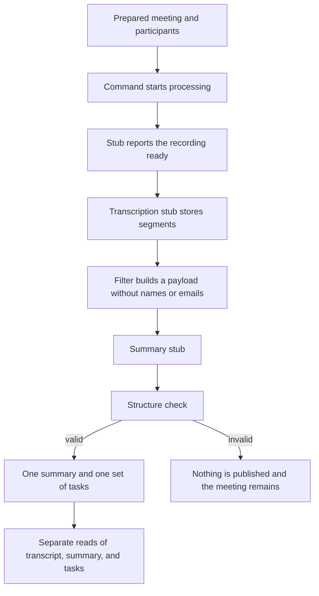

# Version zero

Concept of the assignment skeleton, stage 0 in `docs/implementation-plan.md`. It describes the components, the path of one example meeting, and the behavior that this version actually runs.

This is not the decision document from part A. It does not define a data model or API routes. Policies that already have their own documents are referenced, not restated.

## Boundary

Version zero runs locally. A prepared meeting is processed from a fake "recording ready" step through a stub transcript and a stub summary. Participants can read the transcript, the summary, and the tasks. An organizer who did not attend cannot.

The version shows that a restart does not duplicate results or lose the meeting, that a summary with the wrong shape is not published, that names and email addresses stay out of the summary payload, and that the API checks participation before every read.

Consciously absent:

- audio, video, and recording files
- Google Meet, Google Drive, and Google login
- a real transcription model and a real summary model
- speaker mapping
- consent, retention, and deletion
- a meeting list, search, an assistant, notifications, and a user interface

Consent, retention, and deletion are built only when the system is prepared for the whole company. They are described in `docs/privacy.md` and are not behavior of this version. `docs/implementation-plan.md` currently places retention and deletion in stage 1, and `docs/environments.md` lists consent and deletion tests. This specification follows the later decision: those mechanisms wait until the company-wide rollout.

## Architecture

Five pieces run in Docker Compose:

- a NestJS API, the only place that returns meeting content
- a separate worker process
- PostgreSQL, which stores the meeting and is the only durable trace that a step finished
- Redis and BullMQ, which queue work and retry delivery
- three replaceable adapters: recording source, transcription, and summary

A queue job carries a meeting id and a step name. The saved result is the trace that the step finished, written in the same database transaction as that result. The results are the recording-ready marker, the transcript segments, and the summary with its tasks. Redis does not keep a second progress log. If the queue is lost on restart, the meeting remains and an unfinished step can be run again.

The stack for this version is NestJS, TypeScript, Zod, PostgreSQL, Drizzle, BullMQ, Redis, Docker Compose, Vitest, and OpenAPI. OpenAPI describes the API for local use. Routes are outside this document.

## Example meeting

One synthetic meeting is already stored, with three participants: two employees and one client. The organizer of that meeting did not attend. There is no extra employee outside the meeting.

The participants exist so the API knows who may read. They are not speakers. The transcript uses local speaker ids, and this version has no step that maps those ids to people.

## Processing

A command starts processing for that meeting. The worker then runs the steps below.

### Recording ready

The recording source is an adapter. For the example meeting the stub answers immediately that the recording is ready and returns one stable fake recording id. It does not return a file, a path, a URL, or audio. Asking again returns the same id. The ready marker is stored once with the meeting, so a second run does not create a second recording.

`docs/implementation-plan.md` stage 0 says not to add a simulated recording source or recording fixtures. This specification replaces that line: the ready step stays, and no recording medium is created. `notes/tech-stack-recap.md` and `notes/environments-recap.md` describe a fake source together with audio fixtures and missing recordings. Version zero is narrower. It has no file and no "recording missing" case.

A later adapter can answer with a real file from a bucket or from Google Drive. The steps after this one stay the same. That real file arrives in stage 1 for a bucket and in stage 2 for Meet and Drive. Downloading an MP4 is not part of version zero. `docs/transcription-workflow.md` describes that later path.

### Transcription stub

The transcription adapter receives the meeting id and the fake recording id. It does not open media. It returns a fixed set of sample segments. Each segment has timing, text, and a speaker id that belongs to this meeting only. The ids are labels such as `speaker_1`, not people, and they are not reused for another meeting.

The segments are stored once. A retry that finds them already stored does not insert a second transcript.

Part B allows a real summary model. Stage 0 uses a stub for both transcription and summary, and this version follows stage 0.

### Outbound payload

Before the summary adapter runs, the worker builds the payload the model is allowed to see: the segments, the local speaker ids, and a role for each speaker. In this version every role is `unknown`, because nobody has mapped a speaker.

The payload does not include names, email addresses, or a mapping from a speaker id to a person. A filter checks that. The summary stub does not send the payload anywhere. The same check is what a test asserts, so a later real provider cannot receive those fields by accident.

Spoken words may still contain a name. The filter guards the fields added around the transcript. It does not rewrite the words that were said.

### Summary and validation

The summary stub returns a short summary, a list of decisions, and a list of tasks. A task has a speaker, an action, and a deadline. The speaker on a task, and any quoted speaker, is a local speaker id from this meeting's transcript.

Validation checks that shape. It does not judge whether the summary is true or whether the Polish is good. The result is invalid when:

- the response is ordinary prose or empty
- the summary, the decisions, or the task list is missing
- a task has no speaker, no action, or no deadline
- the speaker is a name, an email address, or an id that is not in this meeting's transcript

An invalid result is not published. The meeting remains, and the transcript from the earlier step remains readable. A read of the summary or the tasks does not return the invalid result. The specification does not set a retry count or name pipeline states. A later attempt that returns a valid structure stores exactly one summary and one set of tasks.

A repeated delivery of a step that already stored its result does not add a copy. A crash before that write leaves the step unfinished, and the next delivery continues it. A crash after the write leaves the stored result in place.

## Access

There is no Google login. A local stand-in presents a stable user id before a read. The API compares that id with the participants of the requested meeting. `docs/authorization.md` assumes a Google Workspace account. In this version the stand-in supplies the id. The participation rule is the same. Later Google login replaces the stand-in and leaves the rule in place.

The access point required by part B is the API as a whole, not one route that returns three resources. A participant reads the transcript, the summary, and the tasks as separate reads. Each read checks participation on the server and denies by default. The meeting id is not permission to read.

Any of the three participants can read. The organizer, who did not attend, is refused on each read. The refusal does not include the transcript, the summary, or the tasks.

Speaker ids are returned as ids. This version does not replace them with display names. That replacement waits for speaker mapping in stage 2.

Search and the assistant are not part of this version, including their authorization tests. `docs/authorization.md` lists those tests for the first version. `notes/search.md` and stage 4 of the implementation plan defer both features. The same participant rule will apply when they are built. This version does not run them.

A meeting list, notifications, and a user interface are also absent. The interface is stage 2. Search, the assistant, notifications, and sharing with non-participants are stage 4.
