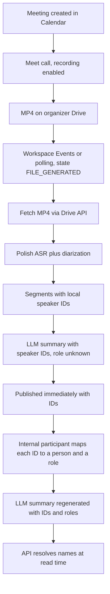

# Transcription workflow

Decision record for how Vinseo's meeting assistant obtains a Google Meet recording, turns it into a Polish transcript with speaker separation, and attaches those speakers to people. Written on 2026-10-30 from research and decisions made before implementation.

This file is the full record. The Part A document should condense it. The README section on AI usage should follow section 6.

Claims below are marked **Fact** (checked against a source on the date given) or **Assumption** (not verified, and open to change).

## 1. Context and verified facts

Checked on 2026-10-30.

### What the assignment needs

**Fact.** The company runs on Google Workspace. After a meeting the tool must produce a Polish transcript with speaker separation, a short summary, and a list of decisions and tasks (who, what, by when). People may ask questions and must get an answer with a source. Access is limited to meetings a person should see. Client data must not leave the company to places it should not. About 40 people, about 25 of whom meet regularly, about 300 hours of meetings a month, usually 45 minutes, 2–6 participants, Polish with English campaign names and jargon, and some participants from outside the company. Source: `docs/zadanie.md`.

### Google Meet recordings

**Fact.** A recording is one MP4 saved to the meeting organizer's Google Drive. The Meet REST API returns metadata, not the file bytes. `driveDestination.file` is the Drive file id. Download is `GET https://www.googleapis.com/drive/v3/files/{fileId}?alt=media`. The recording state moves from `STARTED` to `ENDED` (the call ended, the file is not ready) to `FILE_GENERATED` (ready to download). A user can delete the Drive file while the Meet recording id still exists. Source: [Work with artifacts](https://developers.google.com/workspace/meet/api/guides/artifacts), [conferenceRecords.recordings](https://developers.google.com/workspace/meet/api/reference/rest/v2/conferenceRecords.recordings).

**Fact.** `conferenceRecords.list` returns only conferences where the caller is the meeting organizer, ordered by start time. An app with only the `meetings.space.created` scope sees only spaces that app created. Source: [Work with conferences](https://developers.google.com/workspace/meet/api/guides/conferences).

**Fact.** Someone must start recording during the meeting, or the meeting space must have auto-recording configured. Recording is available on Business Standard, Business Plus, Enterprise editions, and several other paid editions. A Workspace admin must allow it. The organizer's Drive and the organization's Drive both need free space. Source: [Record a video meeting](https://support.google.com/meet/answer/9308681).

### Google Meet transcripts

**Fact.** Meet can also produce a transcript, independent of the video recording. Structured transcript entries from the REST API include `participant`, `text`, `languageCode`, `startTime`, and `endTime`. Each entry is one participant's speech. Entries are deleted 30 days after the conference ends. A Google Docs file is also saved to the organizer's Drive and follows Drive retention. API entries can differ from the Docs file. Source: [Work with artifacts](https://developers.google.com/workspace/meet/api/guides/artifacts), [transcript entries](https://developers.google.com/workspace/meet/api/reference/rest/v2/conferenceRecords.transcripts.entries).

**Fact.** Saved Meet transcripts are available in English, French, German, Italian, Japanese, Korean, Portuguese, and Spanish. Polish is not on that list. The same eight languages apply to Gemini "Take notes for me". Live captions do include Polish, but captions are not a saved, speaker-attributed transcript in the API. Source: [Use Transcripts with Google Meet](https://support.google.com/meet/answer/12849897), checked 2026-10-30.

**Fact.** Transcription is on by default for supported editions (including Business Standard) but is not automatic for each meeting. Someone in the meeting has to start it, unless auto-transcription was configured on the space. Source: [Turn meeting transcription on or off](https://knowledge.workspace.google.com/admin/meet/turn-meeting-transcription-on-or-off).

### Meet Media API

**Fact.** On 2026-10-28 Google deprecated the Meet Media API. It will not reach general availability. New Developer Preview signups are closed. Existing preview participants keep access until the endpoints are turned off on 2027-01-15. Google points meeting-summary and action-item use cases to the Meet REST API. Source: [Google Meet REST API release notes](https://developers.google.com/workspace/meet/release-notes), [Google Meet for developers](https://developers.google.com/workspace/meet).

**Fact.** While it existed, the Media API delivered at most three virtual audio streams (the three loudest participants at a time). Each participant had a stable CSRC, mapped to a participant resource, so packets could be bucketed per person. It was receive-only, required host consent, and used the restricted scope `meetings.conference.media.readonly`. Source: [Manage virtual media streams](https://developers.google.com/workspace/meet/media-api/guides/virtual-streams).

### Other official paths that do not give per-person audio

**Fact.** A Meet add-on runs in an iframe and does not get `getUserMedia` access to the microphone or camera. Source: [Google Workspace Developers forum thread](https://discuss.google.dev/t/need-help-accessing-user-media-camera-microphone-in-google-meet-for-educational-analytics/245715/2).

**Fact.** Third-party SIP and H.323 devices join Meet through a gateway as one participant. That is one mixed stream, not one track per person. Source: [Allow third-party devices to join Meet](https://knowledge.workspace.google.com/admin/meet-hardware/allow-3rd-party-devices-to-join-meet-video-meetings).

### Authorization

**Fact.** Relevant OAuth scopes:

| Scope | What it allows | Classification |
| --- | --- | --- |
| `https://www.googleapis.com/auth/meetings.space.readonly` | Read metadata of any meeting space the user can access, including recordings, transcripts, and transcript entries | Sensitive |
| `https://www.googleapis.com/auth/drive.meet.readonly` | Read Drive files created or edited by Google Meet | Restricted |
| `https://www.googleapis.com/auth/drive.readonly` | Read the user's entire Drive | Restricted, wider than needed |

A domain admin can grant domain-wide delegation so a service account impersonates a user without a consent screen per person. Impersonation still acts as that user. Source: [Authenticate and authorize Meet REST API requests](https://developers.google.com/workspace/meet/api/guides/authenticate-authorize).

**Fact.** Apps can subscribe to Meet events for one space or for all spaces belonging to one user, through the Google Workspace Events API. Source: [Google Meet REST API overview](https://developers.google.com/workspace/meet/api/guides/overview).

### Bots

**Fact.** Commercial meeting bots join as a visible participant. Recall.ai documents separate per-participant audio for Google Meet, capped at 16 concurrent speakers, with the participant's display name. Meet itself does not give the bot an email address. Email is filled only by fuzzy-matching the calendar guest list, and only for bots created through Recall's calendar integration. A signed-in bot uses a dedicated Google account. Google still decides whether the bot is admitted. Sources: [Separate audio per participant](https://docs.recall.ai/docs/how-to-get-separate-audio-per-participant-realtime), [Meeting participant emails](https://docs.recall.ai/docs/meeting-participant-emails), [Skip the waiting room](https://docs.recall.ai/docs/google-meet-skip-the-waiting-room).

**Fact.** Google's Terms of Service prohibit bypassing protective measures and reverse engineering services to extract proprietary information, except where law allows it. The Meet acceptable use policy prohibits circumventing restrictions and interfering with the product. Sources: [Google Terms of Service](https://policies.google.com/terms), [Google Meet Acceptable Use Policy](https://support.google.com/meet/answer/9847091).

**Assumption.** A visible notetaker that a host admits is widely used in practice. That does not make an unofficial client a supported API. Building one means automating the Meet web page or speaking Meet's private media protocol.

### Identity of a Meet participant

**Fact.** A Meet participant is a signed-in user, an anonymous user, or a phone user. A signed-in user has an opaque user id (interoperable with the Admin SDK and People API) and a display name, not an email on the participant resource itself. An anonymous or phone user has a display name only. A conference-room device is one participant. Source: [Work with participants](https://developers.google.com/workspace/meet/api/guides/participants).

## 2. End-to-end workflow

### Steps

1. Someone creates a meeting in Google Calendar. Meet is the conference. The organizer is the Workspace user who owns the meeting space. They may or may not attend.
2. A host, co-host, or (when host management is off) someone from the host's organization starts recording. Auto-recording on the space is the alternative. Participants see that recording is on. If the admin requires explicit consent, each person must accept before capture continues.
3. When the conference ends, Meet writes an MP4 to the organizer's Drive. The file is not ready at the moment the call ends.
4. The app learns that the file is ready either from a Workspace Events subscription or by listing conference records for each organizer and reading recordings in state `FILE_GENERATED`.
5. A service account, impersonating the organizer, downloads the MP4 with the Drive API. The copy kept by the app follows the retention rules in Q6.
6. Polish speech recognition plus diarization turns the mixed audio into segments. Each segment has a start time, an end time, text, and a speaker id local to this meeting (`spk_1`, `spk_2`, …). The id is not a person and is not reused across meetings. The transcription model drops backchannels such as "mhm", so they never become a speaker on the mapping screen.
7. An external LLM receives the segments, the speaker ids, and the role `unknown` for every speaker. It returns a structured summary and tasks. Every quote and every task owner is a `speakerId`, never a name inside a sentence.
8. The meeting is published immediately: transcript, summary, tasks, and the list of Meet participants. Unmapped speakers stay as ids. Nothing waits for a person to click.
9. Any employee who was on the meeting and who already has access to the recording opens one screen. For each speaker they see a quote and can play a short clip. They assign that speaker to someone on the Meet participant list, or they skip. Merge, split, marking a segment as mixed, and adding a person who was not on the Meet list are not in this version (D4, section 5).
10. Assigning a person also assigns a role, in the same action. An internal Workspace account defaults to `employee`. A guest already on the Meet list defaults to `client`. The person mapping can change the role.
11. When a role actually changes, the LLM runs again on the same segments, now with `employee` or `client` on the mapped speakers. Speakers still not mapped stay `unknown`. Tasks stay keyed by `speakerId`. How the new summary replaces the published one is Q9.
12. On every read, the API checks access, then resolves `speakerId` through the mapping table to a display name. If there is no mapping, the UI shows the id. The LLM is never given the name or the mapping legend.

### What is stored

- **Segment:** meeting id, speaker id, start, end, text. This is the transcript. It is a list of segments, not one text block per speaker.
- **Mapping:** meeting id, speaker id, person id or empty, role (`unknown`, `employee`, `client`), who changed it, when. History is kept. Two people editing the same speaker do not silently overwrite each other without a trace. The current row is the one the UI shows.
- **Person:** an internal Workspace user, or a signed-in external Meet participant already on the meeting. A guest typed by hand, who was not a Meet participant, is a later version (section 5) and depends on Q12.
- **Summary and tasks:** structured fields. Speaker references are ids. The name is applied when the API builds the response.

### Mapping screen

The screen is for someone who was on the call. A quote is the first signal. Playback is there when the quote is not enough. The Meet participant list is the set of accounts to pick from. People who stayed silent are still on that list. A room device, or one Google account used by two humans, is one row. The first version cannot add the second human. That speaker stays an id until a later version, and only if Q12 says this case is real.

Operations in the first version:

- **Assign.** Point a speaker id at a person who was a Meet participant. Role is set in the same step, with the default above.
- **Skip.** Leave the speaker as an id. This is a valid outcome, not an error.

Backchannels are not filtered on this screen. The transcription model removes them before speakers are created.

Not in the first version: merge, split, marking a segment as mixed, and adding a person who joined through someone else's Google account. See D4 and section 5.

Names, emails, and the mapping never enter the prompt. The prompt may contain speaker ids, the role of each speaker, and the words that were said.

### Search

A question such as "what did Bartek say about the budget" is handled in our API before any model call:

1. Keep only meetings the caller is allowed to read.
2. Resolve "Bartek" to a person. If several people match, ask which one. Do not rewrite an unrelated mention (a question about a topic that happens to be someone's name) into a speaker id.
3. Collect segments mapped to that person. Unmapped segments are not included. The answer should say so when the meeting still has unlabeled speakers, so an empty result is not mistaken for "nothing was agreed".
4. Send those quotes, still keyed by speaker id and role, to the LLM. Do not send a legend of the form "spk_3 = Bartek".
5. Resolve ids to names only in the response shown to the caller.

The assistant must not guess that an unlabeled speaker is someone from the participant list. A name from that list may appear as a speaker only when a human mapped that id, or when the name was spoken and the quote is shown as evidence.

## 3. Decisions

Each decision records what was chosen, why, the advantages, the disadvantages, the risks (impact and what we do about them), and the options that were rejected.

### D1. Recordings come from the official MP4

**Chosen.** Meet REST API for conference records and recording metadata. Drive API for the MP4 bytes. Our own Polish transcription on that file.

**Why.** Polish is required. Native Meet transcripts do not support Polish (fact, section 1). The official file is the supported path, with the smallest scope that still yields the audio.

**Advantages.** Supported API. One file per recording. Consent and the recording indicator are Meet's own. The app does not join the call.

**Disadvantages.** One mixed track. Speaker identity is not in the file. Recording has to be turned on, and the file appears only after `FILE_GENERATED`. `conferenceRecords.list` only returns meetings organized by the impersonated user, so the app must impersonate each organizer.

**Risks.**

- Recording never starts. Impact: high for that meeting, the pipeline has nothing to fetch. Mitigation: detect meetings with no recording and surface them. Do not invent a transcript.
- Organizer deletes the Drive file before download. Impact: medium. Mitigation: fetch on `FILE_GENERATED` rather than hours later.
- Domain-wide delegation can read every Meet file of the impersonated users. Impact: high if the service account is broader than this product. Mitigation: section 7.

**Rejected.**

- **Native transcript entries as the Polish transcript.** The API does split speech by participant, and that attribution is better than acoustic diarization, because Meet knows which client sent the audio. The language list does not include Polish, so there is nothing to fetch for Vinseo's meetings. Revisit if Google adds Polish.
- **Meet Media API.** It was the best technical way to get a separate track per participant, tied to a participant resource. Google deprecated it on 2026-10-28 and will turn the endpoints off on 2027-01-15. New signups are closed. Too short a life for a product.
- **A commercial bot (Recall.ai and similar).** Separate audio per participant, with the display name, is a real product. The recording of client meetings would be processed by that vendor. That conflicts with "client data should not go where it should not." A self-hosted bot is the next rejection.
- **Our own Meet client.** A browser or custom WebRTC client joins as a visible participant, buckets audio by participant, and stores it on our side. Rejected because of maintenance cost and instability: Meet can change the page without notice, sessions expire, one account can be in one meeting at a time, and headless guests are often blocked. It also sits outside the published API, against the Terms of Service rules on bypassing protections and reverse engineering. Not a supported integration.
- **An agent on each employee laptop, recording that person's microphone.** The track is clean and already tied to the logged-in account. It does not capture the client, unless the client also installs it, which they will not. Two capture paths to operate, for about 25 machines. Rejected for the first version.

### D2. Speakers come from diarization of the mixed file

**Chosen.** The ASR step returns segments grouped into speaker ids local to the meeting. Those ids are labels such as "speaker 1", not accounts.

**Why.** The MP4 has one audio mix. Diarization is what the file can support. The assignment asks for a transcript divided by speaker. It does not require each speaker to be a Google account.

**Advantages.** No extra software in the meeting. Works for Polish with English words, provided the model does. Segments stay addressable, so a later version can merge or split them without a new recording.

**Disadvantages.** A cluster can contain two people, or one person can be split into two ids. A meeting room, or two people on one Google account, is one Meet participant and may be two voices. The first version does not repair that. Overlapping speech inside one segment cannot be separated by hand.

**Risks.**

- Bad diarization makes the mapping screen frustrating, and people stop using it. Impact: medium if it shows up in real meetings. Mitigation in this version: the transcription model drops backchannels, and skip is a valid result. Merge and split are added only if real meetings show the model is not good enough (D4).
- Re-running diarization later would renumber speakers under an existing mapping. Impact: high if done carelessly. Mitigation: not in the first version. If it is added, mappings are reattached by segment time ranges, not by the old label string.

**Rejected.** Per-person tracks from a bot or the Media API. See D1.

### D3. Humans map speakers, as a company procedure, and ids remain when they do not

**Chosen.** Any employee who attended the meeting and who already has access to the recording may map speakers. Mapping is the expected procedure. If nobody does it, the transcript, summary, and tasks stay under speaker ids. Publication does not wait.

**Why.** The person who was on the call can recognize a voice or a quote. The calendar organizer often is not that person, and may have left the company. Blocking the summary until someone clicks would leave many of the roughly 400 meetings a month (300 hours, about 45 minutes each) without a summary. **Assumption:** 300 hours and 45 minutes in `docs/zadanie.md` imply on the order of 400 meetings a month. That count is only for sizing the human step.

**Advantages.** A wrong name is worse than "speaker 2" on a client commitment. Skip is an explicit, safe result. The work is spread across people who were actually there, not a central admin. Access to the mapping screen is the same as access to the recording. There is no role that can listen to every meeting just to label it.

**Disadvantages.** The step is optional in the software, so it will be skipped when people are busy. Voice memory fades. After the audio is deleted, only quotes remain. Two attendees can assign the same speaker to two people. The current row must be visible, and the history must show who wrote it.

**Risks.**

- Most meetings stay unlabeled, and search by name misses them. Impact: medium, and accepted. Mitigation: the meeting screen shows which speakers have no person. An empty answer must not look like "nothing was agreed".
- Someone assigns the wrong person, and a task briefly has the wrong owner. Impact: medium. Mitigation: undo through the mapping, history, quote and playback on the screen. Tasks stay keyed by `speakerId`, so the view updates on the next read.
- The organizer never attended. Impact: high if only the organizer could map. Mitigation: any internal attendee with access can map. This is why organizer-only was rejected.

**Rejected.**

- **Organizer only.** The organizer is often the right person, and often is not in the room. A departing organizer would freeze unlabeled meetings.
- **Hold the summary until mapping is done.** More meetings would have names. Many meetings would have no summary at all.
- **Correct only the task owner, not the speaker.** Less clicking, and it hits "who, what, by when". The transcript and later questions ("what did the client say") would stay on ids. Kept as a fallback if the full screen does not fit the first version. The chosen screen covers tasks as well, because tasks point at speaker ids.
- **Everyone introduces themselves at the start.** A name in the first minute can be a hint. It fails when people talk over each other, join late, use a short name, or sit in a room with one microphone. Asking a known client to introduce themselves on the third call is awkward. The mapping screen is still required. Rejected as a ritual. Names that people happen to say are still useful later, as a suggestion, not in the first version (D8).

### D4. The first version only assigns a speaker to a Meet participant

**Chosen.** The mapping screen can assign a speaker id to a person who was on the Meet participant list, or skip. It cannot merge speakers, split a speaker by moving segments, mark a segment as mixed, or add a person who was not a Meet participant.

**Why.** The transcription model may separate speakers well enough that hand repair is unnecessary. It already drops backchannels, so the screen is not filled with "mhm". Merge, split, and mixed are real repairs, and they are also extra UI on every meeting. They wait until real recordings show they are needed. Adding someone who was not on the Meet list is a separate, narrower case: two people can share one Google account, diarization then returns more speakers than accounts, and one of those speakers has nobody on the list to point at. Example: the Meet list is `jan@gmail.com` and `bartek@gmail.com`, but Bartek and Paweł both sat at Bartek's account. The model returns three speakers. One of them is Paweł, who is not a Meet participant. Whether that happens often enough to build is Q12. Until then, that speaker stays an id.

**Advantages.** The first screen is assign or skip. A wrong repair cannot scramble segments. We learn from the MVP whether the model is good enough before building the editor.

**Disadvantages.** A speaker the model split in two stays two ids, and someone may map both to the same person or skip one. Two people on one account cannot both get a name. Overlapping speech stays inside whatever segment the model produced.

**Risks.**

- The model is worse than expected, and people work around it by skipping speakers. Impact: medium, visible in the "share of meetings mapped" metric in section 5. Mitigation: add merge and split then, on the segment list we already store. Do not rebuild the pipeline.
- Shared accounts are common, so many speakers stay unnamed. Impact: medium, and it is exactly what Q12 is for. Mitigation: a later action that creates a guest and points one existing speaker id at that guest. The guest does not receive words by being created. The human picks the speaker.

**Kept for a later version, not rejected.** If the MVP shows the need: merge (move every segment of one speaker id onto another), split (new speaker id, move selected segments), mixed (one segment with two voices at once stays unattributed and is not a task quote), and a hand-added guest assigned to one existing speaker. Re-running the whole file through another diarization model is a worse fix. It renumbers ids under an existing mapping. Segment edits do not.

### D5. Names stay in our API. The model sees speaker ids

**Chosen.** Stored transcript, summary, and tasks use speaker ids. The mapping table is the only place that links an id to a person. The API resolves the name at read time, after the access check. The model never receives a name, an email, or the legend.

**Why.** Putting the name in the sentence means a wrong click is baked into prose, Polish inflection breaks a text replace ("zadanie Bartka" does not contain the token "speaker 3"), and the name is in the vendor's prompt logs. A structured `speakerId` avoids the replace. The view updates when the mapping changes, including after a person is renamed.

**Advantages.** Undo is one row. Regenerating the LLM is not required for a name change. Unmapped speakers stay honest. A test can assert that outbound prompts contain no display names from the mapping. Search cannot leak a meeting the caller cannot access, because resolution happens after the access filter.

**Disadvantages.** The model writes worse Polish in free text, because the word for "speaker" is masculine, so it will say "zobowiązał się" about a woman. The model does not know the person's name, so it cannot inflect it. Search by name is our code, not a full-text query. This is accepted.

**Risks.**

- The model paraphrases the id ("the third speaker", "he") and a string replace would miss it. Impact: high if names were substituted inside sentences. Mitigation: do not substitute inside sentences. The name is a label rendered next to a quote or a task that already has `speakerId`.
- "What did Bartek say" is implemented as a global replace of the word Bartek. Impact: high. It hits the wrong person, another meeting, or a question that is about a topic. Mitigation: the search steps in section 2.
- The same small integer means different people in different meetings. Impact: high if one global id is pasted into every transcript. Mitigation: speaker ids are local. The person id in the mapping is what joins meetings.
- Spoken names still leave in the sentence ("Jan from the client, budget fifty thousand"). Impact: high for the privacy write-up, low for day-to-day operation if the test is honest. The mask covers labels, not the content of speech. The transcript is still personal data. The vendor is still a processor.

**Rejected.**

- **Write the full name into the transcript and the summary, and send that text to the model.** Best prose and best task owners. A wrong mapping is stuck in sentences until a full regeneration. Inflected forms are easy to miss. The name is in the prompt. A full-text index then contains the identity even when nobody said the name. Rejected because the privacy decision was to keep the identity link inside our API.
- **Send only the first name.** Better grammar than "speaker 3" for a common Polish name. Still personal data. In a company of about 40 people a first name is often unique, and together with the topic it identifies the person. Two people with the same first name collapse into one speaker if the name is the key. A surname initial does not finish the job (two Annas whose surnames start with K) and is close to sending the surname. A numeric suffix ("Anna 2") can make a prompt unique for one meeting, but it is a poor key for storage. Rejected as the identifier. The transcript key remains the speaker id. First names are not sent.

### D6. The model receives a role, assigned in the same step as the person

**Chosen.** Each speaker sent to the LLM has a role: `unknown`, `employee`, or `client`. The role is chosen on the mapping screen together with the person. An internal Workspace account defaults to `employee`. A guest already on the Meet list defaults to `client`. The human can override. A person who was not a Meet participant cannot be added in this version (D4).

The first summary is generated as soon as segments exist, with every role `unknown`. After a role actually changes, the summary and tasks are generated again from the same segments, now with roles. Speakers nobody mapped stay `unknown`. Tasks remain keyed by `speakerId`.

**Why.** "Who promised what" is the business problem. An id alone does not tell the model which side of the table spoke. The role answers that without sending a name. Doing it in the same step means there is no second procedure.

**Advantages.** Task ownership improves once someone maps the meeting. Defaults match the usual case, so the extra click is only the exception. Skipped meetings still publish, with `unknown`. A wrong role is corrected the same way as a wrong person: edit the row, regenerate.

**Disadvantages.** The first published summary is weaker than the one after mapping. Regeneration changes wording the user may already have read. A role plus the transcript can still identify a client when only two people were on the call. The role is personal data, thinner than a name, and it still leaves the company.

**Risks.**

- Regeneration surprises someone who quoted the old summary. Impact: medium. Mitigation: Q9, still open. Do not regenerate when the mapping edit did not change a role.
- A wrong role points tasks at the wrong side. Impact: medium. Mitigation: mapping history, and the task still shows the quote.
- Cost of a second LLM call for every mapped meeting. Impact: depends on Q2. **Assumption:** one extra call per mapped meeting is small next to transcription cost. Check it when the model and the price are chosen.

**Rejected.** Sending the role only in a later version. The mapping screen already exists. Leaving the role out of the first version would throw away the reason for the second LLM call's design. Also rejected: blocking the first summary until roles exist. That brings back D3's rejected option.

### D7. Search and the assistant go through our API

**Chosen.** The access check and the name resolution happen before the model sees text. The model receives quotes, speaker ids, and roles. It does not receive the mapping. The response is labeled with names only for the caller who passed the access check.

**Why.** The assignment requires that search and the assistant do not reveal a meeting to someone who should not see it. A model with a company-wide corpus and a name in the question will not enforce that.

**Advantages.** One place enforces access. Ambiguous names are a question to the user, not a guess. Unmapped speech is excluded on purpose and the UI can say why.

**Disadvantages.** More application code than "embed all transcripts and ask". The assistant cannot answer "what did the client say" for a speaker nobody mapped, even if the words are in the database.

**Risks.**

- A later prompt builder "helpfully" adds participant names. Impact: high. It deletes D5. Mitigation: a test on the outbound payload. No display name from the person table. No email.
- The model attributes a quote to the wrong id. Impact: medium. Mitigation: the API selects the segments. The model summarizes those quotes. It does not search the whole company.

**Rejected.** Full-text search over a transcript that already contains names. Looks simpler. It still needs the access filter, and it matches the word "Bartek" when the question is not about that person.

### D8. Voice profiles and automatic suggestions wait

**Chosen.** Not in the first version: a voice profile built from earlier recordings, suggestions from a name spoken in the text, and suggestions from the time a participant joined.

**Why.** A voice template used to recognize a person is biometric data. Under GDPR that is a special category when the purpose is unique identification. Employee consent is a weak basis, because it is hard to treat as voluntary. This needs a lawyer before any recording is enrolled. Name-in-text and join-time hints are not biometric, and they are still wrong often enough that a human must confirm them. They can be added later on the same screen, without a new data model. The first version should not depend on them.

**Advantages.** The first version does not create a voice database. The mapping screen does not have to change when suggestions arrive. They would show up as a pre-selected row, still confirmed by a click.

**Disadvantages.** Every meeting needs the human step. Returning clients are labeled by hand every time.

**Risks.**

- Someone treats "we will add voice matching" as a promise that unlabeled meetings will fix themselves. Impact: medium. Mitigation: this record says the opposite. Ids are the accepted fallback.
- Join time is a strong hint only when someone arrives or leaves mid-call. When everyone stays from the start, the signal is empty. Impact: low, and it is why this is not in version one.

**Rejected for the first version, kept as later work.** See section 5. Also rejected, firmly: enrolling a voice without a separate decision from the legal review.

## 4. Questions to ask before building

Each question says what I would do with the answer. None of these were decided in this record except where a section above already locked a behavior.

### Q1. Can mapping speakers be a manual company procedure?

I would ask the people who run client meetings, not only engineering. The software treats the step as expected and allows skip.

- If yes, ids stay the fallback and the first version does not need voice profiles or suggestions.
- If no, most meetings will stay on ids, search by name will miss them, and D8 moves forward. I would still not block publication.

### Q2. What monthly budget is available for running this?

Include ASR, the LLM, storage, and the time to watch Meet API changes. About 300 hours of audio a month is the volume in `docs/zadanie.md`.

- A tight budget pushes toward one external ASR API and rules out any bot vendor.
- A budget that allows a GPU, or a strong preference that audio not leave the company, pushes toward self-hosted ASR. The speaker-id design does not change.
- The second LLM call in D6 has to fit this number. If it does not, regenerate only task owners, not the whole narrative.

The model itself is a separate decision (Part A, question 4). This record does not pick one.

### Q3. Questions for a lawyer

I am not treating "sending a surname is illegal" as a conclusion. A surname, a first name, a role, and a speaker id whose key we hold are all personal data. What changes the design is the answer to the following.

- What is the legal basis for employees, and for clients who are not our employees? Can employee consent be treated as voluntary?
- What must participants be told before recording, including that an external model will read the words?
- Is the LLM vendor a processor? Do we have a data processing agreement, an EU region, a block on training on our data, and a stated log retention? If the vendor is outside the EEA, what transfer tool applies?
- Does sending ids plus roles count as pseudonymization, and does that change anything we are allowed to do? My current assumption: it reduces what the vendor sees, and it does not make the transcript anonymous.
- How long may we keep the audio, the transcript, the summary, and the mapping? Audio must outlive the mapping window (Q6).
- Voice profiles in a later version: Article 9, a DPIA, and whether employee consent is even available. A "no" here deletes section 5's voice item permanently.
- If Q12 leads us to add a person who was not a Meet participant: that record is created from an employee's memory, not from the data subject. Is that acceptable under the same basis as the transcript?

Answers change what may leave the company, how long each artifact lives, and whether D8's voice item can exist. They do not, by themselves, force names into the prompt. Data minimization still favors ids if the model can do the job without names.

### Q4. May a meeting be shared with someone who was not on it?

For example, a colleague who joins the client project later.

- If no, access stays "internal attendees, plus whoever the product already treats as allowed to see that client." Mapping rights stay tied to attendance. Simpler, and it matches D3.
- If yes, sharing is an explicit grant, not a side effect of being in the company. The new person can read. I would not let them map speakers unless they were on the call, because they cannot judge the voice. Q4 changes the access model either way. It is not built in the first version until Vinseo answers.

### Q5. Who is allowed to record, and how does the client find out?

Is Meet's explicit-consent prompt turned on by the admin? Who is allowed to start a recording when host management is on?

- If consent is required in Meet, the pipeline can trust that capture already had an on-screen acceptance. We still need a place to record a refusal that happens outside Meet.
- If anyone on the domain can record without a prompt, the product needs its own rule before it fetches the file. Fetching everything `FILE_GENERATED` would process meetings the company did not mean to capture.

### Q6. How long is each artifact kept?

I need a duration for the MP4 copy, the segments, the summary, the tasks, and the mapping.

- If audio is deleted before people are expected to finish mapping, late mapping falls back to quotes and will be worse. I would set audio retention at least as long as the mapping window.
- A short transcript retention conflicts with "what did we promise this client two weeks ago" if "two weeks" is the real horizon. The assignment's example is two weeks. The real horizon may be longer. The answer sets the index, not the speaker design.

### Q7. Confidential meetings, and someone who refuses to be recorded

- A meeting marked confidential should not be fetched, or should be fetched only into a tighter access list. I need the signal: a calendar flag, a Meet label, or a person clicking "do not import" before the file is downloaded.
- A person who refuses: they leave the call, or the host stops recording. If a recording already exists and the refusal comes later, we need a delete that removes the MP4 copy, the segments, the summary, and the mapping, including derived tasks. Backups have to follow the same rule. I would not keep a "speaker 2" transcript of a meeting that must be deleted.
- If the answer is "record everything and sort it out later", the risk moves onto the access rules and onto Q3.

### Q8. Which Workspace edition, and is auto-recording on?

Business Standard is the floor for recording (fact, section 1). I need the edition Vinseo actually has, and whether auto-recording can be turned on for internal and client meetings.

- If auto-recording is on, the pipeline sees most meetings and Q5 becomes the main control.
- If people must press record, many meetings will be missing. The product should show "no recording" rather than an empty transcript. I would not build a bot to fill that gap unless Q1 and Q2 both change.

### Q9. How should a regenerated summary be shown?

Regeneration after a role change is decided (D6). Still open: does the new text replace the published summary in place, or does the user see it as a new version? And does Q2 allow the extra call?

- Silent replace is simpler and will confuse someone who already forwarded the old wording.
- A version, or a short "updated after speakers were assigned", keeps the audit trail and costs a bit of UI.
- If the budget forbids the second call, the first summary stays role-blind and only the task owner labels update from the mapping, with no new prose.

### Q10. How often is a conference room or a phone participant on the call?

- If rooms and phone dial-ins are rare, the first version's "skip the extra speaker" is enough.
- If they are common, diarization quality matters more, and merge, split, or a hand-added guest (section 5) move up as soon as the MVP shows unlabeled speakers that a human could have named.

### Q11. An employee leaves. Who can still map their meetings?

The mapping rows stay. Their login goes away.

- If any remaining internal attendee can map, unlabeled meetings are recoverable.
- If nobody else attended from the company (a one-to-one that only the leaver sat on), the meeting stays on ids forever unless Q4 allows someone else to map. I would rather leave the ids than let a stranger assign voices they never heard.

### Q12. Can more than one person join from a single Google account?

For example, two accounts on the Meet list, `jan@gmail.com` and `bartek@gmail.com`, while Bartek and Paweł both use Bartek's account. Diarization then returns three speakers. Only two people can be picked from the Meet list. The third speaker has no account to assign.

- If this does not happen, or happens rarely, the first version is enough. That speaker stays an id. Skip is the honest result. I would not build a "add a guest" action.
- If this is normal (shared laptops, a client sitting with an employee, a room joined from one account), a later version lets the mapper add Paweł, who was not a Meet participant, and assign him to that one speaker. The other speakers still map to Jan and Bartek. Role defaults to `client`, and the mapper can change it. Q3 still has to allow creating that person record.
- The answer does not by itself add merge or split. Those repair a bad model. This question is only about a real extra human who was never a Meet participant.

## 5. Later versions, after the MVP

Collect, from real use: the share of meetings that get mapped, how often a mapping is corrected, and how often a task owner is wrong. Then consider, in this order:

1. **Reminders and a completeness marker.** The meeting shows which speakers have no person. A nudge to attendees who have not mapped. This does not change the model. It tests whether the procedure in Q1 is real.
2. **Suggestions that are not biometric.** A name spoken in a segment, and a participant who joins at the same time a new voice starts. Shown as a suggestion on the existing screen. A click still writes the mapping. Join time does nothing when everyone is present the whole time.
3. **Share with a colleague who was not on the call.** Only if Q4 is yes. Read access and mapping access are separate.
4. **Voice profiles.** Only after Q3 allows it. High score threshold. Below the threshold the speaker stays unlabeled. The profile is stored only after a human confirms a clean segment, not from a mixed one. A wrong profile poisons later meetings, so automatic enrollment is out.
5. **A second diarization pass.** Only with a way to keep existing mappings attached to time ranges when ids change.
6. **Merge, split, and mixed segments.** Only if real meetings show the transcription model is not good enough. Merge moves every segment of one speaker id onto another. Split creates a new speaker id and moves selected segments. A segment where two people talk at once is marked mixed and is not used as one person's task quote. Backchannels are not part of this work. The transcription model already drops them.
7. **A guest who was not a Meet participant.** Only if Q12 says several people join through one Google account, and Q3 allows the record. The mapper adds the person and assigns them to one existing speaker. Creating the person does not move words by itself.

Not planned unless the facts in section 1 change: a Meet bot, and native Meet transcript entries as the Polish source. If Google adds Polish to saved transcripts, transcript entries become the first choice, because the participant id is Meet's, not a guess from the audio.

## 6. How AI was used

AI (Cursor, in this chat) was used to research Google's APIs and to lay out options with advantages, disadvantages, and risks. I compared the options and made every decision in sections 3 and 4. I did not treat the model's preference as the decision.

### What I asked the model to do

Research and source checks:

- How to fetch Google Meet recordings, and whether the API can split speech by user.
- Whether a Polish speaker-attributed transcript is available from Meet, or whether we have to transcribe the audio ourselves.
- Whether the Meet Media API is actually unavailable, with a source.
- What else could produce a separate audio track per participant.

Comparisons, after I rejected a direction:

- "Porównaj to podejście i określ ryzyka, zalety i wady oraz inne możliwości."
- "Porównaj je z opcją podmiany identyfikatorów również w streszczeniach i transkrypcjach. Jeśli chodzi o wady: jak można sobie z nimi poradzić i jak duży mają impact."
- A first-name-only prompt versus opaque ids, including the case of two people with the same first name and the same surname initial.

### What I verified, because the first answer was not enough

- The Meet Media API looked like the best way to get per-person audio. I asked for a source check. The release notes of 2026-10-28 say it is deprecated and the endpoints go away on 2027-01-15. That killed the option. The earlier "no new signups" banner was incomplete. The shutdown date is the fact that matters.
- Polish support for native transcripts. I did not take the model's summary. The Google Meet help page, checked on 2026-10-30, lists eight languages and Polish is not one of them.

### What I changed relative to the model's proposals

- Mapping is not limited to the organizer. Any internal attendee with access to the recording can do it. The model had centered the organizer. I changed it because the organizer is often absent.
- Mapping is a company procedure. Ids are the backup when someone skips it, not the normal face of the product.
- A guest who was not a Meet participant stays out of the first version. I first treated "add Paweł, who sat next to Bartek's account" as part of mapping. I then moved it to a later version, because I do not yet know whether one Google account is ever used by two people (Q12).
- The role goes to the LLM, and it is set in the same step as the person. The first summary uses `unknown`. A role change triggers a new summary.
- Names in the prompt were rejected after comparing full names, first names, first names with an initial, and ids. The model had spelled out the flaws. The choice to keep names only in our API is mine.
- Merge, split, and mixed are not in the first version. The model proposed them as the manual fix for bad diarization. I kept the design for a later version, and I left them out of the MVP in case the transcription model is good enough. Backchannels are the model's job, not a filter on the mapping screen.

### Example prompts from this chat

Research and a demand for sources:

> W jaki sposób mogę pobierać nagrania z google meet? Da się to robić poprzez api i żeby był podział na wypowiedzi konkretnych użytkowników?

> Czyli z meet api mogę wziąć transkrypcje z podziałem na mówców w języku polski, czy muszę pobierać audio z nagrania i robić transkrypcje potem za pomocą zewnętrznego modelu?

> To media api jest na 100% niedostępne? zweryfikuj tą informację i podaj źródło.

A request for options rather than a single answer:

> Jakie są inne opcje uzyskania osobnych ścieżek audio per uczestnik? Np. poprzez bota dołączającego do spotkania?

A comparison, including impact:

> Porównaj je z opcją podmiany identyfikatorów również w streszczeniach i transkrypcjach, jakie wady i zalety mają te dwa rozwiązania względem siebie. Jeśli chodzi o wady - jak można sobie z nimi poradzić, jak duży mają impact na działanie systemu?

Corrections I sent back, which the model then had to fold in:

> Przypisywanie ról dzieje się równolegle z przypisaniem uczestnika spotkania do identyfikatora mówcy.

> Każdy pracownik firmy, który był uczestnikiem spotkania może wykonać dopasowanie, nie tylko organizator.

## 7. Part A, question 1: where recordings come from, and the smallest access that works

**Source.** The MP4 that Meet already stores for the organizer. Discovery and metadata come from the Meet REST API (`conferenceRecords.list` and `conferenceRecords.recordings`). Bytes come from the Drive API (`files.get` with `alt=media`) using `driveDestination.file`. We do not use Meet's own transcript as the Polish text. We do not join the meeting.

**When a file is ready.** Subscribe with the Workspace Events API for recording-file events on the organizers we care about, or poll those organizers' conference records until the recording state is `FILE_GENERATED`. Polling is enough for a first version. Events cost less quota and less delay. Either way, do not download on `ENDED`. The file does not exist yet.

**Scopes, smallest set.**

- `https://www.googleapis.com/auth/meetings.space.readonly` to list conferences, recordings, and participants.
- `https://www.googleapis.com/auth/drive.meet.readonly` to download files Meet created.

Not `drive.readonly`. That would expose the organizer's whole Drive. `drive.meet.readonly` is still a restricted scope. Google's verification and security assessment apply if the app is ever published beyond this one Workspace customer. For an internal app, an admin can grant the scopes to the service account.

**Who the app acts as.** A service account with domain-wide delegation, impersonating the meeting organizer. This is necessary because `conferenceRecords.list` only returns conferences that the caller organized. Impersonating one user does not reveal another user's meetings.

Delegation is limited to those two scopes. The application impersonates only Workspace users who organize recorded meetings, not every account in the domain. If those users sit in one organizational unit, the loop that picks users is limited to that unit. **Assumption:** domain-wide delegation itself is granted per scope for the domain. The organizational-unit limit is something we enforce by which users we impersonate, not a second Google scope. This should be confirmed in the admin console when the project exists.

**What this still exposes.** For each impersonated organizer, the app can read Meet metadata and every Drive file Meet created for them, including meetings the product is not meant to import. Mitigations: impersonate only the organizers who should be in the system, download only recordings in `FILE_GENERATED` that the product has decided to import (Q5, Q7), keep the audio only for the retention window (Q6), and log every download with the conference id and the user we impersonated. Do not log the audio or the transcript in application logs.

**What we do not need.** Write access to Meet or Drive. The Media API scope. A bot account inside the meeting. Access to Gmail. A full Drive scope.

## 8. Interview notes

### What would make me change this

- Google adds Polish to saved Meet transcripts, with the same participant-level entries the API already has for the eight supported languages. I would take those entries as the transcript and keep diarization as a fallback for meetings where transcription was not started. Mapping might become a check, not the primary way to learn who spoke.
- Vinseo cannot require recording, and Q2 allows a supported way to capture audio. There is no supported way today. A bot would be a new decision, not a small patch.
- The lawyer forbids sending the role, or the transcript text, to an external model. Then the LLM moves in-house or the summary becomes a template over the segments. The speaker-id boundary stays. It gets stricter, not looser.
- Q1 comes back "no". Suggestions and, only with legal approval, voice profiles move up. The id fallback stays.

### What the first version deliberately does not do

- It does not join the meeting.
- It does not send names or emails to the model.
- It does not build a voice database.
- It does not auto-assign a Meet account to a voice.
- It does not block the summary on a human click.
- It does not share a meeting with someone who was not on it (Q4).
- It does not pick the ASR or LLM vendor. That is Part A question 4, and it depends on Q2 and Q3.
- It does not merge speakers, split speakers, or mark a segment as mixed.
- It does not add a person who was not a Meet participant. That waits on Q12.

### Edge cases from the assignment

| Situation in `docs/zadanie.md` | What this design does |
| --- | --- |
| A client does not agree to be recorded | Q5 and Q7. Prefer Meet's own consent prompt. If a recording must be removed, delete the file, the segments, the summary, the tasks, and the mapping. |
| A confidential meeting | Q7. Do not import it, or import it into a tighter access list. The mapping screen never becomes a backdoor for people who cannot hear the recording. |
| An employee leaves | Q11. Mapping history stays. Their login loses access. Another internal attendee can still map. If nobody else from the company was there, speakers stay ids. |
| Search or the assistant is asked by someone who should not see the meeting | D7. Filter meetings before any model call. Do not put the mapping legend in the prompt. |
| Two people talk over each other, or share one Google account | D4 and Q12. The first version leaves the extra speaker as an id. Merge, split, mixed, and a hand-added guest come later, only if real meetings need them. |

### Facts and assumptions, short list

Facts are in section 1 and carry links. The assumptions that the implementation depends on:

- The transcription model drops backchannels and separates speakers well enough that merge and split are not in the first version. Segments are still stored with timestamps, so a later editor can move them without a new recording.
- One extra LLM call per mapped meeting is affordable. Q2 can overturn the full regeneration. Task labels would still update from the mapping with no call.
- Domain-wide delegation cannot be scoped to an organizational unit by Google. We scope it by which users the job impersonates.
- A role plus speaker id is still personal data. We send it because the task needs the side of the table, not because it is anonymous.
- About 400 meetings a month is arithmetic from the assignment's 300 hours and 45 minutes, not a measurement.

### What I would say if asked "why not just send the name"

The view the user sees has the name. The sentence in the database and the prompt do not. That split is what makes a wrong click reversible and what keeps the mapping testable. Sending the name produces better prose and a worse correction story, and it puts the identity in the vendor's logs. I compared that option, the first-name option, and the id option, and kept the ids.
