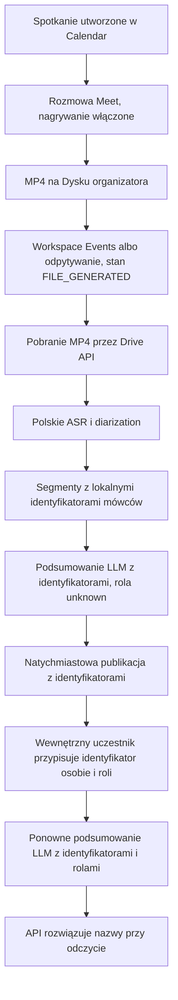

# Przebieg transkrypcji

Rejestr decyzji dotyczących tego, jak asystent spotkań Vinseo pozyskuje nagranie Google Meet, przekształca je w polską transkrypcję z rozdzieleniem mówców i przypisuje tych mówców do osób. Dokument sporządzono 2026-10-30 na podstawie badań i decyzji podjętych przed implementacją.

Ten plik jest pełnym rejestrem. Dokument Part A powinien go skrócić. Sekcja README dotycząca użycia AI powinna być zgodna z sekcją 6.

Poniższe twierdzenia oznaczono jako **Fakt** (sprawdzony względem źródła w podanym dniu) albo **Założenie** (niezweryfikowane i możliwe do zmiany).

## 1. Kontekst i zweryfikowane fakty

Sprawdzone 2026-10-30.

### Wymagania zadania

**Fakt.** Firma korzysta z Google Workspace. Po spotkaniu narzędzie musi utworzyć polską transkrypcję z rozdzieleniem mówców, krótkie podsumowanie oraz listę decyzji i zadań (kto, co i do kiedy). Użytkownicy mogą zadawać pytania i muszą otrzymać odpowiedź ze źródłem. Dostęp jest ograniczony do spotkań, które dana osoba powinna widzieć. Dane klienta nie mogą opuszczać firmy i trafiać tam, gdzie nie powinny. Około 40 osób, z czego około 25 spotyka się regularnie, około 300 godzin spotkań miesięcznie, zwykle po 45 minut, 2–6 uczestników, język polski z angielskimi nazwami kampanii i żargonem oraz część uczestników spoza firmy. Źródło: `docs/zadanie.md`.

### Nagrania Google Meet

**Fakt.** Nagranie jest pojedynczym plikiem MP4 zapisanym na Dysku Google organizatora spotkania. Meet REST API zwraca metadane, a nie bajty pliku. `driveDestination.file` to identyfikator pliku na Dysku. Pobieranie odbywa się przez `GET https://www.googleapis.com/drive/v3/files/{fileId}?alt=media`. Stan nagrania przechodzi z `STARTED` do `ENDED` (połączenie się zakończyło, ale plik nie jest gotowy), a następnie do `FILE_GENERATED` (plik jest gotowy do pobrania). Użytkownik może usunąć plik z Dysku, mimo że identyfikator nagrania Meet nadal istnieje. Źródło: [Work with artifacts](https://developers.google.com/workspace/meet/api/guides/artifacts), [conferenceRecords.recordings](https://developers.google.com/workspace/meet/api/reference/rest/v2/conferenceRecords.recordings).

**Fakt.** `conferenceRecords.list` zwraca wyłącznie konferencje, których organizatorem jest wywołujący, uporządkowane według czasu rozpoczęcia. Aplikacja mająca tylko zakres `meetings.space.created` widzi wyłącznie przestrzenie utworzone przez tę aplikację. Źródło: [Work with conferences](https://developers.google.com/workspace/meet/api/guides/conferences).

**Fakt.** Ktoś musi rozpocząć nagrywanie podczas spotkania albo w jego przestrzeni musi być skonfigurowane automatyczne nagrywanie. Nagrywanie jest dostępne w wersjach Business Standard, Business Plus, Enterprise i kilku innych płatnych wersjach. Administrator Workspace musi je zezwolić. Zarówno Dysk organizatora, jak i Dysk organizacji muszą mieć wolne miejsce. Źródło: [Record a video meeting](https://support.google.com/meet/answer/9308681).

### Transkrypcje Google Meet

**Fakt.** Meet może również utworzyć transkrypcję niezależnie od nagrania wideo. Ustrukturyzowane wpisy transkrypcji z REST API zawierają `participant`, `text`, `languageCode`, `startTime` i `endTime`. Każdy wpis obejmuje wypowiedź jednego uczestnika. Wpisy są usuwane 30 dni po zakończeniu konferencji. Na Dysku organizatora zapisywany jest także plik Google Docs, który podlega zasadom przechowywania Dysku. Wpisy API mogą różnić się od pliku Docs. Źródło: [Work with artifacts](https://developers.google.com/workspace/meet/api/guides/artifacts), [transcript entries](https://developers.google.com/workspace/meet/api/reference/rest/v2/conferenceRecords.transcripts.entries).

**Fakt.** Zapisane transkrypcje Meet są dostępne po angielsku, francusku, niemiecku, włosku, japońsku, koreańsku, portugalsku i hiszpańsku. Polskiego nie ma na tej liście. Te same osiem języków dotyczy funkcji Gemini „Take notes for me”. Napisy na żywo obejmują język polski, ale napisy nie są zapisaną transkrypcją przypisaną do mówców i dostępną w API. Źródło: [Use Transcripts with Google Meet](https://support.google.com/meet/answer/12849897), sprawdzone 2026-10-30.

**Fakt.** Transkrypcja jest domyślnie włączona dla obsługiwanych wersji (w tym Business Standard), ale nie uruchamia się automatycznie dla każdego spotkania. Ktoś na spotkaniu musi ją rozpocząć, chyba że w przestrzeni skonfigurowano automatyczną transkrypcję. Źródło: [Turn meeting transcription on or off](https://knowledge.workspace.google.com/admin/meet/turn-meeting-transcription-on-or-off).

### Meet Media API

**Fakt.** 2026-10-28 Google wycofało Meet Media API. Nie osiągnie ono ogólnej dostępności. Nowe rejestracje do Developer Preview są zamknięte. Dotychczasowi uczestnicy wersji preview zachowają dostęp do wyłączenia endpointów 2027-01-15. Google wskazuje Meet REST API jako rozwiązanie dla przypadków użycia dotyczących podsumowań spotkań i elementów działań. Źródło: [Google Meet REST API release notes](https://developers.google.com/workspace/meet/release-notes), [Google Meet for developers](https://developers.google.com/workspace/meet).

**Fakt.** W czasie istnienia Media API dostarczało najwyżej trzy wirtualne strumienie audio (w danym momencie od trzech najgłośniejszych uczestników). Każdy uczestnik miał stabilny CSRC przypisany do zasobu uczestnika, dzięki czemu pakiety można było grupować według osoby. API działało wyłącznie do odbioru, wymagało zgody hosta i używało ograniczonego zakresu `meetings.conference.media.readonly`. Źródło: [Manage virtual media streams](https://developers.google.com/workspace/meet/media-api/guides/virtual-streams).

### Inne oficjalne ścieżki, które nie dają dźwięku osobno dla każdej osoby

**Fakt.** Dodatek Meet działa w iframe i nie otrzymuje dostępu `getUserMedia` do mikrofonu ani kamery. Źródło: [Google Workspace Developers forum thread](https://discuss.google.dev/t/need-help-accessing-user-media-camera-microphone-in-google-meet-for-educational-analytics/245715/2).

**Fakt.** Urządzenia SIP i H.323 innych firm dołączają do Meet przez bramę jako jeden uczestnik. Oznacza to jeden zmiksowany strumień, a nie osobną ścieżkę dla każdej osoby. Źródło: [Allow third-party devices to join Meet](https://knowledge.workspace.google.com/admin/meet-hardware/allow-3rd-party-devices-to-join-meet-video-meetings).

### Autoryzacja

**Fakt.** Istotne zakresy OAuth:

| Zakres | Co umożliwia | Klasyfikacja |
| --- | --- | --- |
| `https://www.googleapis.com/auth/meetings.space.readonly` | Odczyt metadanych każdej przestrzeni spotkania, do której użytkownik ma dostęp, w tym nagrań, transkrypcji i wpisów transkrypcji | Sensitive |
| `https://www.googleapis.com/auth/drive.meet.readonly` | Odczyt plików na Dysku utworzonych lub zmodyfikowanych przez Google Meet | Restricted |
| `https://www.googleapis.com/auth/drive.readonly` | Odczyt całego Dysku użytkownika | Restricted, szerszy niż potrzebny |

Administrator domeny może przyznać domain-wide delegation, aby konto usługi impersonowało użytkownika bez osobnego ekranu zgody dla każdej osoby. Impersonacja nadal działa z uprawnieniami tego użytkownika. Źródło: [Authenticate and authorize Meet REST API requests](https://developers.google.com/workspace/meet/api/guides/authenticate-authorize).

**Fakt.** Aplikacje mogą subskrybować zdarzenia Meet dla jednej przestrzeni albo wszystkich przestrzeni należących do jednego użytkownika za pośrednictwem Google Workspace Events API. Źródło: [Google Meet REST API overview](https://developers.google.com/workspace/meet/api/guides/overview).

### Boty

**Fakt.** Komercyjne boty spotkań dołączają jako widoczny uczestnik. Recall.ai opisuje osobne audio dla każdego uczestnika Google Meet, z limitem 16 jednoczesnych mówców i nazwą wyświetlaną uczestnika. Sam Meet nie przekazuje botowi adresu e-mail. E-mail jest uzupełniany wyłącznie przez przybliżone dopasowanie listy gości z kalendarza i tylko dla botów utworzonych przez integrację kalendarza Recall. Zalogowany bot korzysta z dedykowanego konta Google. Google nadal decyduje, czy bot zostanie dopuszczony. Źródła: [Separate audio per participant](https://docs.recall.ai/docs/how-to-get-separate-audio-per-participant-realtime), [Meeting participant emails](https://docs.recall.ai/docs/meeting-participant-emails), [Skip the waiting room](https://docs.recall.ai/docs/google-meet-skip-the-waiting-room).

**Fakt.** Warunki korzystania z usług Google zabraniają omijania środków ochronnych i inżynierii wstecznej usług w celu pozyskiwania informacji zastrzeżonych, z wyjątkiem sytuacji dozwolonych prawem. Zasady dozwolonego użycia Meet zabraniają obchodzenia ograniczeń i ingerowania w produkt. Źródła: [Google Terms of Service](https://policies.google.com/terms), [Google Meet Acceptable Use Policy](https://support.google.com/meet/answer/9847091).

**Założenie.** Widoczny notetaker, którego host dopuszcza do spotkania, jest powszechnie używany w praktyce. Nie oznacza to, że nieoficjalny klient staje się obsługiwanym API. Zbudowanie takiego rozwiązania oznacza automatyzację strony Meet albo komunikację z prywatnym protokołem multimedialnym Meet.

### Tożsamość uczestnika Meet

**Fakt.** Uczestnikiem Meet może być zalogowany użytkownik, użytkownik anonimowy albo użytkownik telefoniczny. Zalogowany użytkownik ma niejawny identyfikator użytkownika (interoperacyjny z Admin SDK i People API) oraz nazwę wyświetlaną, ale sam zasób uczestnika nie zawiera adresu e-mail. Użytkownik anonimowy lub telefoniczny ma wyłącznie nazwę wyświetlaną. Urządzenie w sali konferencyjnej jest jednym uczestnikiem. Źródło: [Work with participants](https://developers.google.com/workspace/meet/api/guides/participants).

## 2. Przebieg od początku do końca

### Kroki

1. Ktoś tworzy spotkanie w Google Calendar. Meet jest konferencją. Organizatorem jest użytkownik Workspace posiadający przestrzeń spotkania. Może on uczestniczyć w spotkaniu, ale nie musi.
2. Host, współhost albo — gdy zarządzanie przez hosta jest wyłączone — osoba z organizacji hosta rozpoczyna nagrywanie. Alternatywą jest automatyczne nagrywanie przestrzeni. Uczestnicy widzą, że nagrywanie jest włączone. Jeśli administrator wymaga wyraźnej zgody, każda osoba musi ją zaakceptować, zanim przechwytywanie będzie kontynuowane.
3. Po zakończeniu konferencji Meet zapisuje MP4 na Dysku organizatora. W chwili zakończenia rozmowy plik nie jest jeszcze gotowy.
4. Aplikacja dowiaduje się, że plik jest gotowy, albo przez subskrypcję Workspace Events, albo przez wylistowanie rekordów konferencji dla każdego organizatora i odczytanie nagrań w stanie `FILE_GENERATED`.
5. Konto usługi, impersonujące organizatora, pobiera MP4 przez Drive API. Kopia przechowywana przez aplikację podlega zasadom retencji z Q6.
6. Rozpoznawanie polskiej mowy wraz z diarization przekształca zmiksowany dźwięk w segmenty. Każdy segment ma czas rozpoczęcia, czas zakończenia, tekst i identyfikator mówcy lokalny dla tego spotkania (`spk_1`, `spk_2`, …). Identyfikator nie jest osobą i nie jest ponownie używany w innych spotkaniach. Model transkrypcji usuwa backchanneling, taki jak „mhm”, więc takie dźwięki nigdy nie stają się mówcą na ekranie przypisywania.
7. Zewnętrzny LLM otrzymuje segmenty, identyfikatory mówców oraz rolę `unknown` dla każdego mówcy. Zwraca ustrukturyzowane podsumowanie i zadania. Każdy cytat i właściciel każdego zadania są określeni przez `speakerId`, nigdy przez nazwę umieszczoną w zdaniu.
8. Spotkanie jest natychmiast publikowane: transkrypcja, podsumowanie, zadania i lista uczestników Meet. Nieprzypisani mówcy pozostają identyfikatorami. Nic nie czeka na kliknięcie osoby.
9. Dowolny pracownik, który uczestniczył w spotkaniu i ma już dostęp do nagrania, otwiera jeden ekran. Przy każdym mówcy widzi cytat i może odtworzyć krótki fragment. Przypisuje mówcę osobie z listy uczestników Meet albo pomija. Scalanie, dzielenie, oznaczanie segmentu jako mieszanego i dodawanie osoby, której nie było na liście Meet, nie należą do tej wersji (D4, sekcja 5).
10. Przypisanie osoby przypisuje również rolę, w ramach tej samej czynności. Wewnętrzne konto Workspace domyślnie otrzymuje `employee`. Gość znajdujący się już na liście Meet domyślnie otrzymuje `client`. Przypisanie osoby może zmienić rolę.
11. Gdy rola faktycznie się zmieni, LLM uruchamia się ponownie na tych samych segmentach, tym razem z `employee` albo `client` przy przypisanych mówcach. Mówcy nadal nieprzypisani pozostają `unknown`. Zadania nadal są indeksowane przez `speakerId`. Sposób zastąpienia opublikowanego podsumowania nowym opisuje Q9.
12. Przy każdym odczycie API sprawdza dostęp, a następnie rozwiązuje `speakerId` przez tabelę przypisań do nazwy wyświetlanej. Jeśli nie ma przypisania, interfejs pokazuje identyfikator. LLM nigdy nie otrzymuje nazwy ani legendy przypisań.

### Co jest przechowywane

- **Segment:** identyfikator spotkania, identyfikator mówcy, początek, koniec, tekst. To jest transkrypcja. Jest listą segmentów, a nie jednym blokiem tekstu na mówcę.
- **Mapping:** identyfikator spotkania, identyfikator mówcy, identyfikator osoby albo wartość pusta, rola (`unknown`, `employee`, `client`), osoba, która zmieniła wpis, oraz czas zmiany. Historia jest zachowywana. Dwie osoby edytujące tego samego mówcę nie nadpisują się po cichu bez śladu. Interfejs pokazuje bieżący wiersz.
- **Person:** wewnętrzny użytkownik Workspace albo zalogowany zewnętrzny uczestnik Meet, który już był na spotkaniu. Gość wpisany ręcznie, niebędący uczestnikiem Meet, należy do późniejszej wersji (sekcja 5) i zależy od Q12.
- **Podsumowanie i zadania:** pola strukturalne. Odwołania do mówców są identyfikatorami. Nazwa jest stosowana podczas budowania odpowiedzi przez API.

### Ekran przypisywania

Ekran jest przeznaczony dla osoby, która uczestniczyła w rozmowie. Cytat jest pierwszym sygnałem. Odtwarzanie jest dostępne, gdy cytat nie wystarcza. Lista uczestników Meet jest zbiorem kont, z którego można wybierać. Osoby, które milczały, nadal znajdują się na tej liście. Urządzenie w sali albo jedno konto Google używane przez dwoje ludzi jest jednym wierszem. Pierwsza wersja nie może dodać drugiej osoby. Taki mówca pozostaje identyfikatorem do późniejszej wersji i tylko jeśli Q12 potwierdzi, że taki przypadek rzeczywiście występuje.

Operacje w pierwszej wersji:

- **Przypisz.** Wskaż osobę będącą uczestnikiem Meet dla danego identyfikatora mówcy. Rola jest ustawiana w tym samym kroku, zgodnie z opisanym wyżej domyślnym ustawieniem.
- **Pomiń.** Pozostaw mówcę jako identyfikator. To prawidłowy wynik, a nie błąd.

Backchanneling nie jest filtrowany na tym ekranie. Model transkrypcji usuwa go, zanim zostaną utworzeni mówcy.

W pierwszej wersji nie ma: scalania, dzielenia, oznaczania segmentu jako mieszanego ani dodawania osoby, która dołączyła przez konto Google innej osoby. Zob. D4 i sekcję 5.

Nazwy, adresy e-mail i przypisania nigdy nie trafiają do promptu. Prompt może zawierać identyfikatory mówców, rolę każdego mówcy oraz wypowiedziane słowa.

### Wyszukiwanie

Pytanie takie jak „co Bartek powiedział o budżecie” jest obsługiwane w naszym API przed jakimkolwiek wywołaniem modelu:

1. Zostaw tylko spotkania, które wywołujący może odczytać.
2. Rozwiąż „Bartek” do osoby. Jeśli pasuje kilka osób, zapytaj którą. Nie zamieniaj niezwiązanej wzmianki (pytania o temat, który akurat jest czyimś imieniem) na identyfikator mówcy.
3. Zbierz segmenty przypisane do tej osoby. Nieprzypisane segmenty nie wchodzą do zbioru. Odpowiedź powinna o tym powiedzieć, gdy spotkanie nadal ma nieoznaczonych mówców, aby pusty wynik nie został wzięty za „niczego nie uzgodniono”.
4. Wyślij te cytaty do LLM, nadal oznaczone identyfikatorem mówcy i rolą. Nie wysyłaj legendy w postaci „spk_3 = Bartek”.
5. Rozwiązuj identyfikatory do nazw wyłącznie w odpowiedzi pokazywanej wywołującemu.

Asystent nie może zgadywać, że nieoznaczony mówca jest kimś z listy uczestników. Nazwa z tej listy może pojawić się jako mówca tylko wtedy, gdy człowiek przypisał ten identyfikator, albo gdy nazwa została wypowiedziana i cytat jest pokazywany jako dowód.

## 3. Decyzje

Każda decyzja opisuje wybrane rozwiązanie, powody, zalety, wady, ryzyka (wpływ i sposób postępowania) oraz odrzucone opcje.

### D1. Nagrania pochodzą z oficjalnego pliku MP4

**Wybrano.** Meet REST API do rekordów konferencji i metadanych nagrań. Drive API do pobrania bajtów MP4. Własna polska transkrypcja tego pliku.

**Dlaczego.** Wymagany jest język polski. Natywne transkrypcje Meet nie obsługują polskiego (fakt, sekcja 1). Oficjalny plik jest obsługiwaną ścieżką i wymaga najmniejszego zakresu uprawnień, który nadal zapewnia dostęp do dźwięku.

**Zalety.** Obsługiwane API. Jeden plik na nagranie. Zgoda i wskaźnik nagrywania należą do Meet. Aplikacja nie dołącza do rozmowy.

**Wady.** Jedna zmiksowana ścieżka. Tożsamość mówcy nie znajduje się w pliku. Nagrywanie musi być włączone, a plik pojawia się dopiero po `FILE_GENERATED`. `conferenceRecords.list` zwraca tylko spotkania zorganizowane przez impersonowanego użytkownika, więc aplikacja musi impersonować każdego organizatora.

**Ryzyka.**

- Nagrywanie nigdy się nie rozpoczyna. Wpływ: wysoki dla tego spotkania, bo potok nie ma czego pobrać. Ograniczenie: wykrywać spotkania bez nagrania i je pokazywać. Nie wymyślać transkrypcji.
- Organizator usuwa plik z Dysku przed pobraniem. Wpływ: średni. Ograniczenie: pobierać przy `FILE_GENERATED`, a nie wiele godzin później.
- Domain-wide delegation może odczytać każdy plik Meet impersonowanych użytkowników. Wpływ: wysoki, jeśli konto usługi jest szersze niż ten produkt. Ograniczenie: sekcja 7.

**Odrzucono.**

- **Natywne wpisy transkrypcji jako polska transkrypcja.** API dzieli wypowiedzi według uczestnika, a takie przypisanie jest lepsze niż akustyczna diarization, ponieważ Meet wie, który klient wysłał dźwięk. Lista języków nie obejmuje polskiego, więc dla spotkań Vinseo nie ma czego pobrać. Wrócić do tego, jeśli Google doda polski.
- **Meet Media API.** Było najlepszą techniczną drogą do osobnej ścieżki na uczestnika, powiązanej z zasobem uczestnika. Google wycofało je 2026-10-28 i wyłączy endpointy 2027-01-15. Nowe rejestracje są zamknięte. Zbyt krótki czas życia jak na produkt.
- **Komercyjny bot (Recall.ai i podobne).** Osobne audio na uczestnika, z nazwą wyświetlaną, jest prawdziwym produktem. Nagrania spotkań z klientami przetwarzałby ten dostawca. To kłóci się z zasadą, że dane klienta nie powinny trafiać tam, gdzie nie powinny. Kolejnym odrzuceniem jest bot hostowany u nas.
- **Własny klient Meet.** Przeglądarka albo własny klient WebRTC dołącza jako widoczny uczestnik, grupuje audio według uczestnika i zapisuje je po naszej stronie. Odrzucono ze względu na koszt utrzymania i niestabilność: Meet może zmienić stronę bez zapowiedzi, sesje wygasają, jedno konto może być tylko na jednym spotkaniu naraz, a goście headless są często blokowani. Rozwiązanie leży też poza opublikowanym API, wbrew zasadom Terms of Service dotyczącym omijania zabezpieczeń i inżynierii wstecznej. To nie jest obsługiwana integracja.
- **Agent na laptopie każdego pracownika, nagrywający mikrofon tej osoby.** Ścieżka jest czysta i już powiązana z zalogowanym kontem. Nie nagrywa klienta, chyba że klient też ją zainstaluje, czego nie zrobi. Dwie ścieżki przechwytywania do utrzymania, dla około 25 maszyn. Odrzucono dla pierwszej wersji.

### D2. Mówcy pochodzą z diarization zmiksowanego pliku

**Wybrano.** Krok ASR zwraca segmenty pogrupowane według identyfikatorów mówców lokalnych dla spotkania. Identyfikatory są etykietami takimi jak „speaker 1”, a nie kontami.

**Dlaczego.** MP4 zawiera jeden miks audio. Diarization odpowiada temu, co może obsłużyć plik. Zadanie wymaga transkrypcji podzielonej według mówców, ale nie wymaga, aby każdy mówca był kontem Google.

**Zalety.** Brak dodatkowego oprogramowania na spotkaniu. Rozwiązanie działa dla języka polskiego z angielskimi słowami, o ile model sobie z tym radzi. Segmenty pozostają adresowalne, więc późniejsza wersja może je scalać lub dzielić bez nowego nagrania.

**Wady.** Jeden klaster może zawierać dwie osoby albo jedna osoba może zostać podzielona na dwa identyfikatory. Sala konferencyjna albo dwie osoby korzystające z jednego konta Google są jednym uczestnikiem Meet, ale mogą reprezentować dwa głosy. Pierwsza wersja tego nie naprawia. Nakładającej się mowy w jednym segmencie nie można rozdzielić ręcznie.

**Ryzyka.**

- Zła diarization sprawia, że ekran przypisywania jest frustrujący i ludzie przestają go używać. Wpływ: średni, jeśli pojawi się to na prawdziwych spotkaniach. Ograniczenie w tej wersji: model transkrypcji usuwa backchanneling, a pominięcie jest prawidłowym wynikiem. Scalanie i dzielenie dodajemy tylko wtedy, gdy prawdziwe spotkania pokażą, że model nie jest wystarczająco dobry (D4).
- Ponowne uruchomienie diarization później przenumerowałoby mówców pod istniejącym przypisaniem. Wpływ: wysoki, jeśli zrobić to nieuważnie. Ograniczenie: nie w pierwszej wersji. Jeśli zostanie dodane, przypisania podpina się według zakresów czasu segmentów, a nie według starego tekstu etykiety.

**Odrzucono.** Ścieżki osobne dla osób uzyskane przez bota albo Media API. Zob. D1.

### D3. Ludzie przypisują mówców w ramach procedury firmowej, a w przeciwnym razie pozostają identyfikatory

**Wybrano.** Mówców może przypisywać każdy pracownik, który uczestniczył w spotkaniu i ma już dostęp do nagrania. Przypisywanie jest oczekiwaną procedurą. Jeśli nikt go nie wykona, transkrypcja, podsumowanie i zadania pozostają przypisane do identyfikatorów mówców. Publikacja nie czeka.

**Dlaczego.** Osoba obecna na rozmowie może rozpoznać głos albo cytat. Organizator w kalendarzu często nie jest tą osobą i może już nie pracować w firmie. Wstrzymywanie podsumowania do czasu kliknięcia pozostawiłoby wiele z około 400 spotkań miesięcznie (300 godzin, około 45 minut każde) bez podsumowania. **Założenie:** 300 godzin i 45 minut w `docs/zadanie.md` oznacza około 400 spotkań miesięcznie. Ta liczba służy wyłącznie do oszacowania udziału pracy człowieka.

**Zalety.** Błędna nazwa jest gorsza niż „speaker 2” przy zobowiązaniu wobec klienta. Pomiń jest jawnym, bezpiecznym wynikiem. Praca jest rozłożona między osoby, które rzeczywiście były na spotkaniu, a nie skupiona u centralnego administratora. Dostęp do ekranu przypisywania jest taki sam jak dostęp do nagrania. Nie ma roli, która mogłaby słuchać każdego spotkania tylko po to, aby je opisać.

**Wady.** Ten krok jest opcjonalny w oprogramowaniu, więc będzie pomijany, gdy ludzie są zajęci. Pamięć głosu zanika. Po usunięciu audio pozostają tylko cytaty. Dwoje uczestników może przypisać tego samego mówcę dwóm osobom. Bieżący wiersz musi być widoczny, a historia musi pokazywać, kto go utworzył.

**Ryzyka.**

- Większość spotkań pozostaje bez etykiet, a wyszukiwanie po nazwie ich nie znajduje. Wpływ: średni i zaakceptowany. Ograniczenie: ekran spotkania pokazuje, którzy mówcy nie mają przypisanej osoby. Pusta odpowiedź nie może wyglądać tak, jakby „niczego nie uzgodniono”.
- Ktoś przypisuje niewłaściwą osobę i zadanie przez pewien czas ma niewłaściwego właściciela. Wpływ: średni. Ograniczenie: cofnięcie przez przypisanie, historię, cytat i odtwarzanie na ekranie. Zadania nadal mają klucz `speakerId`, więc widok zaktualizuje się przy kolejnym odczycie.
- Organizator nigdy nie uczestniczył w spotkaniu. Wpływ: wysoki, gdyby tylko organizator mógł przypisywać. Ograniczenie: każdy wewnętrzny uczestnik z dostępem może przypisywać. Dlatego odrzucono wariant tylko dla organizatora.

**Odrzucono.**

- **Tylko organizator.** Organizator często jest właściwą osobą, ale często nie ma go w pokoju. Odejście organizatora zamroziłoby nieoznaczone spotkania.
- **Wstrzymanie podsumowania do zakończenia przypisywania.** Więcej spotkań miałoby nazwy. Wiele spotkań nie miałoby jednak żadnego podsumowania.
- **Korygowanie tylko właściciela zadania, a nie mówcy.** Mniej kliknięć i bezpośrednia obsługa wymogu „kto, co i do kiedy”. Transkrypcja i późniejsze pytania („co powiedział klient”) nadal pozostawałyby przypisane do identyfikatorów. Zachowano jako wariant awaryjny, gdyby pełny ekran nie zmieścił się w pierwszej wersji. Wybrany ekran obejmuje również zadania, ponieważ wskazują one identyfikatory mówców.
- **Wszyscy przedstawiają się na początku.** Nazwa w pierwszej minucie może być wskazówką. To zawodzi, gdy ludzie mówią jednocześnie, dołączają późno, używają skróconego imienia albo siedzą w sali z jednym mikrofonem. Proszenie znanego klienta o przedstawienie się podczas trzeciej rozmowy jest niezręczne. Ekran przypisywania nadal jest potrzebny. Odrzucono jako rytuał. Nazwy wypowiedziane przypadkiem mogą być później przydatne jako sugestia, ale nie w pierwszej wersji (D8).

### D4. Pierwsza wersja przypisuje mówcę wyłącznie do uczestnika Meet

**Wybrano.** Ekran przypisywania może przypisać identyfikator mówcy osobie z listy uczestników Meet albo pominąć przypisanie. Nie może scalać mówców, dzielić mówcy przez przenoszenie segmentów, oznaczać segmentu jako mieszanego ani dodawać osoby, która nie była uczestnikiem Meet.

**Dlaczego.** Model transkrypcji może rozdzielać mówców na tyle dobrze, że ręczna naprawa nie będzie potrzebna. Już usuwa backchanneling, więc ekran nie jest wypełniony wpisami „mhm”. Scalanie, dzielenie i oznaczanie segmentów jako mieszanych to rzeczywiste naprawy, ale również dodatkowy interfejs przy każdym spotkaniu. Poczekają, aż prawdziwe nagrania pokażą, że są potrzebne. Dodanie osoby nieobecnej na liście Meet to osobny, węższy przypadek: dwie osoby mogą współdzielić konto Google, więc diarization zwróci więcej mówców niż kont, a jednego z nich nie będzie można przypisać do nikogo z listy. Przykład: lista Meet zawiera `jan@gmail.com` i `bartek@gmail.com`, ale Bartek i Paweł siedzieli przy koncie Bartka. Model zwraca trzech mówców. Jednym z nich jest Paweł, który nie jest uczestnikiem Meet. Czy zdarza się to wystarczająco często, aby budować obsługę tego przypadku, określa Q12. Do tego czasu mówca pozostaje identyfikatorem.

**Zalety.** Pierwszy ekran oferuje przypisanie albo pominięcie. Błędna naprawa nie może pomieszać segmentów. Z MVP dowiemy się, czy model jest wystarczająco dobry, zanim zbudujemy edytor.

**Wady.** Mówca podzielony przez model na dwie osoby pozostaje dwoma identyfikatorami, a ktoś może przypisać oba tej samej osobie albo pominąć jeden. Dwie osoby korzystające z jednego konta nie mogą obie otrzymać nazwy. Nakładająca się mowa pozostaje w segmencie utworzonym przez model.

**Ryzyka.**

- Model jest gorszy, niż oczekiwano, a ludzie obchodzą problem, pomijając mówców. Wpływ: średni, widoczny w mierniku „udział spotkań z przypisaniami” w sekcji 5. Ograniczenie: wtedy dodać scalanie i dzielenie na podstawie przechowywanej już listy segmentów. Nie przebudowywać potoku.
- Współdzielone konta są częste, więc wielu mówców pozostaje bez nazwy. Wpływ: średni — właśnie temu służy Q12. Ograniczenie: późniejsza czynność tworzy gościa i wskazuje tego gościa przy jednym istniejącym identyfikatorze mówcy. Samo utworzenie gościa nie przypisuje mu wypowiedzi. Mówcę wybiera człowiek.

**Zachowano na późniejszą wersję, nie odrzucono.** Jeśli MVP pokaże taką potrzebę: scalanie (przeniesienie każdego segmentu jednego identyfikatora mówcy do innego), dzielenie (nowy identyfikator mówcy i przeniesienie wybranych segmentów), oznaczenie jako mixed (jeden segment z dwoma głosami pozostaje bez przypisania i nie jest cytatem zadania) oraz ręcznie dodany gość przypisany do jednego istniejącego mówcy. Ponowne przepuszczenie całego pliku przez inny model diarization byłoby gorszą naprawą. Zmieniłoby numerację identyfikatorów przy istniejących przypisaniach. Edycja segmentów tego nie robi.

### D5. Nazwy pozostają w naszym API. Model widzi identyfikatory mówców

**Wybrano.** Przechowywana transkrypcja, podsumowanie i zadania używają identyfikatorów mówców. Tabela przypisań jest jedynym miejscem łączącym identyfikator z osobą. API rozwiązuje nazwę podczas odczytu, po sprawdzeniu dostępu. Model nigdy nie otrzymuje nazwy, adresu e-mail ani legendy.

**Dlaczego.** Umieszczenie nazwy w zdaniu oznacza, że błędne kliknięcie zostaje utrwalone w tekście, polska fleksja utrudnia podmianę tekstu („zadanie Bartka” nie zawiera tokenu „speaker 3”), a nazwa trafia do logów promptów dostawcy. Strukturalny `speakerId` eliminuje potrzebę podmiany. Widok aktualizuje się po zmianie przypisania, także po zmianie nazwy osoby.

**Zalety.** Cofnięcie zmiany dotyczy jednego wiersza. Zmiana nazwy nie wymaga ponownego uruchamiania LLM. Nieprzypisani mówcy pozostają opisani zgodnie z prawdą. Test może sprawdzić, że wysyłane prompty nie zawierają nazw wyświetlanych z tabeli przypisań. Wyszukiwanie nie ujawni spotkania, do którego wywołujący nie ma dostępu, ponieważ rozwiązanie nazw następuje po filtrowaniu dostępu.

**Wady.** Model pisze gorszą polszczyznę w swobodnym tekście, ponieważ słowo „mówca” jest rodzaju męskiego, więc powie „zobowiązał się” o kobiecie. Model nie zna nazwy osoby, więc nie może jej odmieniać. Wyszukiwanie po nazwie jest realizowane przez nasz kod, a nie przez zapytanie pełnotekstowe. Jest to zaakceptowane.

**Ryzyka.**

- Model parafrazuje identyfikator („the third speaker”, „he”), a podmiana ciągu znaków go nie znajdzie. Wpływ: wysoki, gdyby nazwy były podstawiane w zdaniach. Ograniczenie: nie podmieniać nazw w zdaniach. Nazwa jest etykietą renderowaną obok cytatu albo zadania, które już ma `speakerId`.
- „What did Bartek say” zaimplementowane jako globalna podmiana słowa Bartek trafiłoby w niewłaściwą osobę, inne spotkanie albo pytanie dotyczące tematu. Wpływ: wysoki. Ograniczenie: kroki wyszukiwania z sekcji 2.
- Ta sama mała liczba całkowita oznacza różne osoby na różnych spotkaniach. Wpływ: wysoki, gdyby jeden globalny identyfikator był wklejany do każdej transkrypcji. Ograniczenie: identyfikatory mówców są lokalne. Spotkania łączy identyfikator osoby w tabeli przypisań.
- Wypowiedziane nazwy nadal pozostają w zdaniu („Jan from the client, budget fifty thousand”). Wpływ: wysoki dla opisu prywatności, niski dla codziennego działania, jeśli test jest uczciwy. Maska obejmuje etykiety, a nie treść mowy. Transkrypcja nadal jest danymi osobowymi. Dostawca nadal jest procesorem.

**Odrzucono.**

- **Wpisanie pełnej nazwy do transkrypcji i podsumowania oraz wysłanie tego tekstu do modelu.** Najlepsza proza i najlepsi właściciele zadań. Błędne przypisanie pozostaje w zdaniach do czasu pełnego ponownego wygenerowania. Formy odmienione łatwo przeoczyć. Nazwa znajduje się w prompcie. Indeks pełnotekstowy zawierałby tożsamość nawet wtedy, gdy nikt nie wypowiedział nazwy. Odrzucono, ponieważ decyzja dotycząca prywatności zakłada zachowanie powiązania tożsamości wewnątrz naszego API.
- **Wysłanie tylko imienia.** Lepsza gramatyka niż „speaker 3” przy typowym polskim imieniu. Nadal są to dane osobowe. W firmie liczącej około 40 osób imię często jest unikatowe i razem z tematem identyfikuje osobę. Dwie osoby o tym samym imieniu zlałyby się w jednego mówcę, gdyby imię było kluczem. Inicjał nazwiska nie rozwiązuje problemu (dwie Anny, których nazwiska zaczynają się na K) i jest bliski wysłaniu nazwiska. Sufiks liczbowy („Anna 2”) może uczynić prompt unikatowym dla jednego spotkania, ale jest słabym kluczem do przechowywania. Odrzucono jako identyfikator. Kluczem transkrypcji pozostaje identyfikator mówcy. Imiona nie są wysyłane.

### D6. Model otrzymuje rolę przypisaną w tym samym kroku co osoba

**Wybrano.** Każdy mówca wysyłany do LLM ma rolę: `unknown`, `employee` albo `client`. Rolę wybiera się na ekranie przypisywania razem z osobą. Wewnętrzne konto Workspace domyślnie otrzymuje `employee`. Gość już obecny na liście Meet domyślnie otrzymuje `client`. Człowiek może zmienić to ustawienie. Osoby, która nie była uczestnikiem Meet, nie można dodać w tej wersji (D4).

Pierwsze podsumowanie powstaje, gdy tylko istnieją segmenty, z każdą rolą ustawioną na `unknown`. Po faktycznej zmianie roli podsumowanie i zadania są generowane ponownie z tych samych segmentów, już z rolami. Mówcy, których nikt nie przypisał, pozostają `unknown`. Zadania nadal mają klucz `speakerId`.

**Dlaczego.** Problemem biznesowym jest „kto co obiecał”. Sam identyfikator nie mówi modelowi, po której stronie stołu siedział mówca. Rola odpowiada na to bez wysyłania nazwy. Ustawienie jej w tym samym kroku oznacza brak drugiej procedury.

**Zalety.** Właścicielstwo zadań poprawia się po przypisaniu spotkania. Wartości domyślne odpowiadają typowemu przypadkowi, więc dodatkowe kliknięcie jest potrzebne tylko w wyjątkach. Pominięte spotkania nadal są publikowane, z rolą `unknown`. Błędną rolę koryguje się tak samo jak błędną osobę: edytuje się wiersz i generuje ponownie.

**Wady.** Pierwsze opublikowane podsumowanie jest słabsze niż to po przypisaniu. Ponowne generowanie zmienia sformułowania, które użytkownik mógł już przeczytać. Rola wraz z transkrypcją nadal może identyfikować klienta, gdy w rozmowie były tylko dwie osoby. Rola jest daną osobową, uboższą niż nazwa, ale nadal opuszcza firmę.

**Ryzyka.**

- Ponowne generowanie zaskakuje osobę, która zacytowała stare podsumowanie. Wpływ: średni. Ograniczenie: Q9 pozostaje otwarte. Nie generować ponownie, gdy edycja przypisania nie zmieniła roli.
- Błędna rola wskazuje zadania niewłaściwej stronie. Wpływ: średni. Ograniczenie: historia przypisań, a zadanie nadal pokazuje cytat.
- Koszt drugiego wywołania LLM dla każdego przypisanego spotkania. Wpływ: zależy od Q2. **Założenie:** jedno dodatkowe wywołanie na przypisane spotkanie jest małe wobec kosztu transkrypcji. Sprawdzić to, gdy zostaną wybrane model i cena.

**Odrzucono.** Wysyłanie roli dopiero w późniejszej wersji. Ekran przypisywania już istnieje. Pominięcie roli w pierwszej wersji pozbawiłoby sensu projekt drugiego wywołania LLM. Odrzucono również blokowanie pierwszego podsumowania do czasu ustalenia ról. Przywróciłoby to odrzuconą opcję z D3.

### D7. Wyszukiwanie i asystent przechodzą przez nasze API

**Wybrano.** Sprawdzenie dostępu i rozwiązanie nazw następują przed zobaczeniem tekstu przez model. Model otrzymuje cytaty, identyfikatory mówców i role. Nie otrzymuje przypisań. Odpowiedź jest opatrywana nazwami wyłącznie dla wywołującego, który przeszedł sprawdzenie dostępu.

**Dlaczego.** Zadanie wymaga, aby wyszukiwanie i asystent nie ujawniały spotkania osobie, która nie powinna go widzieć. Model z firmowym korpusem i nazwą w pytaniu nie wyegzekwuje tego ograniczenia.

**Zalety.** Jedno miejsce egzekwuje dostęp. Niejednoznaczne nazwy stają się pytaniem do użytkownika, a nie zgadywaniem. Nieprzypisane wypowiedzi są celowo wykluczane, a interfejs może wyjaśnić dlaczego.

**Wady.** Więcej kodu aplikacji niż w rozwiązaniu „zindeksuj wszystkie transkrypcje i zapytaj”. Asystent nie może odpowiedzieć „co powiedział klient” w odniesieniu do mówcy, którego nikt nie przypisał, nawet jeśli słowa znajdują się w bazie.

**Ryzyka.**

- Późniejszy budowniczy promptu „pomocnie” dodaje nazwy uczestników. Wpływ: wysoki. Kasuje to D5. Ograniczenie: test ładunku wychodzącego. Żadnej nazwy wyświetlanej z tabeli osób. Żadnego adresu e-mail.
- Model przypisuje cytat do niewłaściwego identyfikatora. Wpływ: średni. Ograniczenie: segmenty wybiera API. Model streszcza te cytaty. Nie przeszukuje całej firmy.

**Odrzucono.** Wyszukiwanie pełnotekstowe w transkrypcji zawierającej już nazwy. Wygląda prościej. Nadal wymaga filtra dostępu i dopasuje słowo „Bartek”, gdy pytanie nie dotyczy tej osoby.

### D8. Profile głosowe i automatyczne sugestie poczekają

**Wybrano.** W pierwszej wersji nie ma profilu głosowego zbudowanego na podstawie wcześniejszych nagrań, sugestii wynikających z nazwy wypowiedzianej w tekście ani sugestii wynikających z czasu dołączenia uczestnika.

**Dlaczego.** Szablon głosu używany do rozpoznawania osoby jest daną biometryczną. Zgodnie z GDPR jest szczególną kategorią danych, gdy celem jest jednoznaczna identyfikacja. Zgoda pracownika jest słabą podstawą, ponieważ trudno uznać ją za dobrowolną. Przed zapisaniem jakiegokolwiek nagrania do takiego profilu potrzebna jest opinia prawnika. Wskazówki z nazwy w tekście i czasu dołączenia nie są biometryczne, ale wystarczająco często bywają błędne, aby człowiek musiał je potwierdzić. Można je później dodać na tym samym ekranie bez nowego modelu danych. Pierwsza wersja nie powinna od nich zależeć.

**Zalety.** Pierwsza wersja nie tworzy bazy głosów. Ekran przypisywania nie musi się zmieniać, gdy pojawią się sugestie. Byłyby wyświetlane jako wstępnie wybrany wiersz, nadal wymagający potwierdzenia kliknięciem.

**Wady.** Każde spotkanie wymaga udziału człowieka. Powracający klienci za każdym razem są oznaczani ręcznie.

**Ryzyka.**

- Ktoś traktuje „dodamy dopasowywanie głosu” jako obietnicę, że nieoznaczone spotkania naprawią się same. Wpływ: średni. Ograniczenie: ten rejestr mówi coś przeciwnego. Identyfikatory są zaakceptowanym wariantem awaryjnym.
- Czas dołączenia jest silną wskazówką tylko wtedy, gdy ktoś przychodzi lub wychodzi w trakcie rozmowy. Gdy wszyscy są obecni od początku, sygnał jest pusty. Wpływ: niski, i dlatego rozwiązania nie ma w pierwszej wersji.

**Odrzucono w pierwszej wersji, zachowano jako późniejszą pracę.** Zob. sekcję 5. Stanowczo odrzucono także rejestrowanie głosu bez osobnej decyzji wynikającej z przeglądu prawnego.

## 4. Pytania przed rozpoczęciem budowy

Każde pytanie mówi, co zrobiłbym z odpowiedzią. Żadnego z nich nie rozstrzygnięto w tym rejestrze, poza miejscami, w których wcześniejsza sekcja już ustaliła zachowanie.

### Q1. Czy przypisywanie mówców może być ręczną procedurą firmową?

Zapytałbym osoby prowadzące spotkania z klientami, nie tylko zespół techniczny. Oprogramowanie traktuje ten krok jako oczekiwany i pozwala go pominąć.

- Jeśli tak, identyfikatory pozostają rozwiązaniem awaryjnym, a pierwsza wersja nie potrzebuje profili głosowych ani sugestii.
- Jeśli nie, większość spotkań zostanie przy identyfikatorach, wyszukiwanie po nazwie ich nie znajdzie, a D8 przesuwa się do przodu. Nadal nie blokowałbym publikacji.

### Q2. Jaki miesięczny budżet jest dostępny na uruchomienie tego rozwiązania?

Uwzględnić ASR, LLM, przechowywanie oraz czas na śledzenie zmian Meet API. Około 300 godzin audio miesięcznie to wolumen z `docs/zadanie.md`.

- Ciasny budżet pcha w stronę jednego zewnętrznego API ASR i wyklucza dostawcę botów.
- Budżet pozwalający na GPU albo silna preferencja, aby audio nie opuszczało firmy, pcha w stronę ASR hostowanego u nas. Projekt identyfikatorów mówców się nie zmienia.
- Drugie wywołanie LLM z D6 musi zmieścić się w tej kwocie. Jeśli nie, ponownie generować tylko właścicieli zadań, a nie całą narrację.

Sam model jest osobną decyzją (część A, pytanie 4). Ten rejestr żadnego nie wybiera.

### Q3. Pytania do prawnika

Nie traktuję zdania „wysłanie nazwiska jest nielegalne” jako wniosku. Nazwisko, imię, rola i identyfikator mówcy, którego klucz trzymamy u siebie, są danymi osobowymi. Projekt zmienia odpowiedź na poniższe pytania.

- Jaka jest podstawa prawna dla pracowników i dla klientów, którzy nie są naszymi pracownikami? Czy zgodę pracownika można uznać za dobrowolną?
- Co trzeba powiedzieć uczestnikom przed nagrywaniem, w tym że zewnętrzny model przeczyta słowa?
- Czy dostawca LLM jest procesorem? Czy mamy umowę powierzenia, region UE, blokadę trenowania na naszych danych i określoną retencję logów? Jeśli dostawca jest poza EOG, jakie narzędzie transferu ma zastosowanie?
- Czy wysyłanie identyfikatorów i ról jest pseudonimizacją i czy zmienia to, co wolno nam robić? Moje obecne założenie: zmniejsza to, co widzi dostawca, i nie czyni transkrypcji anonimową.
- Jak długo możemy trzymać audio, transkrypcję, podsumowanie i przypisanie? Audio musi przetrwać okno przypisywania (Q6).
- Profile głosowe w późniejszej wersji: art. 9, DPIA i czy zgoda pracownika w ogóle jest dostępna. „Nie” w tym miejscu trwale usuwa pozycję głosu z sekcji 5.
- Jeśli Q12 prowadzi do dodania osoby, która nie była uczestnikiem Meet: ten rekord powstaje z pamięci pracownika, a nie od osoby, której dane dotyczą. Czy jest to dopuszczalne na tej samej podstawie co transkrypcja?

Odpowiedzi zmieniają to, co może opuścić firmę, jak długo żyje każdy artefakt i czy pozycja głosu z D8 może istnieć. Same z siebie nie wymuszają nazw w prompcie. Minimalizacja danych nadal faworyzuje identyfikatory, jeśli model może wykonać zadanie bez nazw.

### Q4. Czy spotkanie można udostępnić osobie, która w nim nie uczestniczyła?

Na przykład kolega, który później dołącza do projektu klienta.

- Jeśli nie, dostęp zostaje przy „wewnętrznych uczestnikach oraz osobach, które produkt już traktuje jako uprawnione do tego klienta”. Prawo do przypisywania zostaje związane z obecnością. Prostsze i zgodne z D3.
- Jeśli tak, udostępnienie jest jawnym nadaniem, a nie skutkiem ubocznym pracy w firmie. Nowa osoba może czytać. Nie pozwoliłbym jej przypisywać mówców, jeśli nie była na rozmowie, bo nie oceni głosu. Q4 zmienia model dostępu w obie strony. W pierwszej wersji tego nie budujemy, dopóki Vinseo nie odpowie.

### Q5. Kto może nagrywać i jak klient się o tym dowiaduje?

Czy administrator włączył w Meet monit o wyraźnej zgodzie? Kto może rozpocząć nagrywanie, gdy zarządzanie przez hosta jest włączone?

- Jeśli zgoda jest wymagana w Meet, potok może ufać, że przechwytywanie miało już akceptację na ekranie. Nadal potrzebujemy miejsca na zapisanie odmowy, która dzieje się poza Meet.
- Jeśli ktokolwiek w domenie może nagrywać bez monitu, produkt potrzebuje własnej reguły, zanim pobierze plik. Pobieranie wszystkiego w stanie `FILE_GENERATED` przetworzyłoby spotkania, których firma nie chciała przechwycić.

### Q6. Jak długo przechowywany jest każdy artefakt?

Potrzebuję czasu dla kopii MP4, segmentów, podsumowania, zadań i przypisania.

- Jeśli audio zostanie usunięte, zanim ludzie zdążą dokończyć przypisywanie, późne przypisywanie oprze się na cytatach i będzie gorsze. Ustawiłbym retencję audio co najmniej tak długą jak okno przypisywania.
- Krótka retencja transkrypcji kłóci się z pytaniem „co obiecaliśmy temu klientowi dwa tygodnie temu”, jeśli „dwa tygodnie” jest prawdziwym horyzontem. Przykład z zadania to dwa tygodnie. Prawdziwy horyzont może być dłuższy. Odpowiedź ustala indeks, a nie projekt mówców.

### Q7. Spotkania poufne i osoba, która odmawia nagrywania

- Spotkania oznaczonego jako poufne nie należy pobierać albo należy je pobrać tylko do ciaśniejszej listy dostępu. Potrzebuję sygnału: flagi w kalendarzu, etykiety Meet albo kliknięcia „nie importuj”, zanim plik zostanie pobrany.
- Osoba, która odmawia: wychodzi z rozmowy albo host zatrzymuje nagrywanie. Jeśli nagranie już istnieje, a odmowa przychodzi później, potrzebujemy usunięcia, które zdejmuje kopię MP4, segmenty, podsumowanie i przypisanie, w tym zadania pochodne. Backupy muszą iść tą samą regułą. Nie trzymałbym transkrypcji „speaker 2” ze spotkania, które trzeba usunąć.
- Jeśli odpowiedź brzmi „nagrywaj wszystko i rozstrzygnij później”, ryzyko przenosi się na reguły dostępu i na Q3.

### Q8. Jaka jest wersja Workspace i czy automatyczne nagrywanie jest włączone?

Business Standard jest dolną granicą nagrywania (fakt, sekcja 1). Potrzebuję wersji, którą Vinseo naprawdę ma, oraz informacji, czy automatyczne nagrywanie można włączyć dla spotkań wewnętrznych i z klientami.

- Jeśli automatyczne nagrywanie jest włączone, potok widzi większość spotkań, a Q5 staje się główną kontrolą.
- Jeśli ludzie muszą nacisnąć nagrywanie, wielu spotkań będzie brakować. Produkt powinien pokazać „brak nagrania”, a nie pustą transkrypcję. Nie budowałbym bota, żeby wypełnić tę lukę, chyba że zmienią się zarówno Q1, jak i Q2.

### Q9. Jak powinno być prezentowane ponownie wygenerowane podsumowanie?

Ponowne generowanie po zmianie roli jest rozstrzygnięte (D6). Nadal otwarte: czy nowy tekst zastępuje opublikowane podsumowanie w miejscu, czy użytkownik widzi je jako nową wersję? I czy Q2 pozwala na dodatkowe wywołanie?

- Cicha podmiana jest prostsza i zmyli osobę, która już przekazała stare sformułowanie.
- Wersja albo krótka informacja „zaktualizowano po przypisaniu mówców” zachowuje ślad audytu i kosztuje trochę interfejsu.
- Jeśli budżet zabrania drugiego wywołania, pierwsze podsumowanie zostaje ślepe na role, a etykiety właścicieli zadań aktualizują się z przypisania, bez nowej prozy.

### Q10. Jak często w rozmowie uczestniczy sala konferencyjna albo uczestnik telefoniczny?

- Jeśli sale i połączenia telefoniczne są rzadkie, „pomiń dodatkowego mówcę” z pierwszej wersji wystarcza.
- Jeśli są częste, jakość diarization ma większe znaczenie, a scalanie, dzielenie albo ręcznie dodany gość (sekcja 5) przesuwają się w górę, gdy tylko MVP pokaże nieoznaczonych mówców, których człowiek mógłby nazwać.

### Q11. Pracownik odchodzi. Kto nadal może przypisywać jego spotkania?

Wiersze przypisań zostają. Jego login znika.

- Jeśli dowolny pozostały wewnętrzny uczestnik może przypisywać, nieoznaczone spotkania da się odzyskać.
- Jeśli nikt inny z firmy nie uczestniczył (rozmowa jeden na jeden, na której siedział tylko odchodzący), spotkanie zostaje przy identyfikatorach na zawsze, chyba że Q4 pozwoli komuś innemu przypisywać. Wolę zostawić identyfikatory, niż pozwolić obcej osobie przypisać głosy, których nigdy nie słyszała.

### Q12. Czy więcej niż jedna osoba może dołączyć z jednego konta Google?

Na przykład dwa konta na liście Meet, `jan@gmail.com` i `bartek@gmail.com`, podczas gdy Bartek i Paweł obaj używają konta Bartka. Diarization zwraca wtedy trzech mówców. Z listy Meet można wybrać tylko dwie osoby. Trzeci mówca nie ma konta do przypisania.

- Jeśli to się nie zdarza albo zdarza się rzadko, pierwsza wersja wystarcza. Ten mówca zostaje identyfikatorem. Pominięcie jest uczciwym wynikiem. Nie budowałbym akcji „dodaj gościa”.
- Jeśli jest to normalne (współdzielone laptopy, klient siedzący z pracownikiem, sala dołączona z jednego konta), późniejsza wersja pozwala przypisującemu dodać Pawła, który nie był uczestnikiem Meet, i przypisać go do tego jednego mówcy. Pozostali mówcy nadal mapują się na Jana i Bartka. Rola domyślnie to `client`, a przypisujący może ją zmienić. Q3 nadal musi pozwolić utworzyć ten rekord osoby.
- Odpowiedź sama z siebie nie dodaje scalania ani dzielenia. Te operacje naprawiają zły model. To pytanie dotyczy wyłącznie prawdziwej dodatkowej osoby, która nigdy nie była uczestnikiem Meet.

## 5. Późniejsze wersje, po MVP

Zbierać z rzeczywistego użycia: udział spotkań, które dostają przypisanie, jak często przypisanie jest korygowane i jak często właściciel zadania jest błędny. Potem rozważyć, w tej kolejności:

1. **Przypomnienia i znacznik kompletności.** Spotkanie pokazuje, którzy mówcy nie mają osoby. Ponaglenie dla uczestników, którzy nie przypisali. To nie zmienia modelu. Sprawdza, czy procedura z Q1 jest prawdziwa.
2. **Sugestie, które nie są biometryczne.** Nazwa wypowiedziana w segmencie oraz uczestnik, który dołącza w chwili, gdy zaczyna się nowy głos. Pokazane jako sugestia na istniejącym ekranie. Kliknięcie nadal zapisuje przypisanie. Czas dołączenia nic nie daje, gdy wszyscy są obecni przez cały czas.
3. **Udostępnienie koledze, którego nie było na rozmowie.** Tylko jeśli Q4 brzmi „tak”. Dostęp do odczytu i dostęp do przypisywania są osobne.
4. **Profile głosowe.** Dopiero po zgodzie z Q3. Wysoki próg wyniku. Poniżej progu mówca zostaje nieoznaczony. Profil jest zapisywany dopiero po tym, jak człowiek potwierdzi czysty segment, a nie mieszany. Zły profil zatruwa późniejsze spotkania, więc automatyczny zapis jest wykluczony.
5. **Drugie przejście diarization.** Tylko ze sposobem utrzymania istniejących przypisań przy zakresach czasu, gdy identyfikatory się zmieniają.
6. **Scalanie, dzielenie i segmenty mieszane.** Tylko jeśli prawdziwe spotkania pokażą, że model transkrypcji nie jest wystarczająco dobry. Scalanie przenosi każdy segment jednego identyfikatora mówcy na inny. Dzielenie tworzy nowy identyfikator mówcy i przenosi wybrane segmenty. Segment, w którym dwie osoby mówią naraz, jest oznaczany jako mieszany i nie jest używany jako cytat zadania jednej osoby. Backchanneling nie jest częścią tej pracy. Model transkrypcji już go usuwa.
7. **Gość, który nie był uczestnikiem Meet.** Tylko jeśli Q12 mówi, że kilka osób dołącza przez jedno konto Google, a Q3 pozwala na ten rekord. Przypisujący dodaje osobę i przypisuje ją do jednego istniejącego mówcy. Samo utworzenie osoby nie przenosi słów.

Nieplanowane, dopóki nie zmienią się fakty z sekcji 1: bot Meet oraz natywne wpisy transkrypcji Meet jako polskie źródło. Jeśli Google doda polski do zapisanych transkrypcji, wpisy transkrypcji stają się pierwszym wyborem, ponieważ identyfikator uczestnika pochodzi od Meet, a nie ze zgadywania na podstawie audio.

## 6. Jak użyto AI

AI (Cursor, w tej rozmowie) użyto do zbadania API Google oraz przedstawienia opcji wraz z zaletami, wadami i ryzykami. Porównałem opcje i podjąłem każdą decyzję z sekcji 3 i 4. Preferencji modelu nie traktowałem jako decyzji.

### O co poprosiłem model

Badanie i sprawdzanie źródeł:

- Jak pobierać nagrania Google Meet i czy API może podzielić wypowiedzi według użytkowników.
- Czy w Meet dostępna jest polska transkrypcja przypisana do mówców, czy też musimy samodzielnie transkrybować audio.
- Czy Meet Media API jest rzeczywiście niedostępne, wraz ze źródłem.
- Co jeszcze mogłoby dać osobną ścieżkę audio na uczestnika.

Porównania po odrzuceniu przeze mnie kierunku:

- "Porównaj to podejście i określ ryzyka, zalety i wady oraz inne możliwości."
- "Porównaj je z opcją podmiany identyfikatorów również w streszczeniach i transkrypcjach. Jeśli chodzi o wady: jak można sobie z nimi poradzić i jak duży mają impact."
- Prompt zawierający wyłącznie imię w porównaniu z niejawnymi identyfikatorami, w tym przypadek dwóch osób o tym samym imieniu i tej samej pierwszej literze nazwiska.

### Co zweryfikowałem, ponieważ pierwsza odpowiedź nie wystarczyła

- Meet Media API wyglądało na najlepszy sposób uzyskania audio na osobę. Poprosiłem o sprawdzenie źródła. Informacje o wydaniu z 2026-10-28 mówią, że API jest wycofane, a endpointy znikają 2027-01-15. To zabiło tę opcję. Wcześniejszy baner „brak nowych rejestracji” był niekompletny. Datą, która ma znaczenie, jest data wyłączenia.
- Obsługa polskiego w natywnych transkrypcjach. Nie przyjąłem streszczenia modelu. Strona pomocy Google Meet, sprawdzona 2026-10-30, wymienia osiem języków i polskiego wśród nich nie ma.

### Co zmieniłem względem propozycji modelu

- Przypisywanie nie jest ograniczone do organizatora. Może je wykonać każdy wewnętrzny uczestnik mający dostęp do nagrania. Model koncentrował się na organizatorze. Zmieniłem to, ponieważ organizator często jest nieobecny.
- Przypisywanie jest procedurą firmową. Identyfikatory są rozwiązaniem awaryjnym, gdy ktoś pominie procedurę, a nie zwykłym obliczem produktu.
- Gość, który nie był uczestnikiem Meet, pozostaje poza pierwszą wersją. Początkowo traktowałem „dodaj Pawła, który siedział obok konta Bartka” jako część przypisywania. Następnie przeniosłem to do późniejszej wersji, ponieważ nie wiem jeszcze, czy jedno konto Google bywa używane przez dwie osoby (Q12).
- Rola trafia do LLM i jest ustawiana w tym samym kroku co osoba. Pierwsze podsumowanie używa `unknown`. Zmiana roli uruchamia nowe podsumowanie.
- Nazwy w prompcie odrzucono po porównaniu pełnych nazw, imion, imion z inicjałem oraz identyfikatorów. Model szczegółowo opisał wady tych wariantów. Decyzja, aby nazwy pozostawały wyłącznie w naszym API, należy do mnie.
- Scalanie, dzielenie i oznaczanie jako mixed nie należą do pierwszej wersji. Model zaproponował je jako ręczną naprawę złego diarization. Zachowałem ten projekt na późniejszą wersję i pominąłem go w MVP na wypadek, gdyby model transkrypcji był wystarczająco dobry. Backchanneling jest zadaniem modelu, a nie filtrem na ekranie przypisywania.

### Przykładowe prompty z tej rozmowy

Badanie i żądanie podania źródeł:

> W jaki sposób mogę pobierać nagrania z google meet? Da się to robić poprzez api i żeby był podział na wypowiedzi konkretnych użytkowników?

> Czyli z meet api mogę wziąć transkrypcje z podziałem na mówców w języku polski, czy muszę pobierać audio z nagrania i robić transkrypcje potem za pomocą zewnętrznego modelu?

> To media api jest na 100% niedostępne? zweryfikuj tą informację i podaj źródło.

Prośba o opcje zamiast jednej odpowiedzi:

> Jakie są inne opcje uzyskania osobnych ścieżek audio per uczestnik? Np. poprzez bota dołączającego do spotkania?

Porównanie obejmujące wpływ:

> Porównaj je z opcją podmiany identyfikatorów również w streszczeniach i transkrypcjach, jakie wady i zalety mają te dwa rozwiązania względem siebie. Jeśli chodzi o wady - jak można sobie z nimi poradzić, jak duży mają impact na działanie systemu?

Korekty, które odesłałem i które model musiał następnie uwzględnić:

> Przypisywanie ról dzieje się równolegle z przypisaniem uczestnika spotkania do identyfikatora mówcy.

> Każdy pracownik firmy, który był uczestnikiem spotkania może wykonać dopasowanie, nie tylko organizator.

## 7. Part A, pytanie 1: skąd pochodzą nagrania i jaki najmniejszy dostęp wystarczy

**Źródło.** MP4, który Meet już zapisuje u organizatora. Odkrywanie i metadane pochodzą z Meet REST API (`conferenceRecords.list` i `conferenceRecords.recordings`). Bajty pochodzą z Drive API (`files.get` z `alt=media`) przy użyciu `driveDestination.file`. Nie używamy własnej transkrypcji Meet jako polskiego tekstu. Nie dołączamy do spotkania.

**Kiedy plik jest gotowy.** Subskrybować Workspace Events API na zdarzenia pliku nagrania dla organizatorów, którzy nas interesują, albo odpytywać rekordy konferencji tych organizatorów, aż stan nagrania będzie `FILE_GENERATED`. Odpytywanie wystarcza na pierwszą wersję. Zdarzenia kosztują mniej limitu i dają mniejsze opóźnienie. W obu wariantach nie pobierać przy `ENDED`. Plik jeszcze wtedy nie istnieje.

**Zakresy, najmniejszy zestaw.**

- `https://www.googleapis.com/auth/meetings.space.readonly` do listowania konferencji, nagrań i uczestników.
- `https://www.googleapis.com/auth/drive.meet.readonly` do pobierania plików utworzonych przez Meet.

Nie `drive.readonly`. To odsłoniłoby cały Dysk organizatora. `drive.meet.readonly` nadal jest zakresem ograniczonym. Weryfikacja i ocena bezpieczeństwa Google mają zastosowanie, jeśli aplikacja kiedykolwiek zostanie opublikowana poza tym jednym klientem Workspace. Dla aplikacji wewnętrznej administrator może nadać te zakresy kontu usługi.

**W czyim imieniu działa aplikacja.** Konto usługi z domain-wide delegation, impersonujące organizatora spotkania. Jest to konieczne, ponieważ `conferenceRecords.list` zwraca tylko konferencje zorganizowane przez wywołującego. Impersonacja jednego użytkownika nie ujawnia spotkań innego użytkownika.

Delegacja jest ograniczona do tych dwóch zakresów. Aplikacja impersonuje tylko użytkowników Workspace, którzy organizują nagrywane spotkania, a nie każde konto w domenie. Jeśli ci użytkownicy siedzą w jednej jednostce organizacyjnej, pętla wybierająca użytkowników jest ograniczona do tej jednostki. **Założenie:** samo domain-wide delegation jest nadawane na zakres dla domeny. Ograniczenie do jednostki organizacyjnej wymuszamy tym, których użytkowników impersonujemy, a nie drugim zakresem Google. Należy to potwierdzić w konsoli administratora, gdy projekt będzie istniał.

**Co to nadal odsłania.** Dla każdego impersonowanego organizatora aplikacja może czytać metadane Meet i każdy plik Dysku utworzony przez Meet, w tym spotkania, których produkt nie ma importować. Ograniczenia: impersonować tylko organizatorów, którzy mają być w systemie, pobierać tylko nagrania w stanie `FILE_GENERATED`, które produkt zdecydował się zaimportować (Q5, Q7), trzymać audio tylko przez okno retencji (Q6) i logować każde pobranie z identyfikatorem konferencji oraz użytkownikiem, którego impersonowaliśmy. Nie logować audio ani transkrypcji w logach aplikacji.

**Czego nie potrzebujemy.** Dostępu do zapisu w Meet albo na Dysku. Zakresu Media API. Konta bota wewnątrz spotkania. Dostępu do Gmaila. Pełnego zakresu Dysku.

## 8. Notatki do rozmowy

### Co skłoniłoby mnie do zmiany

- Google dodaje polski do zapisanych transkrypcji Meet, z tymi samymi wpisami na poziomie uczestnika, które API ma już dla ośmiu obsługiwanych języków. Wziąłbym te wpisy jako transkrypcję i zostawił diarization jako rozwiązanie awaryjne dla spotkań, na których transkrypcji nie uruchomiono. Przypisywanie mogłoby stać się sprawdzeniem, a nie głównym sposobem dowiadywania się, kto mówił.
- Vinseo nie może wymagać nagrywania, a Q2 pozwala na obsługiwany sposób przechwytywania audio. Dziś nie ma obsługiwanego sposobu. Bot byłby nową decyzją, a nie małą poprawką.
- Prawnik zabrania wysyłania roli albo tekstu transkrypcji do zewnętrznego modelu. Wtedy LLM przenosi się do firmy albo podsumowanie staje się szablonem nad segmentami. Granica identyfikatora mówcy zostaje. Robi się ciaśniejsza, nie luźniejsza.
- Q1 wraca z odpowiedzią „nie”. Sugestie oraz, wyłącznie za zgodą prawną, profile głosowe przesuwają się w górę. Identyfikator jako rozwiązanie awaryjne zostaje.

### Czego pierwsza wersja celowo nie robi

- Nie dołącza do spotkania.
- Nie wysyła nazw ani adresów e-mail do modelu.
- Nie buduje bazy głosów.
- Nie przypisuje automatycznie konta Meet do głosu.
- Nie blokuje podsumowania na kliknięciu człowieka.
- Nie udostępnia spotkania osobie, której na nim nie było (Q4).
- Nie wybiera dostawcy ASR ani LLM. To pytanie 4 części A i zależy od Q2 oraz Q3.
- Nie scala mówców, nie dzieli mówców i nie oznacza segmentu jako mieszanego.
- Nie dodaje osoby, która nie była uczestnikiem Meet. To czeka na Q12.

### Przypadki brzegowe z zadania

| Sytuacja w `docs/zadanie.md` | Co robi ten projekt |
| --- | --- |
| Klient nie zgadza się na nagrywanie | Q5 i Q7. Preferować własny monit zgody Meet. Jeśli nagranie trzeba usunąć, usunąć plik, segmenty, podsumowanie, zadania i przypisanie. |
| Spotkanie poufne | Q7. Nie importować albo importować do ciaśniejszej listy dostępu. Ekran przypisywania nigdy nie staje się tylnym wejściem dla osób, które nie mogą usłyszeć nagrania. |
| Pracownik odchodzi | Q11. Historia przypisań zostaje. Jego login traci dostęp. Inny wewnętrzny uczestnik nadal może przypisywać. Jeśli nikogo innego z firmy nie było, mówcy zostają identyfikatorami. |
| Wyszukiwania albo asystenta pyta ktoś, kto nie powinien widzieć spotkania | D7. Filtrować spotkania przed jakimkolwiek wywołaniem modelu. Nie wkładać legendy przypisań do promptu. |
| Dwie osoby mówią jednocześnie albo dzielą jedno konto Google | D4 i Q12. Pierwsza wersja zostawia dodatkowego mówcę jako identyfikator. Scalanie, dzielenie, segment mieszany i ręcznie dodany gość przychodzą później, tylko jeśli prawdziwe spotkania tego potrzebują. |

### Krótka lista faktów i założeń

Fakty są w sekcji 1 i mają linki. Założenia, od których zależy implementacja:

- Model transkrypcji usuwa backchanneling i rozdziela mówców na tyle dobrze, że scalania i dzielenia nie ma w pierwszej wersji. Segmenty i tak są przechowywane ze znacznikami czasu, więc późniejszy edytor może je przenosić bez nowego nagrania.
- Jedno dodatkowe wywołanie LLM na przypisane spotkanie jest do udźwignięcia. Q2 może obalić pełne ponowne generowanie. Etykiety zadań i tak aktualizowałyby się z przypisania bez wywołania.
- Domain-wide delegation nie da się u Google ograniczyć do jednostki organizacyjnej. Ograniczamy je tym, których użytkowników impersonuje zadanie.
- Rola plus identyfikator mówcy nadal są danymi osobowymi. Wysyłamy je, ponieważ zadanie potrzebuje strony stołu, a nie dlatego, że są anonimowe.
- Około 400 spotkań miesięcznie to arytmetyka z 300 godzin i 45 minut z zadania, a nie pomiar.

### Co odpowiedziałbym na pytanie „dlaczego po prostu nie wysłać nazwy”

Widok, który widzi użytkownik, ma nazwę. Zdanie w bazie i w prompcie jej nie ma. Ten podział sprawia, że błędne kliknięcie da się cofnąć, i pozwala testować przypisanie. Wysłanie nazwy daje lepszą prozę i gorszą historię poprawki, a tożsamość ląduje w logach dostawcy. Porównałem tę opcję, opcję samego imienia i opcję identyfikatora, i zostałem przy identyfikatorach.
