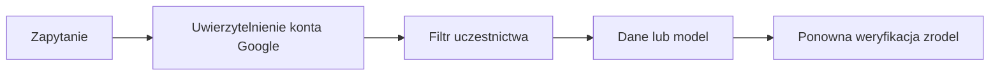
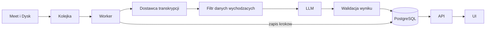

# Firmowy asystent spotkań Vinseo: dokument decyzyjny (część A)

## 0. Streszczenie dla decydenta

**Rekomendacja:** zbudować system na oficjalnych nagraniach Google Meet, z zewnętrznymi usługami AI, dostępem tylko dla uczestników spotkania i ścisłą kontrolą danych wychodzących. Koszt: **około 167–239 USD miesięcznie za usługi** (wariant A), zależnie od użycia asystenta. Z czasem utrzymania (założenie 4 h miesięcznie) to 327–399 USD.

Kluczowe decyzje:

1. **Źródło:** oficjalny plik MP4 z Meet zapisany na Dysku organizatora. Bez bota w spotkaniu, z uprawnieniami tylko do odczytu.
2. **Prywatność:** nagrywamy tylko za zgodą wszystkich uczestników. Do dostawców AI trafiają wyłącznie anonimowe identyfikatory mówców i role, nigdy imiona ani e-maile.
3. **Dostęp:** spotkanie widzą tylko jego uczestnicy. Organizator, który nie uczestniczył, nie ma dostępu. Domyślnie wszystko jest zablokowane.
4. **Narzędzia:** AssemblyAI Universal-2 na serwerach w UE do transkrypcji po polsku z podziałem na mówców. Streszczenia przez model LLM wybrany na teście.
5. **Architektura:** PostgreSQL jest źródłem prawdy, kolejka tylko doręcza zadania, a każdy krok można bezpiecznie powtórzyć.
6. **Wdrożenie:** pięć etapów. Pierwsza wersja świadomie nie ma wyszukiwania ani asystenta. Najpierw dowodzimy jakości i bezpieczeństwa (powody i pozostałe rezygnacje w sekcji 8a).

Trzy najważniejsze pytania do Vinseo:

- Czy budżet rzędu 170–240 USD miesięcznie za usługi jest akceptowalny?
- Czy prawnik zaakceptuje przetwarzanie nagrań klientów u dostawców z siedzibą w USA?
- Czy nowe osoby w projekcie mają widzieć historię spotkań, do których nie dołączyły?

Oznaczenia: **Fakt** (sprawdzone w źródle, z datą), **Założenie** (przyjęte, możliwe do zmiany), **Do potwierdzenia** (wymaga decyzji Vinseo lub prawnika).

## 1. Źródło nagrań i uprawnienia

**Decyzja:** pobieram oficjalny plik MP4, który Meet zapisuje na Dysku organizatora, i sam go transkrybuję. Dostęp ma konto usługi z delegacją domenową, z najwęższymi zakresami: tylko odczyt metadanych spotkań i plików utworzonych przez Meet. Plik pobieram dopiero, gdy Meet oznaczy go jako gotowy.

**Dlaczego:**

- **Polski.** **Fakt** (2026-10-30): zapisane transkrypcje Meet nie obsługują polskiego ([lista języków](https://support.google.com/meet/answer/12849897)), więc potrzebny jest sam dźwięk.
- **Zgoda i komunikat o nagrywaniu należą do Meet.** Nasza aplikacja nie jest uczestnikiem rozmowy. Klient nie widzi obcego bota.
- **Dane nie trafiają do kolejnej firmy.** Nagrania klientów przetwarza tylko wybrany przez nas dostawca transkrypcji, a nie dodatkowy dostawca botów.
- **Najmniejszy możliwy zakres:** brak zapisu, brak dostępu do całego Dysku, poczty i kalendarza. Podszywam się tylko pod organizatorów spotkań, które mają trafiać do systemu.

**Świadome kompromisy:**

- Delegacja domenowa daje szerokie uprawnienia: aplikacja widzi każdy plik Meet impersonowanego organizatora. Ograniczam to listą organizatorów, pobieraniem wyłącznie zaakceptowanych spotkań, audytem każdego pobrania i usuwaniem kopii po 48 godzinach.
- Plik zawiera jedną zmiksowaną ścieżkę, więc mówcy są anonimowi. Przypisują ich ręcznie uczestnicy (sekcja 4).

**Rozważone i odrzucone:**

| Opcja | Przewaga | Dlaczego odrzuciłem |
| --- | --- | --- |
| Bot dołączający do spotkania (własny klient lub dostawca) albo agent na laptopie pracownika | Osobne audio każdego uczestnika | Dostawca przetwarza nagrania klientów. Własny klient wymaga omijania zabezpieczeń Google i ciągłej naprawy. Agent nie nagra klienta |
| Transkrypcje Meet i Meet Media API | Przypisanie do konkretnego uczestnika | Brak polskiego. Media API zostało wycofane 2026-10-28, a jego wyłączenie zaplanowano na 2027-01-15 ([źródło](https://developers.google.com/workspace/meet/release-notes)) |
| Zakres dostępu do całego Dysku | Prostsza konfiguracja | Odsłania wszystkie pliki organizatora, nie tylko nagrania |
| Zgoda OAuth od każdego użytkownika | Brak szerokiej delegacji | Każdy organizator musi osobno wyrazić zgodę i utrzymywać dostęp, a brak jednej zgody oznacza brakujące spotkania |

**Co zmieniłoby decyzję:** dodanie polskiego do zapisywanych transkrypcji Meet. Wtedy użyłbym ich jako głównego źródła, a własną transkrypcję zostawił jako rezerwę.

## 2. Bezpieczeństwo i prywatność

To propozycja polityki, nie porada prawna. Podstawa prawna, informacja dla uczestników, DPIA i umowy z dostawcami to **Do potwierdzenia** przez prawnika.

**Decyzja:** zbieram i wysyłam na zewnątrz minimum danych, utrzymuję krótką retencję i mam jedną, kompletną ścieżkę usuwania.

**Dlaczego:**

- **Zgoda wszystkich uczestników.** Nagranie rozmowy z klientem to najbardziej wrażliwy element systemu, więc nie opieram go na domyślnej zgodzie. Klienci wyrażają ją na początku spotkania, pracownicy w aplikacji. Dotyczy to też osób dołączających później. Brak zgody oznacza brak nagrywania, a wycofanie zgody oznacza usunięcie nagrania. Czy zgoda pracownika jest dobrowolna i jaka podstawa prawna jest właściwa, rozstrzyga prawnik (**Do potwierdzenia**).
- **Minimalizacja.** Do dostawcy transkrypcji wysyłam samo audio, bez obrazu. Do modelu LLM trafiają tylko segmenty, lokalne identyfikatory mówców i role (pracownik, klient, nieznany).
- **Imiona, e-maile i mapowanie mówców nie wychodzą poza firmę.** Nazwy dopisuje dopiero nasze API, po sprawdzeniu dostępu.
- **Usuwanie obejmuje wszystko:** nagranie, audio, transkrypcję, streszczenie, zadania, mapowania i indeksy. Kopie zapasowe wygasają zgodnie z polityką i nie przywracają usuniętych danych.
- **Każdy okres retencji ma powód.** 48 godzin to czas na pobranie i wyodrębnienie audio. 7 dni to okno, w którym uczestnicy mogą odsłuchać fragment, żeby przypisać mówcę. 24 miesiące to propozycja, żeby pytanie „co obiecaliśmy klientowi” miało odpowiedź dłuższą niż dwa tygodnie z opisu problemu (**Założenie**, do ustalenia z Vinseo).

| Rodzaj danych | Gdzie trafia | Jak długo |
| --- | --- | --- |
| MP4 | Nasza infrastruktura | Do 48 godzin |
| Audio (bez obrazu) | Dostawca transkrypcji (UE), kopia u nas | U dostawcy usuwam przez API po zapisaniu wyniku, najpóźniej usuwa je dostawca po około dobie. U nas do 7 dni |
| Segmenty z identyfikatorami mówców | Dostawca LLM | Bez przechowywania (**Do potwierdzenia** w umowie) |
| Transkrypcja, streszczenie, zadania | Nasza baza | 24 miesiące (**Do potwierdzenia**) |

| Sytuacja | Zachowanie systemu |
| --- | --- |
| Odchodzący pracownik | Dostęp odebrany natychmiast, historia zostaje. Inny uczestnik może poprawić jego przypisanie. Jeśli był jedynym pracownikiem w rozmowie, mówcy zostają bez nazw, bo nie dopuszczam osób, które głosu nie słyszały |
| Spotkanie poufne | Nie jest importowane. Dodatkowa etykieta w kalendarzu blokuje import nawet po przypadkowym nagraniu (**Do potwierdzenia** technicznie) |
| Osoba odmawia nagrywania | Nagrywanie się nie zaczyna. Jeśli plik powstał, nie jest pobierany |
| Wycofanie zgody | Usunięcie wszystkich danych spotkania. Aplikacja ma uprawnienia tylko do odczytu, więc nagrywanie zatrzymuje prowadzący (**Do potwierdzenia**) |

**Świadome kompromisy:**

- Identyfikatory mówców to pseudonimy, nie anonimizacja. Wypowiedziane imiona zostają w treści, więc dostawcy są procesorami danych osobowych z umową powierzenia.
- Przetwarzanie u dostawcy z USA (sekcja 4) może zablokować prawnik. Dlatego w sekcji 5 jest wariant bez wysyłania audio na zewnątrz.

**Rozważone i odrzucone:** imiona uczestników w prompcie dawałyby ładniejsze streszczenia, ale błędne przypisanie zostałoby w tekście na stałe, a dane osobowe trafiłyby do logów dostawcy. Wybrałem pseudonimy.

## 3. Model dostępu

**Decyzja:** spotkanie widzą wyłącznie jego uczestnicy. Organizator, który nie uczestniczył, nie ma dostępu. Domyślnie dostęp jest zablokowany, a identyfikator spotkania nie jest uprawnieniem.

**Dlaczego:**

- **Spotkania 1:1, rekrutacje i zarząd.** Organizacja spotkania nie oznacza prawa do jego treści.
- **Jedna reguła w jednym miejscu.** API sprawdza uczestnictwo na podstawie stabilnego konta Google przed każdym odczytem i przed wysłaniem tekstu do modelu. Interfejs nie jest granicą bezpieczeństwa.
- **Filtr przed wyszukiwaniem, nie po nim.** Dzięki temu nie ujawniamy tytułów, liczby wyników, fragmentów ani nazw uczestników spotkań, których użytkownik nie widzi.
- **Model nie egzekwuje uprawnień.** Dostaje tylko dozwolone fragmenty. Gdy brak dostępu, odpowiedź jest neutralna i nie potwierdza istnienia spotkania.
- **Źródła i ślad.** Cytaty w odpowiedzi są wczytywane dosłownie z bazy, a nie z tekstu modelu, i każde źródło przechodzi kontrolę dostępu ponownie. Odebranie dostępu natychmiast wyłącza spotkanie z wyszukiwania i unieważnia pamięć podręczną. Audyt rejestruje odczyty, zmiany uprawnień, usunięcia i próby bez dostępu, bez treści rozmów.

**Świadomy kompromis:** nowa osoba w projekcie nie zobaczy historii, co kłóci się z celem z opisu problemu. Ograniczam to, planując jawne udostępnianie z audytem i możliwością odebrania w późniejszym etapie, a nie dziurę w regule.

**Rozważone i odrzucone:**

| Opcja | Przewaga | Dlaczego odrzuciłem |
| --- | --- | --- |
| Dostęp organizatora lub całego zespołu | Prostota, historia dla nowych osób | Ujawnia rozmowy poufne i 1:1 |
| Uprawnienia w prompcie lub filtr po wyszukiwaniu | Łatwiejsza implementacja | Model można obejść, a wyniki ujawniają metadane |
| Nieodgadywalne adresy URL | Brak logiki dostępu | Adres nie jest uprawnieniem i może wyciec |

**Co zmieniłoby decyzję:** potwierdzona potrzeba biznesowa udostępniania historii. Wprowadziłbym to jako jawne, audytowane nadanie dostępu.

## 4. Narzędzia i modele

**Decyzja:** transkrypcja i podział na mówców: **AssemblyAI Universal-2 na serwerach w UE**. Streszczenia i zadania: model LLM z ustaloną strukturą wyniku, wybrany na teście.

**Dlaczego Universal-2:**

- **Kopia w UE i krótkie przechowywanie bez umowy Enterprise.** Audio jest usuwane po około dobie, a transkrypcja najpóźniej po 30 dniach, i usuwam ją sam po zapisaniu wyniku. U konkurenta to samo wymaga planu Enterprise.
- **Polski z angielskimi wtrąceniami.** Model działa w parze polski i angielski, co odpowiada nazwom kampanii i żargonowi. **Fakt** (2026-10-30): polski jest w grupie wysokiej dokładności, 6,63% błędów na zbiorze FLEURS (mowa czytana, nie spotkanie).
- **Najniższy koszt:** 0,17 USD za godzinę z podziałem na mówców, czyli **51 USD** przy 300 godzinach ([cennik](https://www.assemblyai.com/pricing)).
- **Brak serwerów do utrzymania.** Awaria dostawcy zatrzymuje krok, ale nie gubi spotkania.

| Opcja | Polski | Koszt (300 h) | Prywatność i utrzymanie |
| --- | --- | --- | --- |
| **Universal-2 (wybrany)** | Grupa wysokiej dokładności | 51 USD | Kopia w UE, krótka retencja, bez utrzymania |
| Scribe v2 | Przedział do 5% błędów | 66 USD | Dane w USA, region UE tylko w Enterprise |
| Whisper z pyannote (własny serwer) | Dobry, bez liczb dla spotkań | Zależny od GPU (sekcja 5) | Audio zostaje w firmie, wysokie utrzymanie |
| Odrzucone na starcie | Universal-3.5 Pro i transkrypcje Meet nie obsługują polskiego. gpt-4o-transcribe-diarize zostanie wyłączony 2027-02-26 | | |

**Rozpoznawanie mówców:**

- Diarizacja zmiksowanego pliku daje etykiety lokalne dla spotkania (mówca 1, mówca 2). Potem uczestnik spotkania przypisuje je do osób z listy Meet albo pomija. Pominięcie jest poprawnym wynikiem.
- **Dlaczego przypisuje uczestnik, a nie organizator:** organizator często nie był na rozmowie albo już nie pracuje w firmie, a tylko obecny rozpozna głos lub cytat. Błędna nazwa przy zobowiązaniu wobec klienta jest gorsza niż „mówca 2”, więc nieprzypisany mówca jest bezpiecznym stanem.
- **Dlaczego publikuję od razu:** czekanie na kliknięcie zostawiłoby wiele z około 400 spotkań miesięcznie bez streszczenia.
- **Role i nazwy:** przy przypisaniu ustawia się też rolę (pracownik, klient, nieznany), bo model musi wiedzieć, po której stronie stołu ktoś siedział, żeby poprawnie określić właściciela zadania. Zmiana roli uruchamia ponowne streszczenie tych samych segmentów. Zadania i cytaty wskazują identyfikator mówcy, a nazwę dopisuje API przy odczycie, więc pomyłkę cofa się zmianą jednego wiersza bez ponownego wywoływania modelu.
- Profile głosowe są trwale poza zakresem: to dane biometryczne, więc ryzyko prawne przewyższa korzyść.

**Streszczenia:**

- Kryteria: jakość polskiego, poprawność struktury wyniku, opóźnienie, region przetwarzania i koszt. Kandydaci: OpenAI (region UE), Anthropic, Mistral.
- Test na tych samych fikcyjnych transkrypcjach. Wynik ma ustaloną strukturę, a niepoprawny wynik nie jest publikowany.
- Ten dokument nie wskazuje zwycięzcy. Do wyceny przyjmuję OpenAI jako model referencyjny.

**Świadome kompromisy:**

- To nie jest zamknięta skrzynka w UE. **Fakt:** dane konta są w USA, wsparcie spoza UE może otworzyć plik, a decyzja o adekwatności EU-US Data Privacy Framework jest przedmiotem odwołania (C-703/25 P). **Do potwierdzenia** przez specjalistę.
- Jakość podziału na mówców dla polskich spotkań z nakładającą się mową nie jest nigdzie opublikowana. Sprawdzam ją na nagraniu próbnym przed pilotażem.

**Co zmieniłoby decyzję:** wyraźnie lepszy wynik Scribe na nagraniu próbnym albo opinia specjalisty, że kopia w UE nie rozwiązuje problemu transferu. Wtedy wycenię Enterprise albo przechodzę na własny serwer.

## 5. Koszt miesięczny

**Założenia:** 300 godzin, około 400 spotkań po 45 minut (**Założenie**, 300 h ÷ 0,75 h), jedna ścieżka mono, 25 aktywnych użytkowników. Kurs 1 EUR = 1,14 USD. Ceny sprawdzone 2026-11-04.

**Warianty:**

- **A, zewnętrzne usługi:** AssemblyAI, OpenAI (streszczenia: gpt-6.1-terra, bo to zadanie powtarzalne i tańsze, asystent: gpt-6.1-sol, bo odpowiada użytkownikowi i potrzebuje lepszego rozumowania, embeddingi: text-embedding-3-small, przetwarzanie w UE +10%), Cloud Run, Neon, Redis. Hosting wybrałem, bo skaluje się do zera poza workerem i nie wymaga administrowania serwerem. Odrzuciłem własny VPS (tańszy, ale wymaga TLS, poprawek i kopii zapasowych) oraz Firebase (nie zastępuje workera i bazy).
- **B, modele zarządzane przez firmę na wynajętym GPU:** Whisper z pyannote i ogólny model LLM z otwartymi wagami na jednej karcie L40S 48 GB (Scaleway, 1,47 EUR/h, czyli 1,68 USD/h). Zakup własnego serwera pomijam, bo wymaga inwestycji i administrowania sprzętem, a przy 300 godzinach miesięcznie wynajem wsadowy wystarcza (cena zakupu nie była sprawdzana).

**Scenariusze użycia AI:** 1 to tylko transkrypcja, streszczenia i zadania (zakres wersji zero). 2 to dodatkowo wyszukiwanie i asystent przy niskich limitach (15 zapytań na osobę miesięcznie, razem 375). 3 to wysokie limity (100 zapytań na osobę, razem 2500). Limity to **Założenie** do ustalenia.

| Pozycja (USD/mies.) | A1 | A2 | A3 | B1 | B2 | B3 |
| --- | ---: | ---: | ---: | ---: | ---: | ---: |
| Transkrypcja i podział na mówców | 51 | 51 | 51 | w GPU | w GPU | w GPU |
| Streszczenia i zadania (LLM) | 15 | 15 | 15 | w GPU | w GPU | w GPU |
| Embeddingi | 0 | <1 | <1 | w GPU | w GPU | w GPU |
| Zapytania asystenta | 0 | 11 | 72 | w GPU | w GPU | w GPU |
| GPU (L40S) | 0 | 0 | 0 | 67 | 511 | 511 |
| Hosting (Cloud Run, Neon, Redis, pliki) | 101 | 101 | 101 | 101 | 101 | 101 |
| Dysk i kopie zapasowe serwera GPU | 0 | 0 | 0 | 20 | 20 | 20 |
| **Suma kosztów usług** | **167** | **178** | **239** | **188** | **632** | **632** |
| Czas utrzymania (A: 4 h, B: 12 h po 40 USD) | 160 | 160 | 160 | 480 | 480 | 480 |
| **Suma z pracą** | **327** | **338** | **399** | **668** | **1112** | **1112** |

**Wzory:**

- Transkrypcja: \(300 \times 0{,}17 = 51\).
- Streszczenia: 600 wywołań (400 spotkań i 200 ponownych po przypisaniu mówców) po 15 tys. tokenów wejścia i 1,5 tys. wyjścia. \((9 \times 1 + 0{,}9 \times 5) \times 1{,}10 = 14{,}85\).
- Asystent: zapytanie to 8 tys. tokenów wejścia i 0,5 tys. wyjścia. \(\frac{8\,000 \times 2 + 500 \times 10}{10^6} \times 1{,}10 \times 1{,}25 = 0{,}029\) USD, gdzie 1,25 to zapas na planowanie zapytania i powtórzenia. Dla 375 zapytań wychodzi 10,8, dla 2500 wychodzi 72,2.
- GPU: B1 to 40 h pracy wsadowej (**Założenie**: transkrypcja, podział na mówców i streszczenia, niezmierzone). B2 i B3 to \((12 \times 22 + 40) \times 1{,}68 = 511\), czyli karta włączona w godzinach pracy.
- Hosting: worker Cloud Run z jedną stale uruchomioną instancją ok. 58, Neon \(220 \times 0{,}106 + 5 \times 0{,}35 \approx 25\), Redis ok. 15 (**Założenie**, niezweryfikowane), pliki ok. 1, razem ok. 101.

W wariancie B jedna karta powinna wystarczyć dla scenariusza 3: około 115 zapytań dziennie to niewielkie obciążenie. Koszt zapytań jest więc stały, ale jakość polskiego u modelu otwartego to **Do potwierdzenia** na teście.

**Wrażliwość:**

- Eksperymentalna diarizacja: +13,50 USD (\(300 \times 0{,}045\)).
- Słownik nazw kampanii (keyterms): +15 USD.
- Ponowne streszczenie wszystkich spotkań po przypisaniu mówców: około +5 USD.

**Porównanie pozakosztowe:** wariant B zostawia audio w firmie, ale kosztuje około 630 USD zamiast 170–240 USD i wymaga trzykrotnie więcej pracy utrzymaniowej. Rekomenduję A. B pozostaje planem awaryjnym na wypadek decyzji prawnika.

## 6. Architektura i obsługa błędów

**Decyzja:** PostgreSQL jest źródłem prawdy, kolejka tylko doręcza zadania, a każdy krok jest idempotentny. API i worker to osobne procesy.

**Dlaczego:**

- **Nic nie ginie.** Wynik kroku i znacznik jego ukończenia zapisują się w jednej transakcji. Po awarii kolejki spotkanie nadal jest w bazie i krok można powtórzyć.
- **Brak duplikatów.** Przed zapisem sprawdzam, czy wynik już istnieje, więc powtórne dostarczenie zadania niczego nie dubluje.
- **Wymienialni dostawcy.** Źródło nagrań, transkrypcja i LLM są za adapterami. Zmiana dostawcy lub test na atrapach nie zmienia reszty systemu.
- **Zadania zawierają tylko identyfikator spotkania i nazwę kroku.** W kolejce nie ma treści rozmów ani danych osobowych.

| Sytuacja | Zachowanie |
| --- | --- |
| Plik jeszcze niegotowy lub usunięty | Nie pobieram, ponawiam. Spotkanie pokazuje „brak nagrania”, a transkrypcja nie jest zmyślana |
| Dostawca niedostępny | Ponowienia z rosnącą przerwą i limitem czasu. Po wyczerpaniu spotkanie i wyniki wcześniejszych kroków zostają |
| Niepoprawny wynik LLM | Nic nie jest publikowane, krok jest ponawiany w limicie, a transkrypcja pozostaje dostępna |
| Restart lub podwójne dostarczenie | Sprawdzenie zapisanego wyniku. Brak duplikatów i brak zgubionego spotkania |

**Świadomy kompromis:** kolejka i osobny worker to więcej elementów niż przetwarzanie w żądaniu HTTP. Ograniczam to konfiguracją trwałości Redis i testami awarii między każdą parą kroków.

**Rozważone i odrzucone:** Redis jako stan procesu jest szybszy, ale jego utrata gubi postęp. Przetwarzanie synchroniczne w żądaniu jest prostsze, ale 45-minutowe nagrania przekraczają limity czasu.

**Wersja zero (część B)** realizuje kolejkę, worker, bazę, idempotencję, walidację, filtr danych wychodzących i kontrolę dostępu, z atrapami źródła nagrań, transkrypcji i streszczenia.

## 7. Środowiska

**Decyzja:** cztery oddzielne środowiska (lokalne, testowe, staging, produkcja) bez wspólnych baz, kolejek, kluczy ani plików. Produkcyjnych danych nigdy nie kopiuję do pozostałych.

**Dlaczego:**

- **Lokalnie i w testach:** dane syntetyczne i atrapy dostawców. Testy obejmują idempotencję, ponowienia, walidację, usuwanie i autoryzację.
- **Staging:** syntetyczne nagrania oraz fikcyjne spotkania nagrane specjalnie do testów, za zgodą uczestników. Dopiero te nagrania dowodzą jakości polskiego i podziału na mówców.
- **Pilotaż:** mała, jawnie zatwierdzona grupa i spotkania o niskiej wrażliwości, z wyłączeniem klientów, HR, zarządu, spraw prawnych i finansowych.

**Świadomy kompromis:** syntetyczne dane są czystsze niż prawdziwe. Uzupełniam to nagraniami fikcyjnych spotkań i ograniczonym pilotażem.

**Rozważone i odrzucone:**

| Opcja | Przewaga | Dlaczego odrzuciłem |
| --- | --- | --- |
| Tylko dane syntetyczne | Najbezpieczniejsze | Nie sprawdzi jakości polskiego ani podziału na mówców |
| Zanonimizowane prawdziwe transkrypcje | Realistyczny język | Skuteczna anonimizacja jest trudna, dane nadal mogą być osobowe |
| Pilotaż od razu na produkcji | Najlepsza informacja zwrotna | Najwyższe ryzyko prywatności przed weryfikacją zabezpieczeń |

## 8. Plan wdrożenia

| Etap | Co jest | Kryterium przejścia dalej |
| --- | --- | --- |
| 0. Koncept i szkielet | Ten dokument oraz kod z atrapami: model danych, przetwarzanie, walidacja, filtr danych, kontrola dostępu | Testy dostępu, idempotencji i walidacji przechodzą |
| 1. Prototyp API | Nagrania z bucketa, prawdziwa transkrypcja i LLM, zatwierdzone nagrania niepoufne | Użyteczne transkrypcje, streszczenia i zadania. Brak duplikatów |
| 2. Wewnętrzne MVP | Integracja z Meet i Dyskiem, logowanie Google, prosty interfejs, przypisywanie mówców, pilotaż za zgodą uczestników | Zero nieautoryzowanych dostępów. Pozytywne opinie pilotażu |
| 3. Cała firma | Monitoring, automatyczna retencja i usuwanie, kopie zapasowe, DPIA, procedury incydentów | Brak krytycznych luk. Koszt w budżecie |
| 4. Rozwój | Wyszukiwanie, asystent, powiadomienia, udostępnianie, każda funkcja osobno | Zbiór testowy i zero nieautoryzowanych wyników przed włączeniem |

**Pierwsza wersja (etap 2) świadomie nie ma** wyszukiwania, asystenta, powiadomień, udostępniania osobom spoza spotkania, scalania i dzielenia mówców oraz profili głosowych. Powody są w sekcji 8a.

**Pilotaż przed etapem 3:** retencja nie jest jeszcze zautomatyzowana, więc MP4 i audio usuwam ręcznie w terminach z sekcji 2, a zgodę uczestników zbieram poza aplikacją. Pilotaż obejmuje tylko spotkania wewnętrzne o niskiej wrażliwości.

**Mierniki sukcesu** (progi to **Założenie**, do uzgodnienia z Vinseo):

- zero nieautoryzowanych dostępów i zero duplikatów lub zgubionych spotkań w testach i pilotażu,
- co najmniej 80% spotkań pilotażu z przetworzonym wynikiem bez ręcznej interwencji,
- co najmniej połowa spotkań z przypisanymi mówcami (jeśli mniej, wracam do pytania o procedurę firmową),
- większość zadań oceniona przez uczestników jako poprawna co do osoby i treści,
- miesięczny koszt usług w uzgodnionym budżecie.

**Dlaczego tak:** każdy etap dowodzi jednej rzeczy, zanim zbuduję następną. Najpierw poprawność i bezpieczeństwo przetwarzania, potem jakość na prawdziwym audio, potem integracja z Google, na końcu skala i funkcje wrażliwe.

**Rozważone i odrzucone:** wdrożenie od razu dla całej firmy daje szybszy efekt, ale bez dowodu jakości i bezpieczeństwa. Zaczynanie od integracji z Meet i Dyskiem jest bliższe docelowemu stanowi, ale zanim sprawdzę jakość transkrypcji i streszczeń, buduje najdroższy element na niepewnych podstawach.

## 8a. Z czego świadomie rezygnuję i dlaczego

Zasada: rezygnuję z funkcji, których poprawności lub bezpieczeństwa nie potrafię jeszcze udowodnić. Wszystkie zostawiają miejsce w modelu danych, więc dodanie ich później nie wymaga przebudowy.

| Rezygnuję z | Dlaczego | Kiedy wracam |
| --- | --- | --- |
| Wyszukiwania i asystenta w pierwszej wersji (to wymaganie z opisu problemu) | To funkcje najbardziej narażone na wyciek: błędny filtr ujawni cudze spotkanie, tytuł lub liczbę wyników. Jakość trzeba zmierzyć na zbiorze pytań po polsku z angielskimi nazwami kampanii. Wartość pierwszej wersji (transkrypcja, streszczenie, zadania, dostęp) da się sprawdzić bez nich | Etap 4, po dowodzie zera nieautoryzowanych wyników |
| Bota w spotkaniu | Nagrania klientów trafiłyby do kolejnej firmy albo wymagałyby omijania zabezpieczeń Google | Tylko gdy zmieni się to, co Google obsługuje |
| Profili głosowych | To dane biometryczne. Zgoda pracownika jest słabą podstawą | Nigdy bez opinii prawnika |
| Automatycznego przypisywania mówców | Błędna nazwa przy zobowiązaniu wobec klienta jest gorsza niż „mówca 2” | Jako niebiometryczna sugestia do potwierdzenia, po pomiarze |
| Scalania i dzielenia mówców | Nie wiem jeszcze, czy diarizacja jest na tyle słaba, że to potrzebne | Gdy pilotaż pokaże problem |
| Udostępniania osobom spoza spotkania | Domyślnie bezpieczniej, a decyzja jest biznesowa | Po odpowiedzi Vinseo, jako jawne i audytowane nadanie |
| Imion w prompcie modelu | Błędne przypisanie zostałoby w tekście, a dane osobowe w logach dostawcy | Nie planuję |

## 9. Ryzyka i pytania do Vinseo

| Ryzyko | Wpływ | Ograniczenie |
| --- | --- | --- |
| Jakość podziału na mówców po polsku | Użytkownicy porzucają przypisywanie, wyszukiwanie po osobie jest niepełne | Nagranie próbne przed pilotażem. Pominięcie jest poprawnym wynikiem. Scalanie i dzielenie dopiero po pomiarze |
| Transfer danych do USA (dane konta, wsparcie, odwołanie od decyzji o adekwatności) | Prawnik może zablokować dostawcę | Umowa powierzenia, minimalizacja danych, wariant B jako plan awaryjny |
| Delegacja domenowa | Szeroki dostęp do plików Meet | Lista organizatorów, tylko odczyt, audyt pobrań, retencja 48 h |
| Brak historii dla nowych osób | Cel biznesowy spełniony tylko częściowo | Jawne udostępnianie z audytem w etapie 4 |
| Koszt LLM | Scenariusz 3 to około 72 USD za asystenta | Limity zapytań na osobę, monitoring kosztów w pilotażu |
| Nagrywanie nie jest włączone lub brakuje zgody | System widzi tylko część spotkań | Pokazuję „brak nagrania”, nie zmyślam transkrypcji. Ustalam edycję Workspace i automatyczne nagrywanie z wymuszoną zgodą |

**Pytania, które zadałbym przed startem:**

*Biznes*

1. Czy budżet 170–240 USD miesięcznie za usługi (plus czas utrzymania) jest akceptowalny?
2. Czy nowe osoby w projekcie mają widzieć historię (jawne udostępnianie)?
3. Czy przypisywanie mówców może być procedurą firmową wykonywaną przez uczestników? Co z rozmową 1:1, w której nie ma już nikogo z firmy, i czy ponownie wygenerowane streszczenie ma zastąpić stare, czy być widoczne jako nowa wersja?

*Prawo*

4. Jaka jest podstawa prawna dla pracowników i klientów, czy zgoda pracownika może być uznana za dobrowolną, jaka ma być informacja dla uczestników i czy wymagana jest DPIA?
5. Czy kopia danych w UE u AssemblyAI i dostawca LLM są akceptowalni mimo konta i wsparcia w USA oraz umów powierzenia? Czy dopuszczalny byłby tylko dostawca w planie Enterprise?
6. Jak długo przechowujemy transkrypcje (propozycja: 24 miesiące) i kto odpowiada za wnioski o usunięcie danych oraz incydenty?

*Workspace i test jakości*

7. Jaką edycję Workspace mamy, czy administrator może włączyć automatyczne nagrywanie z wymuszoną zgodą, jak oznaczać spotkania poufne i czy aplikacja może zatrzymać nagrywanie po wycofaniu zgody?
8. Czy dostarczycie fikcyjne nagranie podobne do waszych spotkań (polski z angielskimi nazwami, 2–6 osób, nakładanie się wypowiedzi) i jak często zdarzają się sale konferencyjne lub dwie osoby na jednym koncie Google?
