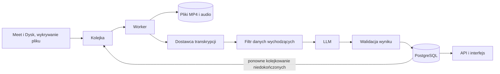

# Firmowy asystent spotkań Vinseo: dokument decyzyjny (część A)

## 0. Streszczenie dla decydenta

**Rekomendacja:** zbudować system na oficjalnych nagraniach Google Meet, z zewnętrznymi usługami AI, dostępem tylko dla pracowników, którzy brali udział w spotkaniu, i ścisłą kontrolą danych wychodzących. Koszt: **około 165–237 USD miesięcznie za usługi** (wariant A), zależnie od użycia asystenta. Z czasem utrzymania (założenie 4 h miesięcznie) to 325–397 USD.

Kluczowe decyzje:

1. **Źródło:** oficjalny plik MP4 z Meet zapisany na Dysku organizatora. Bez bota w spotkaniu, z uprawnieniami tylko do odczytu.
2. **Prywatność:** nagrywamy tylko za zgodą wszystkich uczestników. Do dostawców AI trafiają audio lub treść rozmowy oraz pseudonimowe identyfikatory mówców i role, nigdy imiona ani e-maile.
3. **Dostęp:** spotkanie widzą tylko pracownicy, którzy w nim uczestniczyli. Organizator, który nie uczestniczył, nie ma dostępu. Domyślnie wszystko jest zablokowane.
4. **Narzędzia:** AssemblyAI Universal-2 na serwerach w UE do transkrypcji po polsku z podziałem na mówców. Streszczenia przez model LLM wybrany na teście.
5. **Architektura:** PostgreSQL jest źródłem prawdy, kolejka tylko doręcza zadania, a każdy krok można bezpiecznie powtórzyć.
6. **Wdrożenie:** pięć etapów. Pierwsza wersja świadomie nie ma wyszukiwania ani asystenta (sekcja 8).

Trzy najważniejsze pytania do Vinseo:

- Czy budżet rzędu 165–240 USD miesięcznie za usługi jest akceptowalny?
- Czy prawnik zaakceptuje przetwarzanie nagrań klientów u dostawców z siedzibą w USA?
- Czy klienci i nowe osoby w projekcie mają widzieć spotkania, do których nie dołączyli?

Oznaczenia: **Fakt** (sprawdzone w źródle, z datą), **Założenie** (przyjęte, możliwe do zmiany), **Do potwierdzenia** (wymaga decyzji Vinseo lub prawnika). Nazewnictwo: „wersja zero” to szkielet z atrapami (część B), „pierwsza wersja” to wewnętrzne MVP (etap 2).

## 1. Źródło nagrań i uprawnienia

**Decyzja:** pobieram oficjalny plik MP4, który Meet zapisuje na Dysku organizatora, i sam go transkrybuję. Dostęp ma konto usługi z delegacją domenową (administrator Workspace pozwala aplikacji działać w imieniu wskazanych użytkowników). Zakresy są najwęższe: tylko odczyt metadanych spotkań i tylko odczyt plików utworzonych przez Meet. Plik pobieram dopiero, gdy Meet oznaczy go jako gotowy, wykrywając to zdarzeniem z Workspace albo odpytywaniem.

**Warunki wstępne (Do potwierdzenia u Vinseo):** edycja Workspace z nagrywaniem (od Business Standard), zgoda administratora na delegację, włączone nagrywanie ręczne lub automatyczne oraz wolne miejsce na Dysku.

**Reguła importu:** plik jest pobierany tylko wtedy, gdy organizator jest na liście, zgoda uczestników jest kompletna i spotkanie nie ma etykiety poufności.

**Dlaczego:**

- **Polski.** **Fakt** (2026-10-30): zapisane transkrypcje Meet nie obsługują polskiego ([lista języków](https://support.google.com/meet/answer/12849897)), więc potrzebny jest sam dźwięk.
- **Zgoda i komunikat o nagrywaniu należą do Meet.** Aplikacja nie jest uczestnikiem rozmowy, więc klient nie widzi obcego bota.
- **Dane nie trafiają do kolejnej firmy** i zakres jest najmniejszy: brak zapisu, brak dostępu do całego Dysku, poczty i kalendarza.

**Świadome kompromisy:**

- Delegacja daje szerokie uprawnienia: aplikacja widzi każdy plik Meet organizatora, w imieniu którego działa. Ograniczam to listą organizatorów, audytem każdego pobrania i usuwaniem kopii po 48 godzinach.
- Plik zawiera jedną zmiksowaną ścieżkę, więc mówcy są anonimowi. Przypisują ich ręcznie pracownicy, którzy brali udział w rozmowie (sekcja 4).

**Rozważone i odrzucone:**

| Opcja                                                                                       | Przewaga                              | Dlaczego odrzuciłem                                                                                                                                                       |
| ------------------------------------------------------------------------------------------- | ------------------------------------- | ------------------------------------------------------------------------------------------------------------------------------------------------------------------------- |
| Bot dołączający do spotkania (własny klient lub dostawca) albo agent na laptopie pracownika | Osobne audio każdego uczestnika       | Dostawca botów przetwarza nagrania klientów. Własny klient wymaga omijania zabezpieczeń Google i ciągłej naprawy. Agent nie nagra klienta                                 |
| Transkrypcje Meet i Meet Media API                                                          | Przypisanie do konkretnego uczestnika | Brak polskiego. Media API zostało wycofane 2026-10-28, a jego wyłączenie zaplanowano na 2027-01-15 ([źródło](https://developers.google.com/workspace/meet/release-notes)) |
| Zakres dostępu do całego Dysku                                                              | Prostsza konfiguracja                 | Odsłania wszystkie pliki organizatora, nie tylko nagrania                                                                                                                 |
| Zgoda OAuth od każdego użytkownika                                                          | Brak szerokiej delegacji              | Każdy organizator musi osobno wyrazić zgodę i ją utrzymywać, a brak jednej zgody oznacza brakujące spotkania                                                              |

**Co zmieniłoby decyzję:** dodanie polskiego do zapisywanych transkrypcji Meet. Wtedy użyłbym ich jako głównego źródła, a własną transkrypcję zostawił jako rezerwę.

## 2. Bezpieczeństwo i prywatność

To propozycja polityki, nie porada prawna. Podstawa prawna, informacja dla uczestników, DPIA (ocena skutków dla ochrony danych) i umowy z dostawcami to **Do potwierdzenia** przez prawnika.

**Decyzja:** zbieram i wysyłam na zewnątrz minimum danych, utrzymuję krótką retencję i mam jedną, kompletną ścieżkę usuwania.

**Dlaczego:**

- **Zgoda wszystkich uczestników, także późniejszych.** Klienci wyrażają ją na początku spotkania (wymuszony komunikat w Meet albo potwierdzenie prowadzącego, **Do potwierdzenia**), pracownicy w aplikacji. Brak zgody oznacza brak nagrywania, a jej wycofanie usunięcie nagrania.
- **Minimalizacja.** Do dostawcy transkrypcji wysyłam samo audio, bez obrazu. Do modelu LLM trafiają tylko segmenty tekstu, lokalne identyfikatory mówców i role (pracownik, klient, nieznany). Imiona, e-maile i mapowanie mówców nie wychodzą poza firmę, a nazwy dopisuje nasze API po sprawdzeniu dostępu.
- **Usuwanie obejmuje wszystko:** nagranie, audio, transkrypcję, streszczenie, zadania, mapowania i indeksy. Kopie zapasowe wygasają zgodnie z polityką i nie przywracają usuniętych danych.

| Rodzaj danych                       | Gdzie trafia               | Jak długo i dlaczego                                                                                                             |
| ----------------------------------- | -------------------------- | -------------------------------------------------------------------------------------------------------------------------------- |
| MP4                                 | Nasza infrastruktura       | Do 48 godzin: czas na pobranie i wyodrębnienie audio                                                                             |
| Audio (bez obrazu)                  | Dostawca transkrypcji (UE) | Dostawca zaczyna usuwanie po 24 h i kończy najpóźniej po 48 h (**Fakt**). Wcześniejsze usunięcie przez API: **Do potwierdzenia** |
| Audio (kopia)                       | Nasza infrastruktura       | Do 7 dni: okno, w którym pracownicy mogą odsłuchać fragment, żeby przypisać mówcę                                                |
| Transkrypcja                        | Dostawca transkrypcji (UE) | Do 30 dni u dostawcy. Usuwam ją przez API po zapisaniu wyniku                                                                    |
| Segmenty z identyfikatorami mówców  | Dostawca LLM               | Bez przechowywania (**Do potwierdzenia** w umowie)                                                                               |
| Transkrypcja, streszczenie, zadania | Nasza baza                 | 24 miesiące, żeby pytanie „co obiecaliśmy klientowi” miało odpowiedź dłuższą niż dwa tygodnie (**Założenie**, do ustalenia)      |

| Sytuacja                 | Zachowanie systemu                                                                                                                                                                                                                                |
| ------------------------ | ------------------------------------------------------------------------------------------------------------------------------------------------------------------------------------------------------------------------------------------------- |
| Odchodzący pracownik     | Dostęp odebrany natychmiast, historia zostaje. Inny pracownik, który był na spotkaniu, może poprawić jego przypisanie. Jeśli był jedynym pracownikiem w rozmowie (np. 1:1 z klientem), nikt nie ma już dostępu, a dane podlegają zwykłej retencji |
| Spotkanie poufne         | Nie jest importowane. Etykieta w kalendarzu blokuje import nawet po przypadkowym nagraniu (**Do potwierdzenia** technicznie)                                                                                                                      |
| Osoba odmawia nagrywania | Nagrywanie się nie zaczyna. Jeśli plik powstał, nie jest pobierany                                                                                                                                                                                |
| Wycofanie zgody          | Usunięcie wszystkich danych spotkania, także w trakcie przetwarzania. Aplikacja ma uprawnienia tylko do odczytu, więc nagrywanie zatrzymuje prowadzący (**Do potwierdzenia**)                                                                     |

**Świadome kompromisy:**

- Identyfikatory mówców to pseudonimy, nie anonimizacja. Wypowiedziane imiona zostają w treści, więc dostawcy są procesorami danych osobowych z umową powierzenia.
- Przetwarzanie u dostawcy z USA (sekcja 4) może zablokować prawnik. Dlatego w sekcji 5 jest wariant bez wysyłania audio na zewnątrz.

**Rozważone i odrzucone:** imiona uczestników w prompcie dawałyby ładniejsze streszczenia, ale błędne przypisanie zostałoby w tekście na stałe, a dane osobowe trafiłyby do logów dostawcy. Wybrałem pseudonimy.

## 3. Model dostępu

**Decyzja:** w pierwszej wersji spotkanie widzą wyłącznie pracownicy, którzy w nim uczestniczyli. Klienci nie logują się do aplikacji. Organizator, który nie uczestniczył, nie ma dostępu. Domyślnie dostęp jest zablokowany, a identyfikator spotkania nie jest uprawnieniem.

**Dlaczego:**

- **Spotkania 1:1, rekrutacje i zarząd.** Organizacja spotkania nie oznacza prawa do jego treści.
- **Jedna reguła w jednym miejscu.** API sprawdza uczestnictwo na podstawie stabilnego konta Google przed każdym odczytem i przed wysłaniem tekstu do modelu. Interfejs nie jest granicą bezpieczeństwa.
- **Wyszukiwanie i asystent:** planuję je na PostgreSQL z indeksem leksykalnym i wektorowym. Filtr uczestnictwa jest częścią tego samego zapytania, więc działa przed wyszukiwaniem i nie ujawnia tytułów, liczby wyników ani fragmentów niewidocznych spotkań.
- **Model nie egzekwuje uprawnień.** Dostaje tylko dozwolone fragmenty, a przy braku dostępu odpowiedź jest neutralna.
- **Źródła i ślad.** Cytaty są wczytywane dosłownie z bazy, a każde źródło przechodzi kontrolę dostępu ponownie. Odebranie dostępu natychmiast wyłącza spotkanie z wyszukiwania i unieważnia pamięć podręczną. Audyt rejestruje odczyty, zmiany uprawnień, usunięcia i próby bez dostępu, bez treści rozmów.

**Świadome kompromisy:** nowa osoba w projekcie i klient nie zobaczą historii, co kłóci się z celem z opisu problemu. Ograniczam to, planując jawne udostępnianie z audytem w późniejszym etapie, a nie dziurę w regule.

**Rozważone i odrzucone:**

| Opcja                                            | Przewaga                           | Dlaczego odrzuciłem                             |
| ------------------------------------------------ | ---------------------------------- | ----------------------------------------------- |
| Dostęp organizatora lub całego zespołu           | Prostota, historia dla nowych osób | Ujawnia rozmowy poufne i 1:1                    |
| Uprawnienia w prompcie lub filtr po wyszukiwaniu | Łatwiejsza implementacja           | Model można obejść, a wyniki ujawniają metadane |
| Nieodgadywalne adresy URL                        | Brak logiki dostępu                | Adres nie jest uprawnieniem i może wyciec       |

**Co zmieniłoby decyzję:** potwierdzona potrzeba biznesowa udostępniania historii lub dostępu klientów. Wprowadziłbym to jako jawne, audytowane nadanie dostępu.

## 4. Narzędzia i modele

**Decyzja:** transkrypcja i podział na mówców (diarizacja): **AssemblyAI Universal-2 na serwerach w UE**. Streszczenia i zadania: model LLM z ustaloną strukturą wyniku, wybrany na teście.

**Dlaczego Universal-2:**

- **Kopia w UE i krótkie przechowywanie bez umowy Enterprise.** Dla ElevenLabs Scribe v2 to samo wymaga planu Enterprise, a na zwykłym kluczu dane są w USA.
- **Polski z angielskimi wtrąceniami.** Model działa w parze polski i angielski, co odpowiada nazwom kampanii. **Fakt** (2026-10-30): polski jest w grupie wysokiej dokładności, 6,63% błędów słów (WER) na zbiorze FLEURS, czyli mowie czytanej, nie spotkaniu.
- **Najniższy koszt:** 0,17 USD za godzinę z podziałem na mówców, czyli **51 USD** przy 300 godzinach ([cennik](https://www.assemblyai.com/pricing)).
- **Brak serwerów do utrzymania.** Awaria dostawcy zatrzymuje krok, ale nie gubi spotkania.

| Opcja                              | Polski                                                                                                                 | Koszt (300 h)             | Prywatność i utrzymanie                     |
| ---------------------------------- | ---------------------------------------------------------------------------------------------------------------------- | ------------------------- | ------------------------------------------- |
| **Universal-2 (wybrany)**          | Grupa wysokiej dokładności                                                                                             | 51 USD                    | Kopia w UE, krótka retencja, bez utrzymania |
| Scribe v2                          | Przedział do 5% błędów                                                                                                 | 66 USD                    | Dane w USA, region UE tylko w Enterprise    |
| Whisper z pyannote (własny serwer) | Dobry, bez liczb dla spotkań                                                                                           | Zależny od GPU (sekcja 5) | Audio zostaje w firmie, wysokie utrzymanie  |
| Odrzucone na starcie               | Universal-3.5 Pro i transkrypcje Meet nie obsługują polskiego. gpt-4o-transcribe-diarize zostanie wyłączony 2027-02-26 |                           |                                             |

**Rozpoznawanie mówców:**

- Diarizacja daje etykiety lokalne dla spotkania (mówca 1, mówca 2). Pracownik, który był na spotkaniu, przypisuje je do osób z listy Meet i ustawia rolę albo pomija. Pominięcie jest poprawnym wynikiem, bo błędna nazwa przy zobowiązaniu wobec klienta jest gorsza niż „mówca 2”.
- Publikuję od razu, bo czekanie na kliknięcie zostawiłoby wiele z około 400 spotkań miesięcznie bez streszczenia. Zmiana roli uruchamia ponowne streszczenie. Zadania wskazują identyfikator mówcy, a nazwę dopisuje API przy odczycie, więc pomyłkę cofa się zmianą jednego wiersza.
- Profile głosowe są trwale poza zakresem: to dane biometryczne.

**Streszczenia:** kryteria to jakość polskiego, poprawność struktury wyniku, opóźnienie, region przetwarzania i koszt. Kandydaci: OpenAI (region UE), Anthropic, Mistral, test na tych samych fikcyjnych transkrypcjach. Niepoprawny wynik nie jest publikowany. Dokument nie wskazuje zwycięzcy, a do wyceny przyjmuję OpenAI.

**Świadome kompromisy:**

- To nie jest zamknięta skrzynka w UE. **Fakt:** dane konta są w USA, wsparcie spoza UE może otworzyć plik, a decyzja o adekwatności EU-US Data Privacy Framework jest przedmiotem odwołania (C-703/25 P). **Do potwierdzenia** przez specjalistę.
- Jakość podziału na mówców dla polskich spotkań z nakładającą się mową nie jest nigdzie opublikowana. Sprawdzam ją na nagraniu próbnym przed pilotażem.

**Co zmieniłoby decyzję:** wyraźnie lepszy wynik Scribe na nagraniu próbnym albo opinia specjalisty, że kopia w UE nie rozwiązuje problemu transferu. Wtedy wycenię Enterprise albo przechodzę na własny serwer.

## 5. Koszt miesięczny

**Założenia:** 300 godzin, około 400 spotkań po 45 minut (**Założenie**, 300 h ÷ 0,75 h), jedna ścieżka mono, 25 aktywnych użytkowników. Kurs 1 EUR = 1,14 USD. Ceny katalogowe z 2026-11-04 (strony cenników dostawców; linki do OpenAI, Scaleway, Cloud Run i Neon do dopisania przy ostatecznej redakcji).

**Warianty:**

- **A, zewnętrzne usługi:** AssemblyAI, OpenAI (streszczenia: gpt-6.1-terra, asystent: gpt-6.1-sol, embeddingi, czyli liczbowe reprezentacje tekstu do wyszukiwania: text-embedding-3-small, przetwarzanie w UE +10%), Cloud Run, Neon, Redis. Hosting skaluje się do zera poza workerem (procesem przetwarzającym nagrania). Własny VPS odrzuciłem, bo wymaga administrowania.
- **B, modele firmy na wynajętym GPU:** Whisper z pyannote i LLM z otwartymi wagami na jednej karcie L40S 48 GB (Scaleway, 1,68 USD/h). Zakup serwera pomijam: wymaga inwestycji i administrowania.

**Scenariusze użycia AI:** 1 to transkrypcja, streszczenia i zadania (zakres pierwszej wersji). 2 to dodatkowo wyszukiwanie i asystent (15 zapytań na osobę miesięcznie, razem 375). 3 to wysokie limity (100 zapytań na osobę, razem 2500). Limity to **Założenie**.

| Pozycja (USD/mies.)                         |      A1 |      A2 |      A3 |      B1 |       B2 |       B3 |
| ------------------------------------------- | ------: | ------: | ------: | ------: | -------: | -------: |
| Transkrypcja i podział na mówców            |      51 |      51 |      51 |   w GPU |    w GPU |    w GPU |
| Streszczenia i zadania (LLM)                |      15 |      15 |      15 |   w GPU |    w GPU |    w GPU |
| Embeddingi                                  |       0 |      <1 |      <1 |   w GPU |    w GPU |    w GPU |
| Zapytania asystenta                         |       0 |      11 |      72 |   w GPU |    w GPU |    w GPU |
| GPU (L40S)                                  |       0 |       0 |       0 |      67 |      511 |      511 |
| Hosting (Cloud Run, Neon, Redis, pliki)     |      99 |      99 |      99 |      99 |       99 |       99 |
| Dysk i kopie zapasowe serwera GPU           |       0 |       0 |       0 |      20 |       20 |       20 |
| **Suma kosztów usług**                      | **165** | **176** | **237** | **186** |  **630** |  **630** |
| Czas utrzymania (A: 4 h, B: 12 h po 40 USD) |     160 |     160 |     160 |     480 |      480 |      480 |
| **Suma z pracą**                            | **325** | **336** | **397** | **666** | **1110** | **1110** |

**Wzory:**

- Transkrypcja: \(300 \times 0{,}17 = 51\).
- Streszczenia: 600 wywołań (400 spotkań i 200 ponownych po przypisaniu mówców, **Założenie**) po 15 tys. tokenów wejścia i 1,5 tys. wyjścia. Cena: 1 USD za 1 mln tokenów wejścia i 5 USD za 1 mln wyjścia. \((9 \times 1 + 0{,}9 \times 5) \times 1{,}10 = 14{,}85\).
- Asystent: zapytanie to 8 tys. tokenów wejścia (2 USD za 1 mln) i 0,5 tys. wyjścia (10 USD za 1 mln). \(\frac{8\,000 \times 2 + 500 \times 10}{10^6} \times 1{,}10 \times 1{,}25 = 0{,}029\) USD, gdzie 1,25 to zapas na planowanie zapytania i powtórzenia. Dla 375 zapytań wychodzi 10,8, dla 2500 wychodzi 72,2.
- GPU: B1 to 40 h pracy wsadowej (**Założenie**, niezmierzone): \(40 \times 1{,}68 = 67\). B2 i B3 to \((12 \times 22 + 40) \times 1{,}68 = 511\), czyli karta włączona 12 godzin dziennie przez 22 dni plus 40 h wsadu.
- Hosting: worker Cloud Run z jedną stale uruchomioną instancją ok. 58 (**Założenie**, szacunek), Neon \(220 \times 0{,}106 + 5 \times 0{,}35 \approx 25\) (220 godzin mocy obliczeniowej po 0,106 USD i 5 GB po 0,35 USD), Redis ok. 15 (**Założenie**, niezweryfikowane), pliki ok. 1, razem ok. 99.
- Dysk i kopie serwera GPU: 20 USD (**Założenie**). Czas utrzymania: 40 USD za godzinę to **Założenie**.

W wariancie B jedna karta powinna wystarczyć dla scenariusza 3 (około 115 zapytań dziennie). Jakość polskiego u modelu otwartego to **Do potwierdzenia** na teście.

**Wrażliwość:** eksperymentalna diarizacja +13,50 USD (\(300 \times 0{,}045\)), słownik nazw kampanii (keyterms) +15 USD, ponowne streszczenie wszystkich spotkań po przypisaniu mówców około +5 USD.

**Porównanie pozakosztowe:** wariant B zostawia audio w firmie, ale kosztuje około 630 USD zamiast 165–240 USD i wymaga trzykrotnie więcej pracy utrzymaniowej. Rekomenduję A, a B zostaje planem awaryjnym na wypadek decyzji prawnika.

## 6. Architektura i obsługa błędów

**Decyzja:** PostgreSQL jest źródłem prawdy, kolejka tylko doręcza zadania, a każdy krok jest idempotentny (powtórzenie nie zmienia wyniku). API i worker to osobne procesy.

**Dlaczego:**

- **Nic nie ginie.** Wynik kroku i znacznik jego ukończenia zapisują się w jednej transakcji. Okresowe zadanie wybiera z bazy niedokończone spotkania i ponownie je kolejkuje, więc utrata kolejki nie gubi spotkania.
- **Brak duplikatów.** Przed zapisem sprawdzam, czy wynik już istnieje, a ograniczenia unikalności w bazie zamykają wyścig między dwoma równoległymi dostarczeniami. Identyfikator zadania u dostawcy zapisuję, żeby ponowienie nie zamówiło drugiej płatnej transkrypcji.
- **Wymienialni dostawcy.** Źródło nagrań, transkrypcja i LLM są za adapterami. W kolejce są tylko identyfikator spotkania i nazwa kroku, bez treści rozmów.

| Sytuacja                            | Zachowanie                                                                                                                                                                                                                |
| ----------------------------------- | ------------------------------------------------------------------------------------------------------------------------------------------------------------------------------------------------------------------------- |
| Plik jeszcze niegotowy lub usunięty | Nie pobieram, ponawiam. Spotkanie pokazuje „brak nagrania”, a transkrypcja nie jest zmyślana                                                                                                                              |
| Dostawca niedostępny                | Ponowienia z rosnącą przerwą i limitem czasu. Po wyczerpaniu prób spotkanie dostaje status „nieudane”, widoczny dla uczestników, alert dla opiekuna i możliwość ręcznego ponowienia. Wyniki wcześniejszych kroków zostają |
| Niepoprawny wynik LLM               | Nic nie jest publikowane, krok jest ponawiany w limicie, a transkrypcja pozostaje dostępna                                                                                                                                |
| Restart lub podwójne dostarczenie   | Sprawdzenie zapisanego wyniku. Brak duplikatów i brak zgubionego spotkania                                                                                                                                                |
| Wycofanie zgody w trakcie           | Przetwarzanie się zatrzymuje, a dane spotkania są usuwane, także u dostawców (sekcja 2)                                                                                                                                   |

**Świadomy kompromis:** kolejka i osobny worker to więcej elementów niż przetwarzanie w żądaniu HTTP. Ograniczam to testami awarii między każdą parą kroków.

**Rozważone i odrzucone:** Redis jako stan procesu jest szybszy, ale jego utrata gubi postęp. Przetwarzanie synchroniczne w żądaniu jest prostsze, ale 45-minutowe nagrania przekraczają limity czasu.

**Wersja zero (część B)** realizuje kolejkę, worker, bazę, idempotencję, walidację, filtr danych wychodzących i kontrolę dostępu, z atrapami źródła nagrań, transkrypcji i streszczenia.

## 7. Środowiska

**Decyzja:** cztery oddzielne środowiska (lokalne, testowe, staging, produkcja) bez wspólnych baz, kolejek, kluczy ani plików. Produkcyjnych danych nigdy nie kopiuję do pozostałych.

**Dlaczego:**

- **Lokalnie i w testach:** dane syntetyczne i atrapy dostawców. Testy obejmują idempotencję, ponowienia, walidację, usuwanie i autoryzację.
- **Staging:** osobna testowa domena Workspace z fikcyjnymi kontami, osobne klucze dostawców i fikcyjne spotkania nagrane za zgodą uczestników. Dopiero one dowodzą jakości polskiego i podziału na mówców.
- **Pilotaż:** mała, zatwierdzona grupa i spotkania o niskiej wrażliwości, bez klientów, HR, zarządu, spraw prawnych i finansowych.

**Świadomy kompromis:** syntetyczne dane są czystsze niż prawdziwe. Uzupełniam to nagraniami fikcyjnych spotkań i ograniczonym pilotażem.

**Rozważone i odrzucone:**

| Opcja                                 | Przewaga                     | Dlaczego odrzuciłem                                             |
| ------------------------------------- | ---------------------------- | --------------------------------------------------------------- |
| Tylko dane syntetyczne                | Najbezpieczniejsze           | Nie sprawdzi jakości polskiego ani podziału na mówców           |
| Zanonimizowane prawdziwe transkrypcje | Realistyczny język           | Skuteczna anonimizacja jest trudna, dane nadal mogą być osobowe |
| Pilotaż od razu na produkcji          | Najlepsza informacja zwrotna | Najwyższe ryzyko prywatności przed weryfikacją zabezpieczeń     |

## 8. Plan wdrożenia

| Etap                  | Co jest                                                                                                                                 | Kryterium przejścia dalej                                       |
| --------------------- | --------------------------------------------------------------------------------------------------------------------------------------- | --------------------------------------------------------------- |
| 0. Koncept i szkielet | Ten dokument oraz kod z atrapami: model danych, przetwarzanie, walidacja, filtr danych, kontrola dostępu                                | Testy dostępu, idempotencji i walidacji przechodzą              |
| 1. Prototyp API       | Nagrania z bucketa, prawdziwa transkrypcja i LLM, zatwierdzone nagrania niepoufne                                                       | Użyteczne transkrypcje, streszczenia i zadania. Brak duplikatów |
| 2. Wewnętrzne MVP     | Integracja z Meet i Dyskiem, logowanie Google, prosty interfejs, przypisywanie mówców, pilotaż za zgodą uczestników                     | Zero nieautoryzowanych dostępów. Pozytywne opinie pilotażu      |
| 3. Cała firma         | Monitoring, automatyczna retencja i usuwanie, kopie zapasowe, DPIA, procedury incydentów. Spotkania z klientami dopiero po tych krokach | Brak krytycznych luk. Koszt w budżecie                          |
| 4. Rozwój             | Wyszukiwanie, asystent, powiadomienia, udostępnianie, każda funkcja osobno                                                              | Zbiór testowy i zero nieautoryzowanych wyników przed włączeniem |

**Pilotaż przed etapem 3:** retencja nie jest jeszcze zautomatyzowana, więc MP4 i audio usuwam ręcznie w terminach z sekcji 2, a zgodę uczestników zbieram poza aplikacją. Pilotaż obejmuje tylko spotkania wewnętrzne o niskiej wrażliwości.

**Mierniki sukcesu** (progi to **Założenie**, do uzgodnienia z Vinseo):

- zero nieautoryzowanych dostępów, duplikatów i zgubionych spotkań,
- co najmniej 95% spotkań pilotażu przetworzonych bez ręcznej interwencji, a streszczenie gotowe w ustalonym czasie od końca spotkania,
- jakość transkrypcji zmierzona na nagraniu próbnym,
- co najmniej połowa spotkań z przypisanymi mówcami (jeśli mniej, wracam do pytania o procedurę firmową),
- większość zadań oceniona przez uczestników jako poprawna co do osoby i treści, a koszt w budżecie.

**Pierwsza wersja (etap 2) świadomie nie ma** i dlaczego:

- **Wyszukiwanie i asystent** (to wymaganie z opisu problemu): najbardziej narażone na wyciek, bo błędny filtr ujawni cudze spotkanie, a jakość trzeba zmierzyć na zbiorze pytań po polsku. Wracam w etapie 4, po dowodzie zera nieautoryzowanych wyników.
- **Powiadomienia, scalanie i dzielenie mówców, automatyczne przypisywanie mówców:** nie są potrzebne do dowodu wartości, a błędna nazwa jest gorsza niż „mówca 2”. Wracam, gdy pilotaż pokaże potrzebę.
- **Udostępnianie osobom spoza spotkania i dostęp klientów:** domyślnie bezpieczniej, a decyzja jest biznesowa. Po odpowiedzi Vinseo, jako jawne i audytowane nadanie.

Bot w spotkaniu, profile głosowe i imiona w prompcie są odrzucone na stałe (sekcje 1, 2 i 4). Stabilne identyfikatory spotkań, segmentów i mówców pozwalają dodać odroczone funkcje bez zmiany przetwarzania.

**Rozważone i odrzucone:** wdrożenie od razu dla całej firmy daje szybszy efekt, ale bez dowodu jakości i bezpieczeństwa. Start od integracji z Meet i Dyskiem buduje najdroższy element, zanim sprawdzę jakość transkrypcji i streszczeń.

## 9. Ryzyka i pytania do Vinseo

| Ryzyko                                                                             | Wpływ                                                                        | Ograniczenie                                                                                                     |
| ---------------------------------------------------------------------------------- | ---------------------------------------------------------------------------- | ---------------------------------------------------------------------------------------------------------------- |
| Jakość podziału na mówców po polsku                                                | Użytkownicy porzucają przypisywanie, wyszukiwanie po osobie jest niepełne    | Nagranie próbne przed pilotażem. Pominięcie jest poprawnym wynikiem. Scalanie i dzielenie dopiero po pomiarze    |
| Błędne zadania (zła osoba lub termin z modelu)                                     | Fałszywe zobowiązania wobec klienta                                          | Walidacja struktury, cytat źródłowy przy zadaniu, nieprzypisany mówca zamiast zgadywania, ocena zadań w pilotażu |
| Transfer danych do USA (dane konta, wsparcie, odwołanie od decyzji o adekwatności) | Prawnik może zablokować dostawcę                                             | Umowa powierzenia, minimalizacja danych, wariant B jako plan awaryjny                                            |
| Wycofanie modelu lub dostawcy (jak Media API czy gpt-4o-transcribe-diarize)        | Konieczna wymiana kroku w trakcie projektu                                   | Adaptery, test na atrapach, ocena zamienników przed pilotażem                                                    |
| Delegacja domenowa                                                                 | Szeroki dostęp do plików Meet                                                | Lista organizatorów, tylko odczyt, audyt pobrań, retencja 48 h                                                   |
| Koszt LLM i brak historii dla nowych osób                                          | Scenariusz 3 to około 72 USD za asystenta, cel biznesowy spełniony częściowo | Limity zapytań, monitoring kosztów w pilotażu, jawne udostępnianie z audytem w etapie 4                          |

**Pytania, które zadałbym przed startem:**

_Biznes_

1. Czy budżet 165–240 USD miesięcznie za usługi (plus czas utrzymania) jest akceptowalny?
2. Czy nowe osoby w projekcie i klienci mają mieć dostęp do historii (jawne udostępnianie)?
3. Czy przypisywanie mówców może być procedurą firmową wykonywaną przez pracowników, którzy byli na spotkaniu? Co z rozmową 1:1, w której nie ma już nikogo z firmy?

_Prawo_

5. Jaka jest podstawa prawna dla pracowników i klientów, czy zgoda pracownika jest dobrowolna, jaka ma być informacja dla uczestników i czy wymagana jest DPIA?
6. Czy kopia danych w UE u AssemblyAI i dostawca LLM są akceptowalni mimo konta i wsparcia w USA oraz umów powierzenia? Czy dopuszczalny byłby tylko plan Enterprise?
7. Jak długo przechowujemy transkrypcje (propozycja: 24 miesiące) i kto odpowiada za wnioski o usunięcie danych oraz za incydenty?

_Workspace i test jakości_

8. Jak oznaczać spotkania jako poufne?
9. Jak często zdarzają się sale konferencyjne lub dwie osoby na jednym koncie Google?
10. Czy dostarczycie fikcyjne nagranie podobne do waszych spotkań (polski z angielskimi nazwami, 2–6 osób, nakładanie się wypowiedzi)?
